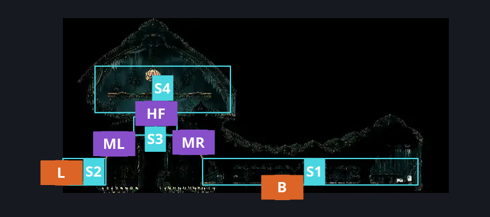
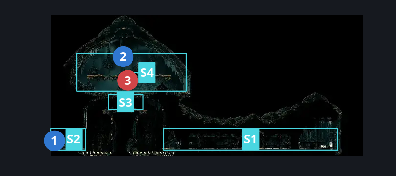
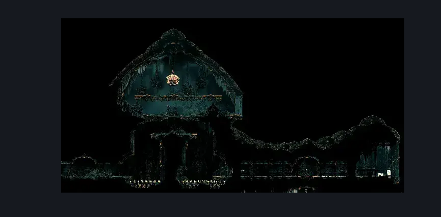

# BEEG flea (Arborium_08)

**Game ID:** Arborium_08

**Contributors:** heric

## Subrooms

| No. | Subroom | Annotated |
| --- | --- | --- |
| S1 | volt | ✓ |
| S2 | left | ✓ |
| S3 | middle | ✓ |
| S4 | upper | ✓ |

## Room Transitions

| Alias | Name | From subroom | Destination | Destination alias | Requirements | TODO | Verification | Annotated | Notes |
| --- | --- | --- | --- | --- | --- | --- | --- | --- | --- |
| B | bot1 | volt | [Memorium Voltnest (Arborium_07)](memorium-voltnest.md) | T | nada |  | Verified | ✓ |  |
| L | left1 | left | [Memorium Start Shaft (Arborium_01)](memorium-start-shaft.md) | T | nada |  | Verified | ✓ |  |

## Subroom Connections

| Alias | Name | Source | Destination | Requirements | TODO | Verification | Annotated | Notes |
| --- | --- | --- | --- | --- | --- | --- | --- | --- |
| ML | middle to left | middle | left | none (fall) |  | Verified | ✓ |  |
| ML | middle to left | left | middle | cling grip either OR (faydown AND ledge grab left AND medium beast reserve bind stall) |  | Verified | ✓ |  |
| MR | middle to right | middle | volt | none (fall) |  | Verified | ✓ |  |
| MR | middle to right | volt | middle | cling grip either OR easy silk soar cancel OR (faydown AND ledge grab left AND medium beast reserve bind stall) |  | Verified | ✓ |  |
| HF | huge flea | upper | middle | none (fall) |  | Verified | ✓ |  |
| HF | huge flea | middle | upper | cling grip either OR ledge grab either OR faydown OR silk soar OR easy [beast,shaman] pogo OR easy beast charge OR easy [plasmium,voltvessels] stall OR medium beast bind stall OR hard bind stall |  | Verified | ✓ |  |

## Check Locations

| No. | Check | Subroom | Requirements | TODO | Verification | Location Type | Annotated | Notes |
| --- | --- | --- | --- | --- | --- | --- | --- | --- |
| 1 | Big flea wall | left | nada |  | Verified | blockade | ✓ | custom name |
| 2 | Flea: Memorium - Huge Flea | upper | cling grip either OR ledge grab either OR faydown OR silk soar OR easy shaman pogo OR easy beast charge OR medium beast bind stall OR easy plasmium stall   OR easy [pimpillo,thread storm] use OR easy curveclaw use x 2 OR medium voltvessels use x 2 OR medium [throwing ring,threefold pin,pale nails] use x 4 OR hard [silkshot twelfth architect] use x 4 |  | Verified | collectible | ✓ | either reach the actual flea platform      or break the cage from below |
| 3 | Huge Flea 1 | upper |  |  |  | enemy | ✓ |  |

## Room Images

### Connections

### Checks

### Scene

