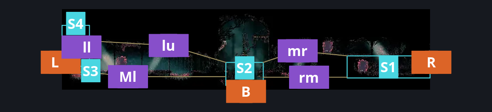
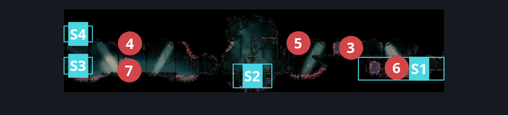
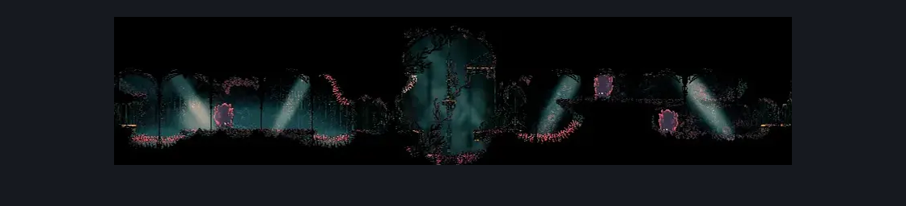

# Memorium Karak (Arborium_06)

**Game ID:** Arborium_06

**Contributors:** heric

## Subrooms

| No. | Subroom | Annotated |
| --- | --- | --- |
| S1 | Right side | ✓ |
| S2 | Middle | ✓ |
| S3 | Left side | ✓ |
| S4 | left and up | ✓ |

## Room Transitions

| Alias | Name | From subroom | Destination | Destination alias | Requirements | TODO | Verification | Annotated | Notes |
| --- | --- | --- | --- | --- | --- | --- | --- | --- | --- |
| R | right1 | Right side | [Memorium Seed Shooty (Arborium_03)](memorium-seed-shooty.md) | UT | none |  | Verified | ✓ |  |
| B | bot1 | Middle | [Memorium Water Room (Arborium_05)](memorium-water-room.md) | T | complete Water karak ceiling IN Memorium water room |  | Verified | ✓ | one way wall |
| L | left1 | Left side | [Memorium Start Shaft (Arborium_01)](memorium-start-shaft.md) | R | none |  | Verified | ✓ |  |

## Subroom Connections

| Alias | Name | Source | Destination | Requirements | TODO | Verification | Annotated | Notes |
| --- | --- | --- | --- | --- | --- | --- | --- | --- |
| rm | blind gameplay | Right side | Middle | easy enemy pogo OR ledge grab OR faydown cloak OR silk soar | TODO |  | ✓ | Room is blind unless dark stuff is removed |
| mr | middle --> right | Middle | Right side | easy enemy pogo OR (ledge grab AND (dash OR run)) OR faydown cloak OR dash OR (run AND cling grip) | TODO |  | ✓ | theres also an enemy that you can super easily clawline even on accident to get the height you need but I have no clue what to label that as you can also clawline plus silk soar but it feels like it would fall under a skip of some kind and i feel like easy enemy pogo already covers that  damage boosts arent accounted for but if implemented "OR easy damage boost" that can be |
| Ml | Middle <-> Left | Left side | Middle | run OR drifter's cloak OR faydown cloak OR easy architect pogo OR (clawline AND silkhearts x 1) OR easy beast pogo | TODO |  | ✓ | Room is blind unless dark stuff is removed |
| Ml | Middle <-> Left | Middle | Left side | medium shaman pogo OR run OR faydown cloak  OR clawline OR drifter's cloak OR easy architect pogo OR easy hunter pogo OR easy wanderer charge OR easy beast pogo | TODO |  | ✓ | can be done no items but need a precise movement option |
| lu | idk | Middle | left and up | faydown cloak OR (silk soar AND (dash OR clawline)) OR (run AND (ledge grab OR cling grip)) OR (clawline AND ledge grab) | TODO |  | ✓ |  |
| ll | smth | Left side | left and up | faydown cloak OR (silk soar AND (dash OR (clawline AND silkhearts x 1))) OR (run AND (ledge grab OR cling grip)) OR (clawline AND silkhearts x 1 AND ledge grab) | TODO |  | ✓ |  |

## Check Locations

| No. | Check | Subroom | Requirements | TODO | Verification | Location Type | Annotated | Notes |
| --- | --- | --- | --- | --- | --- | --- | --- | --- |
| 1 | Memorium - Shell Shard Cache #2 | Middle | cling grip right OR ledge grab right OR faydown OR silksoar x 1 OR easy shaman pogo OR   ((ledge grab left OR cling grip left) AND (drifters OR dash right OR clawline right x 1 OR easy beast pogo OR easy hunter pogo OR easy needle strike OR easy thread storm use OR sharpdart x 1 OR easy silkspear use OR easy pale nails use OR easy rune rage stall OR easy rune rage use OR easy [throwing ring,threefold pin,voltvessels] use OR medium [rosary cannon] use))  OR medium plasmium stall x 2  OR (cling grip left AND (easy witch pogo OR attack right OR easy reaper pogo OR easy [plasmium,flintslate,parry, voltvessels, air bind] stall x 1))   OR hard pogo off driznit |  | Verified | resource |  | prob missed a tool tbh  also some stuff with architect right attack but just no good requirement to label it as |
| 2 | Memorium - Shell Shard Cache #1 | left and up | none |  | Verified | resource |  |  |
| 3 | Crustcrag 1 |  |  |  |  | enemy | ✓ |  |
| 4 | Driznarga 1 |  |  |  |  | enemy | ✓ |  |
| 5 | Driznit 1 |  |  |  |  | enemy | ✓ |  |
| 6 | Crustcrag 2 |  |  |  |  | enemy | ✓ |  |
| 7 | Crustcrag 3 |  |  |  |  | enemy | ✓ |  |

## Room Images

### Connections

### Checks

### Scene

