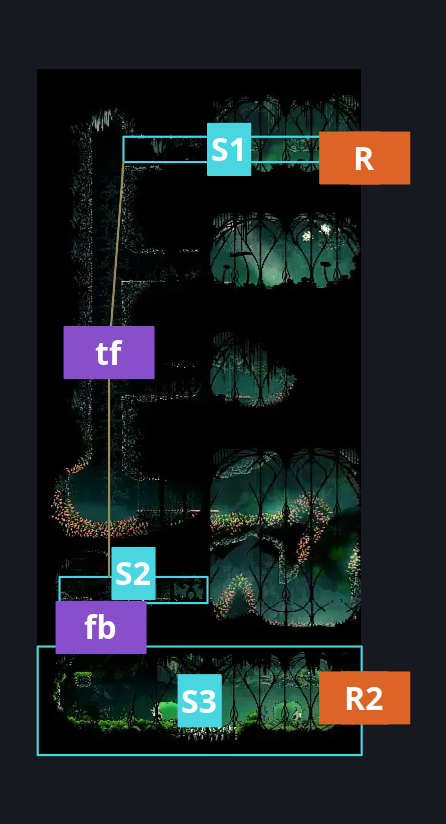
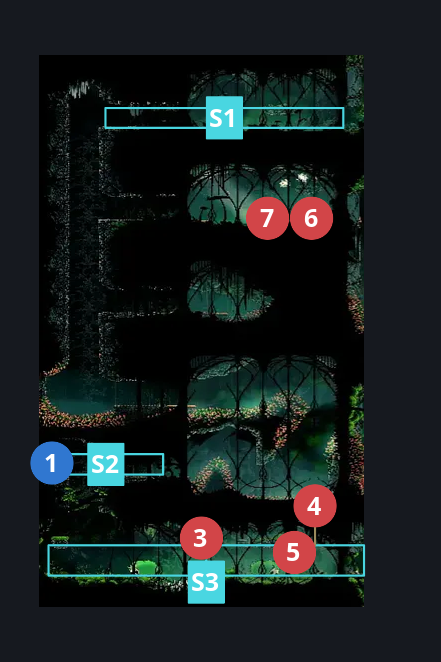
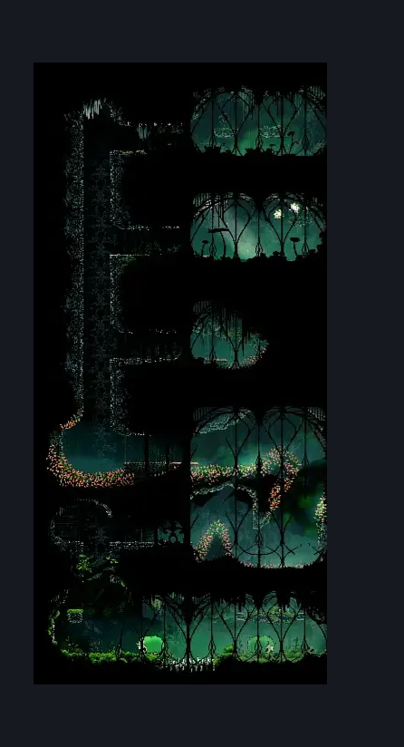

# Memorium Mossy (Arborium_09)

**Game ID:** Arborium_09

**Contributors:** heric

## Subrooms

| No. | Subroom | Annotated |
| --- | --- | --- |
| S1 | Top | ✓ |
| S2 | Fragment | ✓ |
| S3 | Bottom | ✓ |

## Room Transitions

| Alias | Name | From subroom | Destination | Destination alias | Requirements | TODO | Verification | Annotated | Notes |
| --- | --- | --- | --- | --- | --- | --- | --- | --- | --- |
| R | topish shaft | Top | [Memorium Start Shaft (Arborium_01)](memorium-start-shaft.md) | ML | nada |  | Verified | ✓ |  |
| R2 | bottom shaft | Bottom | [Memorium Start Shaft (Arborium_01)](memorium-start-shaft.md) | BL | nada |  | Verified | ✓ |  |

## Subroom Connections

| Alias | Name | Source | Destination | Requirements | TODO | Verification | Annotated | Notes |
| --- | --- | --- | --- | --- | --- | --- | --- | --- |
| tf | top/fragment | Top | Fragment | (Faydown cloak AND (easy scuttlebrace AND (clawline both x 3)))   OR  (Faydown cloak AND (cling grip right AND (elite ball knowledge OR(proficient movement AND  (run right OR clawline right x 1 ) AND (clawline left x 1 OR dash left))))) |  | Verified | ✓ |  |
| fb | fragment/bottom | Fragment | Bottom | nada |  | Verified | ✓ |  |
| fb | fragment/bottom | Bottom | Fragment | silk soar OR cling grip left OR (faydown cloak AND ledge grab either AND easy shaman pogo) OR(easy scuttlebrace AND (faydown cloak OR ledge  grab either OR easy [reaper, shaman, wanderer,architect,witch,beast] pogo OR medium hunter pogo OR easy plasmium stall)) |  | Verified | ✓ | Room is blind unless dark stuff is removed |

## Check Locations

| No. | Check | Subroom | Requirements | TODO | Verification | Location Type | Annotated | Notes |
| --- | --- | --- | --- | --- | --- | --- | --- | --- |
| 1 | Memorium - Spool Fragment | Fragment | none |  | Verified | collectible | ✓ |  |
| 2 | Memorium Mossy wall | Bottom | none |  | Verified | blockade |  | custom name |
| 3 | Massive Mossgrub 1 | Bottom | none |  | Verified | enemy | ✓ |  |
| 4 | Mossgrub 1 | Bottom | nada |  | Verified | enemy | ✓ |  |
| 5 | Massive Mossgrub 2 | Bottom | zilch |  | Verified | enemy | ✓ |  |
| 6 | Nuphar 1 |  |  |  |  | enemy | ✓ | nonexistant pretty sure |
| 7 | Nuphar 2 |  |  |  |  | enemy | ✓ | nonexistant pretty sure |

## Room Images

### Connections

### Checks

### Scene

