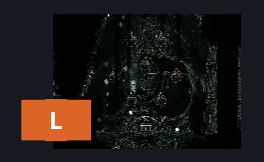
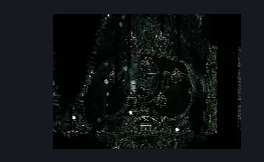

# Memorium Puzzle (Arborium_10)

**Game ID:** Arborium_10

**Contributors:** heric

## Subrooms

No subrooms defined.

## Room Transitions

| Alias | Name | From subroom | Destination | Destination alias | Requirements | TODO | Verification | Annotated | Notes |
| --- | --- | --- | --- | --- | --- | --- | --- | --- | --- |
| L | left1 |  | [Seed Shooty Memorium (Arborium_03)](seed-shooty-memorium.md) | R | nada |  | Verified | ✓ |  |

## Subroom Connections

No subroom connections defined.

## Check Locations

| No. | Check | Subroom | Requirements | TODO | Verification | Location Type | Annotated | Notes |
| --- | --- | --- | --- | --- | --- | --- | --- | --- |
| 1 | Memorimum Cogheart Piece |  | (cling grip right AND (drifters cloak OR (dash left AND attack up))) OR (faydown cloak AND (attack up OR (easy scuttlebug AND drifters))) OR (silk soar AND proficient movement) OR (cling grip left AND drifters cloak AND (attack up OR faydown)) OR (faydown AND cling grip right) OR (cling grip right AND clawline left) OR (cling grip left AND faydown AND (clawline right OR dash right)) |  | Verified | collectible |  | memory puzzle |

## Room Images

### Connections

### Checks

### Scene

