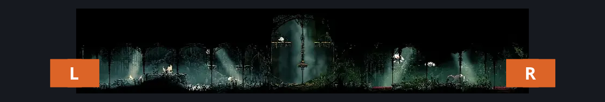
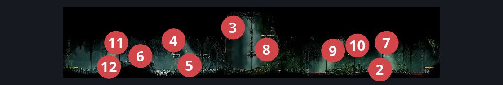
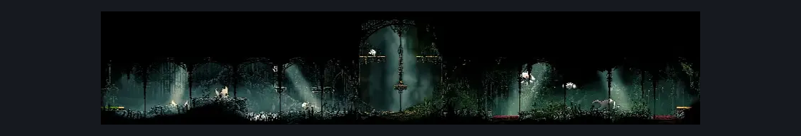

# Memorium Rhino Room (Arborium_02)

**Game ID:** Arborium_02

**Contributors:** heric

## Subrooms

No subrooms defined.

## Room Transitions

| Alias | Name | From subroom | Destination | Destination alias | Requirements | TODO | Verification | Annotated | Notes |
| --- | --- | --- | --- | --- | --- | --- | --- | --- | --- |
| R | right1 |  | [Memorium Seed Shooty (Arborium_03)](memorium-seed-shooty.md) | LL | none |  | Verified | ✓ |  |
| L | left1 |  | [Memorium Start Shaft (Arborium_01)](memorium-start-shaft.md) | LR | none |  | Verified | ✓ |  |

## Subroom Connections

No subroom connections defined.

## Check Locations

| No. | Check | Subroom | Requirements | TODO | Verification | Location Type | Annotated | Notes |
| --- | --- | --- | --- | --- | --- | --- | --- | --- |
| 1 | Memorium - Beast Shard |  | none |  | Verified | collectible |  |  |
| 2 | Rhinogrund 1 |  |  |  |  | enemy | ✓ |  |
| 3 | Kilik 1 |  |  |  |  | enemy | ✓ |  |
| 4 | Beastfly 1 |  |  |  |  | enemy | ✓ |  |
| 5 | Beastfly 2 |  |  |  |  | enemy | ✓ |  |
| 6 | Skull Brute 1 |  |  |  |  | enemy | ✓ |  |
| 7 | Vicious Caranid 1 |  |  |  |  | enemy | ✓ |  |
| 8 | Vicious Caranid 2 |  |  |  |  | enemy | ✓ |  |
| 9 | Vicious Caranid 3 |  |  |  |  | enemy | ✓ |  |
| 10 | Caranid 1 |  |  |  |  | enemy | ✓ |  |
| 11 | Caranid 2 |  |  |  |  | enemy | ✓ |  |
| 12 | Skull Scuttler 1 |  |  |  |  | enemy | ✓ |  |

## Room Images

### Connections

### Checks

### Scene

