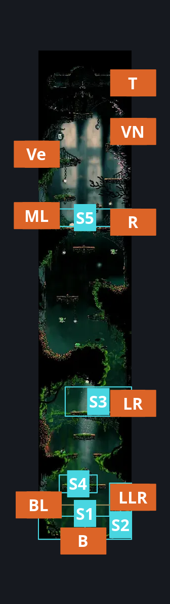
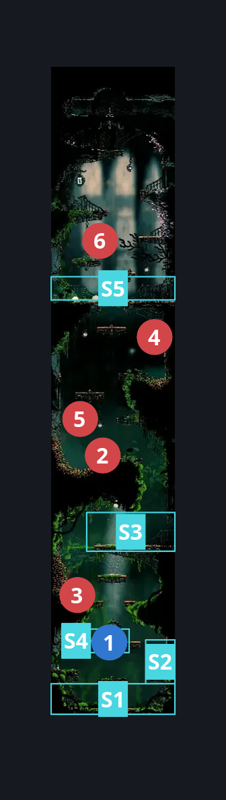
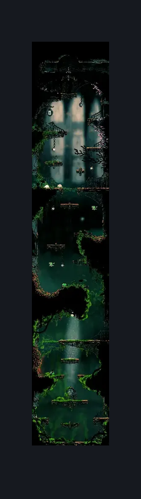

# Memorium Start Shaft (Arborium_01)

**Game ID:** Arborium_01

**Contributors:** heric

## Subrooms

| No. | Subroom | Annotated |
| --- | --- | --- |
| S1 | base | ✓ |
| S2 | Almost bottom | ✓ |
| S3 | Almost middle | ✓ |
| S4 | Lore Platform | ✓ |
| S5 | above evil wall | ✓ |
| S6 | Ventrica ledge |  |
| S7 | Volt Ledge |  |
| S8 | Tippidy top |  |

## Room Transitions

| Alias | Name | From subroom | Destination | Destination alias | Requirements | TODO | Verification | Annotated | Notes |
| --- | --- | --- | --- | --- | --- | --- | --- | --- | --- |
| BL | left2 | Almost bottom | [Memorium Mossy (Arborium_09)](memorium-mossy.md) | R2 | Complete Memorium Mossy wall IN Memorium Mossy |  | Verified | ✓ | shortcut |
| R | right3 | above evil wall | [Memorium Karak (Arborium_06)](memorium-karak.md) | L | nada |  | Verified | ✓ |  |
| Ve | Ventrica | Ventrica ledge | [Memorium Ventrica (Arborium_Tube)](memorium-ventrica.md) | R | nada |  | Verified | ✓ |  |
| T | right1 | Tippidy top | [BEEG flea (Arborium_08)](beeg-flea.md) | l | complete Big flea wall IN BEEG flea |  | Verified | ✓ | shortcut |
| B | bot1 | base | [Memorium Entrance Tunnel (Song_25)](../choral-chambers/memorium-entrance-tunnel.md) | T | Complete Memorium entrance vines IN memorium entrance tunnel |  | Verified | ✓ | one way wall |
| ML | left1 | above evil wall | [Memorium Mossy (Arborium_09)](memorium-mossy.md) | R | nada |  | Verified | ✓ |  |
| LLR | right5 | Almost bottom | [Memorium Bench (Arborium_04)](memorium-bench.md) | L | nada |  | Verified | ✓ |  |
| VN | right2 | Volt Ledge | [Memorium Voltnest (Arborium_07)](memorium-voltnest.md) | L | nada |  | Verified | ✓ |  |
| LR | right4 | Almost middle | [Memorium Rhino Room (Arborium_02)](memorium-rhino-room.md) | L | nada |  | Verified | ✓ |  |

## Subroom Connections

| Alias | Name | Source | Destination | Requirements | TODO | Verification | Annotated | Notes |
| --- | --- | --- | --- | --- | --- | --- | --- | --- |
| 1 | one jump | base | Almost bottom | cling grip OR ledge grab OR faydown cloak OR (silk soar AND silkhearts x 1 ) |  | Verified |  |  |
| 2 | drop | Almost bottom | base | nada |  | Verified |  |  |
| 3 | drop farther | Almost middle | Lore Platform | nada |  | Verified |  |  |
| 4 | couple jumps | Almost bottom | Almost middle | faydown cloak OR (silk soar AND silkhearts x 1) |  | Verified |  |  |
| l | lore | Almost bottom | Lore Platform | cling grip OR ledge grab OR faydown cloak OR (silk soar AND silkhearts x 1) OR (clawline AND silkhearts x 1 AND easy scuttlebrace) |  | Verified |  |  |
| 5 | drop a lil bit | Lore Platform | Almost bottom | nada |  | Verified |  |  |
| O | one way | above evil wall | Almost middle | nada |  | Verified |  |  |
| V | Ventrica-slightly below | above evil wall | Ventrica ledge | ((run OR (clawline AND silkhearts x 1))AND (cling grip OR ledge grab)) OR faydown cloak OR (cling grip AND (drifters OR easy needle strike stall(architect))) |  | Verified |  | easy damage boost AND (drifter's cloak OR ledge grab) OR silk soar OR faydown cloak OR (run And ledge grab)  can be added once damage boosts are added   OR (drifter's cloak AND cling grip)  can be added but also needs some kinda precise movement setting |
| V | Ventrica-slightly below | Ventrica ledge | above evil wall | nada |  | Verified |  |  |
| VV | ventrica volt | Volt Ledge | Ventrica ledge | nada |  | Verified |  |  |
| VV | ventrica volt | Ventrica ledge | Volt Ledge | sprint OR (clawline AND silkhearts x 1) OR cling grip OR faydown cloak OR easy needle strike stall(architect) OR medium needle strike stall(wanderer) OR easy beast pogo OR (easy needle strike stall(reaper) AND ledge grab) |  | Verified |  |  |
| tv | top | Tippidy top | Volt Ledge | nada |  | Verified |  |  |
| tv | top | Volt Ledge | Tippidy top | faydown cloak OR (silk soar AND silkhearts x 1) |  | Verified |  | theres is some stuff you can do to avoid needing a silkheart that requires other items |
| wv | wall to volt | above evil wall | Volt Ledge | silk soar |  | Verified |  |  |

## Check Locations

| No. | Check | Subroom | Requirements | TODO | Verification | Location Type | Annotated | Notes |
| --- | --- | --- | --- | --- | --- | --- | --- | --- |
| 1 | Memorium - Lower Plaque | Lore Platform | nada |  | Verified | lore | ✓ |  |
| 2 | Mossgrub 1 |  |  |  |  | enemy | ✓ |  |
| 3 | Mossgrub 2 |  |  |  |  | enemy | ✓ |  |
| 4 | Mossmir 1 |  |  |  |  | enemy | ✓ |  |
| 5 | Mossmir 2 |  |  |  |  | enemy | ✓ |  |
| 6 | Memoria 1 |  | Black Thread World Spawn |  |  | enemy | ✓ |  |

## Room Images

### Connections

### Checks

### Scene

