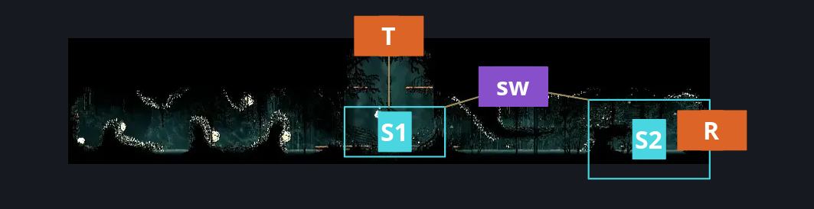
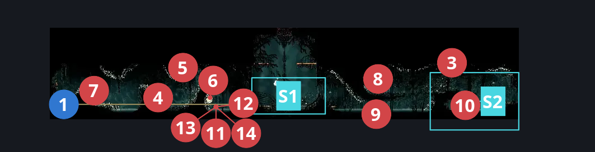
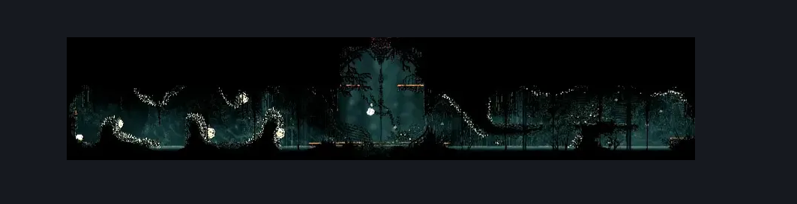

# Memorium Water Room (Arborium_05)

**Game ID:** Arborium_05

**Contributors:** heric

## Subrooms

| No. | Subroom | Annotated |
| --- | --- | --- |
| S1 | Center | ✓ |
| S2 | right side | ✓ |

## Room Transitions

| Alias | Name | From subroom | Destination | Destination alias | Requirements | TODO | Verification | Annotated | Notes |
| --- | --- | --- | --- | --- | --- | --- | --- | --- | --- |
| T | top1 | Center | [Memorium Karak (Arborium_06)](memorium-karak.md) | B | silk soar OR (faydown cloak AND break wall up) |  | Verified | ✓ |  |
| R | right1 | right side | [Memorium Seed Shooty (Arborium_03)](memorium-seed-shooty.md) | T | none |  | Verified | ✓ |  |

## Subroom Connections

| Alias | Name | Source | Destination | Requirements | TODO | Verification | Annotated | Notes |
| --- | --- | --- | --- | --- | --- | --- | --- | --- |
| sw | swim | right side | Center | swim OR (proficient movement AND (dash left AND medium beast pogo AND hard damage boost off pond skipper AND hard air bind stall AND medium pogo off pond skipper)) OR (clawline left x 2 AND (faydown OR ledge grab left) AND (drifters OR easy [parry,flea brew,flintslate] stall)) OR (clawline left x 2 AND faydown AND proficient movement) |  | Verified | ✓ |  |
| sw | swim | Center | right side | swim AND (ledge grab either OR cling grip either OR easy pogo off pond skipper OR faydown) |  | Verified | ✓ |  |

## Check Locations

| No. | Check | Subroom | Requirements | TODO | Verification | Location Type | Annotated | Notes |
| --- | --- | --- | --- | --- | --- | --- | --- | --- |
| 1 | Memorium - Memory Locket | Center | (faydown cloak AND (swim OR cling grip right) AND easy pogo off Gahlia AND (easy pogo off  pollenica OR sharpdart OR dash left)) OR (faydown AND (easy beast pogo OR clawline left x 3) AND (swim OR cling grip right OR easy pogo off pollenica)) |  | Verified | collectible | ✓ | (faydown cloak AND (clawline left OR medium beast pogo OR (dash AND (swim OR easy pogo off Gahlia AND (easy pogo off  pollenica OR clawline left OR sharpdart)))) OR |
| 2 | Water karak ceiling | Center | silksoar OR (faydown cloak AND break wall up) |  | Verified | blockade |  | one way thingy |
| 3 | Shellwood Goomba Flyer 1 |  |  |  |  | enemy | ✓ |  |
| 4 | Gahlia 1 |  |  |  |  | enemy | ✓ |  |
| 5 | Gahlia 2 |  |  |  |  | enemy | ✓ |  |
| 6 | Gahlia 3 |  |  |  |  | enemy | ✓ |  |
| 7 | Pollenica 1 |  |  |  |  | enemy | ✓ |  |
| 8 | Shellwood Goomba 1 |  |  |  |  | enemy | ✓ |  |
| 9 | Pond Skipper 1 |  |  |  |  | enemy | ✓ |  |
| 10 | Pond Skipper 2 |  |  |  |  | enemy | ✓ |  |
| 11 | Shellwood Gnat 1 |  |  |  |  | enemy | ✓ |  |
| 12 | Shellwood Gnat 2 |  |  |  |  | enemy | ✓ |  |
| 13 | Shellwood Gnat 3 |  |  |  |  | enemy | ✓ |  |
| 14 | Shellwood Gnat 4 |  |  |  |  | enemy | ✓ |  |

## Room Images

### Connections

### Checks

### Scene

