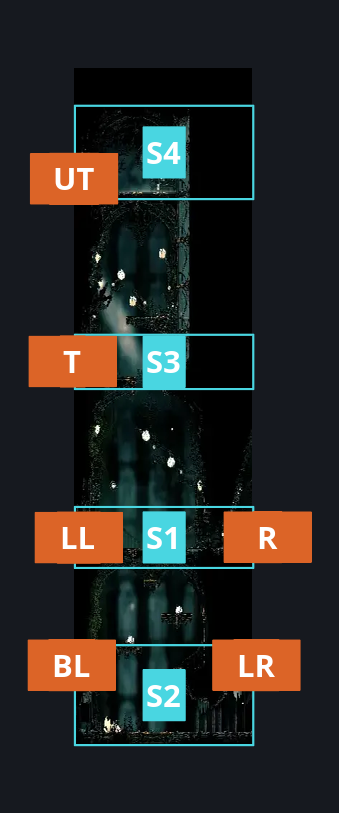
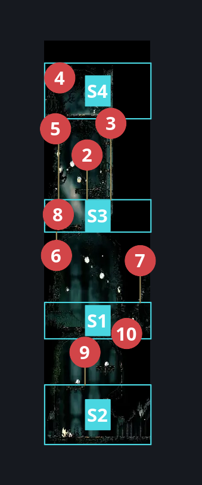
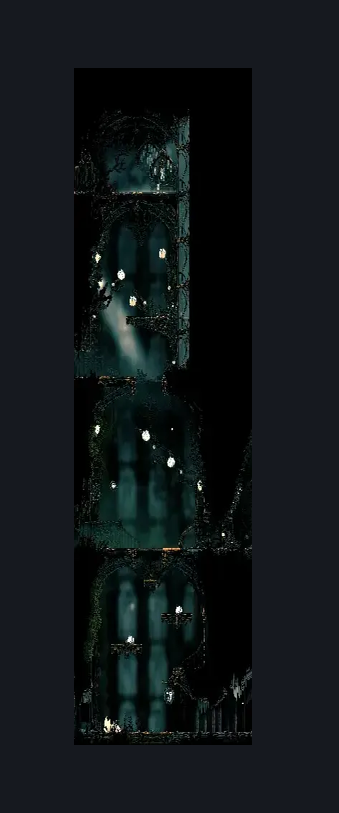

# Seed Shooty Memorium (Arborium_03)

**Game ID:** Arborium_03

**Contributors:** heric, hutyrix

## Subrooms

| No. | Subroom | Annotated |
| --- | --- | --- |
| S1 | Middle | ✓ |
| S2 | Bottom | ✓ |
| S3 | Top | ✓ |
| S4 | Not connected | ✓ |

## Room Transitions

| Alias | Name | From subroom | Destination | Destination alias | Requirements | TODO | Verification | Annotated | Notes |
| --- | --- | --- | --- | --- | --- | --- | --- | --- | --- |
| UT | left1 | Not connected | [Memorium Karak (Arborium_06)](memorium-karak.md) | R | nada |  | Verified | ✓ |  |
| LL | left3 | Middle | [Memorium Rhino Room (Arborium_02)](memorium-rhino-room.md) | R | nada |  | Verified | ✓ |  |
| BL | left4 | Bottom | [Memorium Bench (Arborium_04)](memorium-bench.md) | R | nada |  | Verified | ✓ |  |
| T | left2 | Top | [Memorium Water Room (Arborium_05)](memorium-water-room.md) | R | nada |  | Verified | ✓ |  |
| R | right1 | Middle | [Memorium Puzzle (Arborium_10)](memorium-puzzle.md) | L | nada |  | Verified | ✓ |  |
| LR | right2 | Bottom | [Shopkeeper Hides (Arborium_11)](shopkeeper-hides.md) | L | nada |  | Verified | ✓ |  |

## Subroom Connections

| Alias | Name | Source | Destination | Requirements | TODO | Verification | Annotated | Notes |
| --- | --- | --- | --- | --- | --- | --- | --- | --- |
| 1 | down | Top | Middle | nada |  | Verified |  |  |
| 2 | down2 | Middle | Bottom | nada |  | Verified |  |  |
| 3 | up1 | Middle | Top | (faydown AND (cling grip either OR (Easy scuttlebrace)))  OR silk soar OR (faydown AND easy pogo off pollenica AND (easy [reaper,wanderer,shaman] pogo OR medium [hunter] pogo)) OR (ledge grab either AND faydown AND easy pogo off pollenica AND (easy [hunter,beast,witch,architect] pogo)) OR (cling grip right AND (hard reaper bind stall OR hard shaman pogo OR ((cbt wanderer  bind stall OR (hard wanderer bind stall AND clawline right x 1)) AND have tool: multibinder AND ( Have: Crest Slot Wanderer Blue 1 OR Have: Crest Slot Wanderer Blue 2)))) OR (cling grip either AND drifters AND easy shaman pogo) OR (cling grip left AND hard flea brew stall AND hard beast heal stall) |  | Verified |  | OR (clawline AND hard wanderer pogo) feels a bit to hard to me idk  couldn't replicate  reaper + cling grip right, removed, probably it was old syntax without mentioning heal stall? |
| 4 | up2 | Bottom | Middle | silk soar x 1 OR Easy scuttlebrace OR (faydown cloak AND (ledge grab right OR medium shaman pogo OR cling grip right))  OR (faydown cloak AND medium pogo off mawling AND (medium [reaper,wanderer,beast,witch] pogo OR hard [hunter,architect] pogo))  OR cling grip left (hutyrix added this from report in discord 16/11, not to mention cling grip both was NOT accounted) |  | Verified |  |  |
| 5 | up3 | Bottom | Top | silk soar x 1 AND proficient movement |  | Verified |  |  |

## Check Locations

| No. | Check | Subroom | Requirements | TODO | Verification | Location Type | Annotated | Notes |
| --- | --- | --- | --- | --- | --- | --- | --- | --- |
| 1 | Memorium - Orders | Not connected | nada |  | Verified | lore |  | just name required |
| 2 | Phacia 1 | Top | attack up OR  cling grip left OR faydown OR silk soar x 1 OR easy scuttlebrace | TODO | Needs verification | enemy | ✓ | Another subroom required  for entrance + soul randomizers going from top transition  Probably attack up is enough lol |
| 3 | Phacia 2 | Top | cling grip left OR faydown OR silk soar x 1 OR easy scuttlebrace | TODO | Needs verification | enemy | ✓ | Another subroom required for entrance + soul randomizers going from top transition  But it will definitely need another subroom when attack randomizer will release (movement instead of upslash) |
| 4 | Memoria 1 |  |  | TODO | Needs verification | enemy | ✓ | I think this enemy doesn't exist? ~Hutyrix |
| 5 | Pollenica 1 | Top | silk soar x 2 OR Easy scuttlebrace OR cling grip left | TODO |  | enemy | ✓ |  |
| 6 | Pollenica 2 | Top | silk soar x 1 OR Easy scuttlebrace OR cling grip left | TODO |  | enemy | ✓ |  |
| 7 | Pollenica 3 | Middle | attack up | TODO |  | enemy | ✓ |  |
| 8 | Pollenica 4 | Top |  | TODO |  | enemy | ✓ | I think this enemy doesn't exist? Checked ~Hutyrix |
| 9 | Mawling 1 | Bottom | silk soar x 1 OR Easy scuttlebrace OR cling grip left  OR (attack up AND faydown) | TODO |  | enemy | ✓ |  |
| 10 | Mawling 2 | Middle | none |  |  | enemy | ✓ |  |

## Room Images

### Connections

### Checks

### Scene

