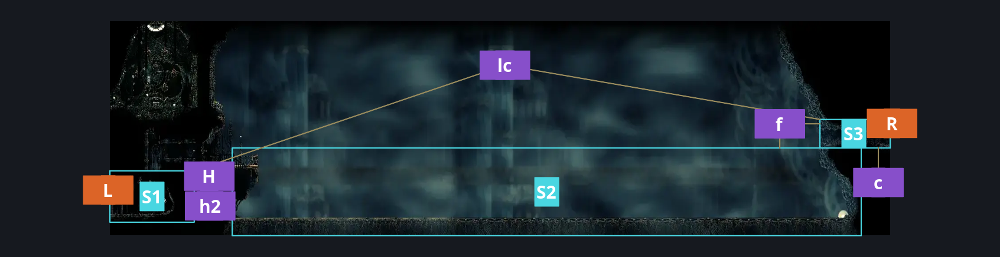
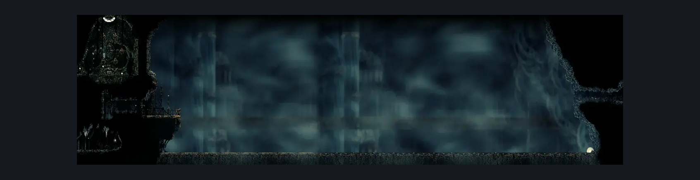

# Shopkeeper Hides (Arborium_11)

**Game ID:** Arborium_11

**Contributors:** heric

## Subrooms

| No. | Subroom | Annotated |
| --- | --- | --- |
| S1 | Entrance | ✓ |
| S2 | Main Area | ✓ |
| S3 | Memorium exit | ✓ |

## Room Transitions

| Alias | Name | From subroom | Destination | Destination alias | Requirements | TODO | Verification | Annotated | Notes |
| --- | --- | --- | --- | --- | --- | --- | --- | --- | --- |
| L | left1 | Entrance | [Seed Shooty Memorium (Arborium_03)](seed-shooty-memorium.md) | LR | nada |  | Verified | ✓ |  |
| R | right1 | Memorium exit | [Putrified Ducts Entrance (Aqueduct_01)](../putrified-ducts/putrified-ducts-entrance.md) | L | nada |  | Verified | ✓ |  |

## Subroom Connections

| Alias | Name | Source | Destination | Requirements | TODO | Verification | Annotated | Notes |
| --- | --- | --- | --- | --- | --- | --- | --- | --- |
| H | hidden area | Entrance | Main Area | silk soar OR (faydown cloak AND (cling grip either OR easy scuttlebrace)) |  | Verified |  |  |
| h2 | hidden area other way | Main Area | Entrance | cling grip left OR (faydown cloak AND (easy shaman pogo AND easy scuttlebrace)) |  | Verified |  | enemy pogos can be done but its a weird rng so ima leave it untouched |
| f | fall | Memorium exit | Main Area | nada |  | Verified |  |  |
| c | climb | Main Area | Memorium exit | silk soar OR ( faydown cloak AND cling grip right) |  | Verified |  | enemy pogos can be done but its a weird rng so ima leave it untouched |
| lc | long clawline spam | Memorium exit | Entrance | (drifter's cloak AND clawline left AND silkhearts x 1 AND (medium scuttlebrace OR (faydown cloak AND easy scuttlebrace)))  OR (proficient movement AND hard shaman scuttle slide) |  | Verified |  |  |

## Check Locations

| No. | Check | Subroom | Requirements | TODO | Verification | Location Type | Annotated | Notes |
| --- | --- | --- | --- | --- | --- | --- | --- | --- |
| 1 | Memorium - Shard Bundle | Main Area | spend 70 rosaries |  | Verified | collectible | ✓ | swapped the subroom - as it appeared to be incorrect - hero |
| 2 | Memorium - Map Purchase | Entrance | none |  | Verified | collectible | ✓ | swapped the subroom - as it appeared to be incorrect - hero |
| 3 | The Lost Merchant Wish Granted | Main Area | complete THE The Lost Merchant Wish Promised |  | Verified | event |  |  |
| 4 | Drapelord 1 |  |  |  |  | enemy | ✓ |  |
| 5 | Drapefly 1 |  |  |  |  | enemy | ✓ |  |
| 6 | Drapefly 2 |  |  |  |  | enemy | ✓ |  |
| 7 | Drapefly 3 |  |  |  |  | enemy | ✓ |  |
| 8 | Drapefly 4 |  |  |  |  | enemy | ✓ |  |
| 9 | Drapelord 2 |  |  |  |  | enemy | ✓ |  |
| 10 | Drapelord 3 |  |  |  |  | enemy | ✓ |  |
| 11 | Drapefly 5 |  |  |  |  | enemy | ✓ |  |
| 12 | Drapefly 6 |  |  |  |  | enemy | ✓ |  |
| 13 | Drapefly 7 |  |  |  |  | enemy | ✓ |  |
| 14 | Drapefly 8 |  |  |  |  | enemy | ✓ |  |
| 15 | Drapelord 4 |  |  |  |  | enemy | ✓ |  |
| 16 | Drapelord 5 |  |  |  |  | enemy | ✓ |  |
| 17 | Drapefly 9 |  |  |  |  | enemy | ✓ |  |
| 18 | Drapefly 10 |  |  |  |  | enemy | ✓ |  |
| 19 | Drapefly 11 |  |  |  |  | enemy | ✓ |  |
| 20 | Drapefly 12 |  |  |  |  | enemy | ✓ |  |
| 21 | Drapelord 6 |  |  |  |  | enemy | ✓ |  |
| 22 | Drapelord 7 |  |  |  |  | enemy | ✓ |  |

## Notes

I HATE THIS ROOOOOM

## Room Images

### Connections

### Checks

### Scene

