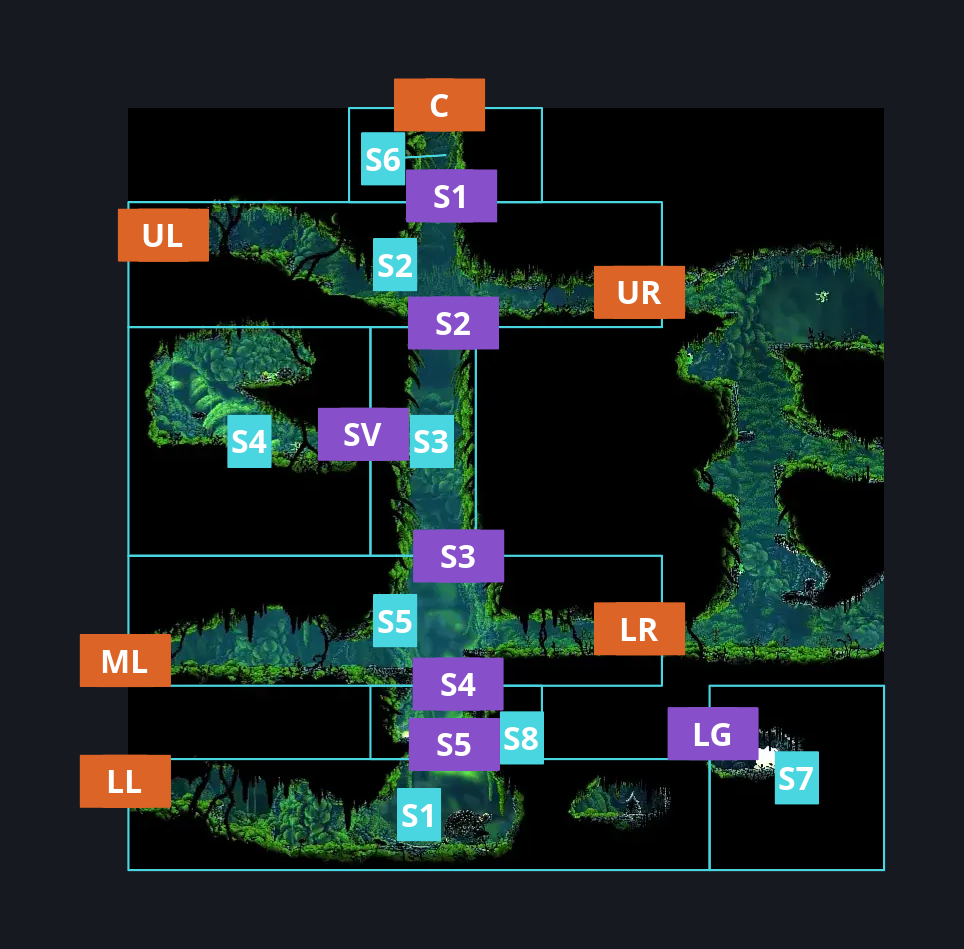
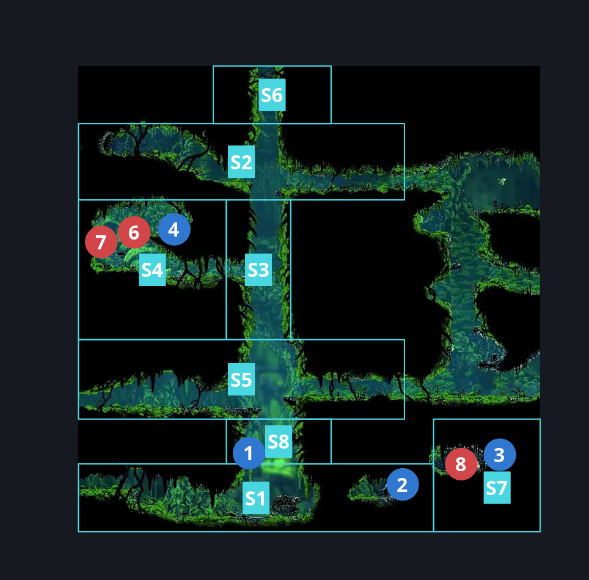
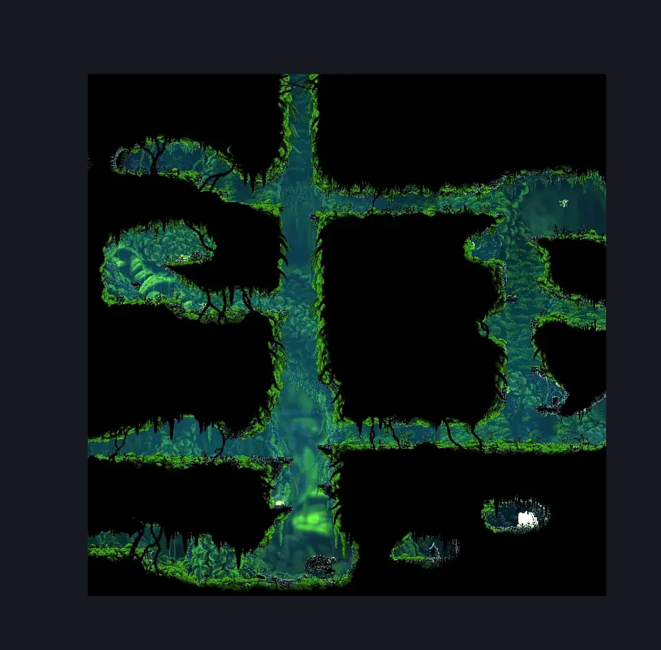

# Moss Grotto Center (Tut_01)

**Game ID:** Tut_01

**Contributors:** herounit, super epicguy, gallos

## Subrooms

| No. | Subroom | Annotated |
| --- | --- | --- |
| S1 | rock bottom | ✓ |
| S2 | upper crossing | ✓ |
| S3 | center shaft | ✓ |
| S4 | side room | ✓ |
| S5 | lower crossing | ✓ |
| S6 | up and away | ✓ |
| S7 | beast alcove | ✓ |
| S8 | dead ledge | ✓ |

## Room Transitions

| Alias | Name | From subroom | Destination | Destination alias | Requirements | TODO | Verification | Annotated | Notes |
| --- | --- | --- | --- | --- | --- | --- | --- | --- | --- |
| LL | lower left | rock bottom | [Moss Grotto West (Tut_02)](moss-grotto-west.md) | LR | break vines left |  | Verified | ✓ |  |
| ML | middle left | lower crossing | [Moss Grotto West (Tut_02)](moss-grotto-west.md) | UR | none |  | Verified | ✓ |  |
| UL | upper left | upper crossing | [Ruined Chapel (Tut_03)](ruined-chapel.md) | R | break vines left |  | Verified | ✓ |  |
| LR | lower right | lower crossing | [Moss Grotto East (Tut_01b)](moss-grotto-east.md) | LL | none |  | Verified | ✓ |  |
| UR | upper right | upper crossing | [Moss Grotto East (Tut_01b)](moss-grotto-east.md) | UL | none |  | Verified | ✓ |  |
| C | ceiling | up and away | [Bone Bottom Town (Bonetown)](../bone-bottom/bone-bottom-town.md) | RF | complete reach bone bottom IN bone bottom town |  | Verified | ✓ | there is a loading zone blocker that only goes away once you've reached bone bottom once |

## Subroom Connections

| Alias | Name | Source | Destination | Requirements | TODO | Verification | Annotated | Notes |
| --- | --- | --- | --- | --- | --- | --- | --- | --- |
| S1 | shaft 1 | upper crossing | up and away | silk soar  OR easy scuttlebrace OR ( cling grip either AND faydown cloak ) OR ( cling grip right AND ( easy shaman pogo OR easy air bind stall OR run OR dash right OR sharpdart OR clawline right OR drifter's cloak ) ) OR cling grip both |  | Verified | ✓ | Easy skip is a heal boost or a reversed slash boost with Shaman's |
| S1 | shaft 1 | up and away | upper crossing | none (falling) |  | Verified | ✓ |  |
| S2 | shaft 2 | center shaft | upper crossing | silk soar  OR cling grip either OR ( easy scuttlebrace AND ( faydown OR ((( flea brew AND ( dash right  OR easy heal stall OR easy flea brew stall OR easy voltvessels stall OR easy plasmium stall )) OR clawline right OR sharpdart OR (medium heal stall AND drifters AND dash right)) AND ledge grab right ))) OR (easy scuttlebrace AND flea brew AND hard heal stall AND hard plasmium stall) |  | Verified | ✓ |  |
| S2 | shaft 2 | upper crossing | center shaft | none (falling) |  | Verified | ✓ |  |
| SV | side room vines | center shaft | side room | break vines left |  | Verified | ✓ |  |
| SV | side room vines | side room | center shaft | break vines right |  | Verified | ✓ |  |
| S3 | shaft 3 | lower crossing | center shaft | silk soar  OR cling grip right OR ( cling grip left AND ( clawline left OR faydown OR sharpdart OR run left) ) OR ( medium scuttlebrace (chains multiple) AND ( clawline left OR faydown cloak ) ) |  | Verified | ✓ |  |
| S3 | shaft 3 | center shaft | lower crossing | none (falling) |  | Verified | ✓ |  |
| S4 | shaft 4 | dead ledge | lower crossing | ( ( ledge grab right OR dash right OR clawline right OR run right OR easy heal stall OR easy flintslate stall OR easy voltvessels stall OR flea brew) AND ( ledge grab left OR cling grip left ) ) OR cling grip right  OR medium plasmium stall  OR easy shaman pogo OR medium voltvessels stall OR faydown cloak  OR silk soar  OR medium scuttlebrace (fall is punishing) |  | Verified | ✓ |  |
| S4 | shaft 4 | lower crossing | dead ledge | none (falling) |  | Verified | ✓ |  |
| S5 | shaft 5 | rock bottom | dead ledge | silk soar OR ( cling grip either AND faydown )  OR ( easy scuttlebrace AND run AND faydown AND ( ( drifters cloak AND ledge grab left ) OR clawline left OR sharpdart ) ) OR (cling grip both AND  (clawline both OR (run left AND drifters) OR (drifters AND dash left AND easy heal stall) OR (clawline left AND dash right AND easy heal stall) OR (clawline right AND dash left AND run left AND easy heal stall))) |  | Verified | ✓ | hard scuttlebrace logic needs a review. seg shared a video at one point, but this was labelled easy and def shouldn't be - hero, 10/20 |
| S5 | shaft 5 | dead ledge | rock bottom | none (falling) |  | Verified | ✓ |  |
| LG | ledge grab 1 | rock bottom | beast alcove | ledge grab right OR faydown cloak OR silk soar OR cling grip right OR easy scuttlebrace |  | Verified | ✓ | left cling grip does not work due to blue hitbox on left wall |
| LG | ledge grab 1 | beast alcove | rock bottom | none (falling) |  | Verified | ✓ |  |

## Check Locations

| No. | Check | Subroom | Requirements | TODO | Verification | Location Type | Annotated | Notes |
| --- | --- | --- | --- | --- | --- | --- | --- | --- |
| 1 | moss grotto frayed rosary string | dead ledge | none |  | Verified | collectible | ✓ |  |
| 2 | moss grotto shell shard cache 1 | rock bottom | none |  | Verified | collectible | ✓ |  |
| 3 | moss grotto beast shard | beast alcove | defeat Marrowmaw 1 |  | Verified | collectible | ✓ |  |
| 4 | moss grotto rosary chest | side room | none |  | Verified | collectible | ✓ |  |
| 5 | moss grotto vanilla spawn | rock bottom | none |  | Verified | spawn |  |  |
| 6 | Mossmir 1 | side room | None |  | Verified | enemy | ✓ |  |
| 7 | Mossmir 2 | side room | None |  | Verified | enemy | ✓ |  |
| 8 | Marrowmaw 1 | beast alcove | Normal World Spawn |  | Verified | enemy | ✓ |  |

## Notes

renamed from "moss grotto west" - was mistakenly marked as same room as west room
not having the west part as part of this area causes the graph to be more complex

## Room Images

### Connections

### Checks

### Scene

