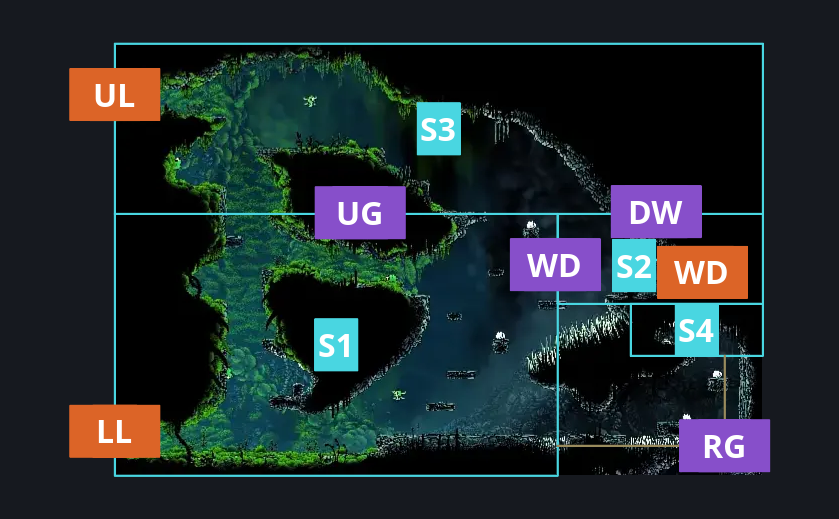
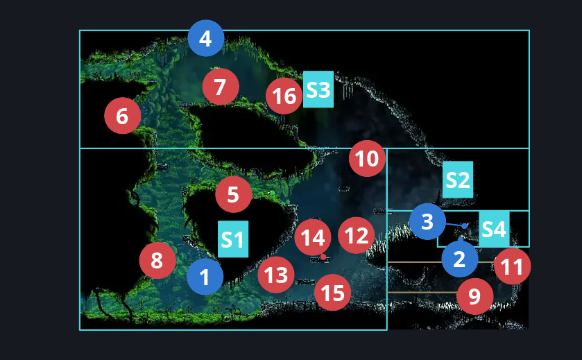
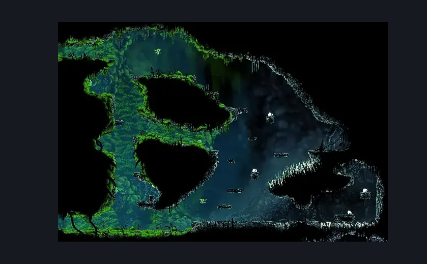

# Moss Grotto East (Tut_01b)

**Game ID:** Tut_01b

**Contributors:** herounit, gallos

## Subrooms

| No. | Subroom | Annotated |
| --- | --- | --- |
| S1 | ground floor | ✓ |
| S2 | weavenest door platform | ✓ |
| S3 | upper platforms | ✓ |
| S4 | alcove check spot | ✓ |

## Room Transitions

| Alias | Name | From subroom | Destination | Destination alias | Requirements | TODO | Verification | Annotated | Notes |
| --- | --- | --- | --- | --- | --- | --- | --- | --- | --- |
| UL | upper left | upper platforms | [Moss Grotto Center (Tut_01)](moss-grotto-center.md) | UR | none |  | Verified | ✓ |  |
| LL | lower left | ground floor | [Moss Grotto Center (Tut_01)](moss-grotto-center.md) | LR | none |  | Verified | ✓ |  |
| WD | weavenest door | weavenest door platform | [Weavenest Atla Entrance (Weave_04)](../weavenest-atla/weavenest-atla-entrance.md) | WD | needolin |  | Verified | ✓ |  |

## Subroom Connections

| Alias | Name | Source | Destination | Requirements | TODO | Verification | Annotated | Notes |
| --- | --- | --- | --- | --- | --- | --- | --- | --- |
| RG | right ledge grab | ground floor | alcove check spot | ledge grab right  OR cling grip right  OR easy scuttlebrace  OR faydown OR silk soar OR easy pogo off [mawling, mossmir] OR ( cling grip left AND ( easy shaman pogo OR ( run right AND proficient movement ))) |  | Verified | ✓ | can lure mossmir over per AP feedback - hero, 10/21 |
| RG | right ledge grab | alcove check spot | ground floor | none (falling) |  | Verified | ✓ |  |
| WD | weavenest door gap | ground floor | weavenest door platform | ledge grab right OR run  OR dash right  OR clawline right  OR drifters  OR faydown  OR cling grip right  OR ( spike pogo AND proficient movement )  OR easy shaman pogo  OR easy beast pogo  OR silk soar OR medium voltvessels stall OR easy pogo off mossmir |  | Verified | ✓ |  |
| WD | weavenest door gap | weavenest door platform | ground floor | none (falling) |  | Verified | ✓ |  |
| UG | upper ledge grab | ground floor | upper platforms | ledge grab right OR cling grip right OR faydown  OR silk soar  OR easy shaman pogo OR easy scuttlebrace OR easy enemy pogo off [ mawling, mossmir ] OR easy damage boost off [ mossmir ] OR easy beast charge OR ( easy pogo off mossgrub AND clawline left AND ( sharpdart OR clawline right ) ) |  | Verified | ✓ |  |
| UG | upper ledge grab | upper platforms | ground floor | none (falling) |  | Verified | ✓ |  |
| DW | drop to weavenest | upper platforms | weavenest door platform | none (falling) |  | Verified | ✓ |  |

## Check Locations

| No. | Check | Subroom | Requirements | TODO | Verification | Location Type | Annotated | Notes |
| --- | --- | --- | --- | --- | --- | --- | --- | --- |
| 1 | shell shard cache moss grotto 2 | ground floor | none |  | Verified | collectible | ✓ |  |
| 2 | shell shard cache moss grotto 3 | alcove check spot | none |  | Verified | collectible | ✓ |  |
| 3 | shell shard cache moss grotto 4 | alcove check spot | none |  | Verified | collectible | ✓ |  |
| 4 | moss grotto east mossberry | upper platforms | easy enemy pogo off mossmir OR run  OR dash right OR drifter's cloak  OR faydown cloak  OR silk soar  OR clawline right OR sharpdart  OR easy beast pogo  OR shaman attack up  OR shaman attack right OR easy [wanderer, architect, witch] needle strike |  | Verified | collectible | ✓ |  |
| 5 | Mossgrub 1 | ground floor | None |  | Verified | enemy | ✓ |  |
| 6 | Mossgrub 2 | upper platforms | None |  | Verified | enemy | ✓ |  |
| 7 | Mossmir 1 | upper platforms | Normal World Spawn |  | Verified | enemy | ✓ |  |
| 8 | Mossgrub 3 | ground floor | Normal World Spawn |  | Verified | enemy | ✓ |  |
| 9 | Mawling 1 | ground floor | Normal World Spawn |  | Verified | enemy | ✓ |  |
| 10 | Mawling 2 | upper platforms | Normal World Spawn |  | Verified | enemy | ✓ |  |
| 11 | Mawling 3 | ground floor | Normal World Spawn |  | Verified | enemy | ✓ |  |
| 12 | Mawling 4 | ground floor | Normal World Spawn |  | Verified | enemy | ✓ |  |
| 13 | Mossmir 2 | ground floor | Normal World Spawn |  | Verified | enemy | ✓ |  |
| 14 | Mawling 5 | ground floor | Black Thread World Spawn |  | Verified | enemy | ✓ |  |
| 15 | Marrowmaw 1 | ground floor | Black Thread World Spawn |  | Verified | enemy | ✓ |  |
| 16 | Mossmir 3 | upper platforms | Black Thread World Spawn |  | Verified | enemy | ✓ |  |

## Room Images

### Connections

### Checks

### Scene

