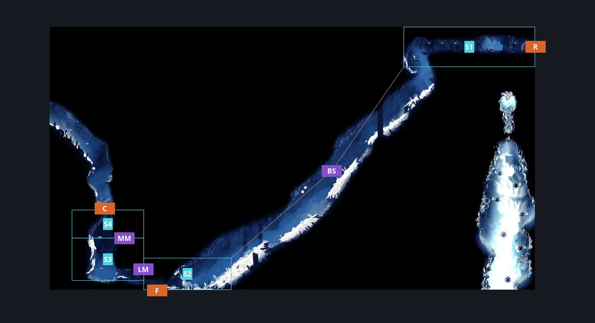
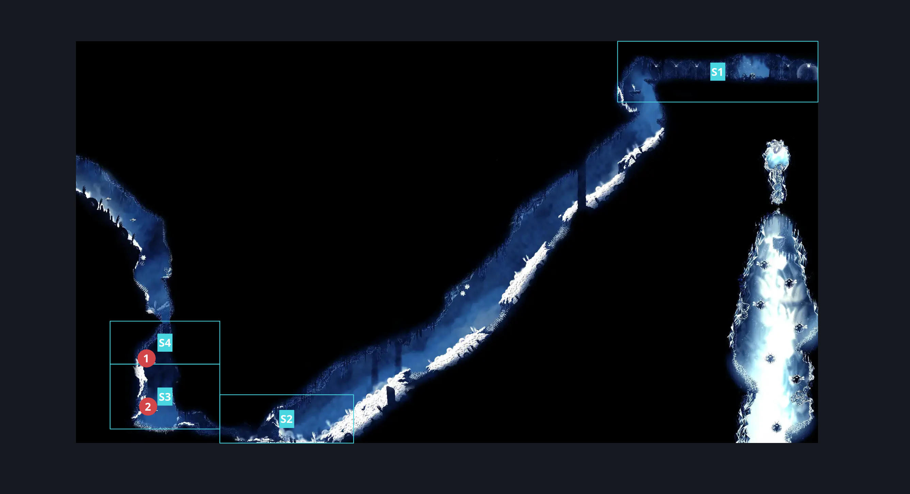
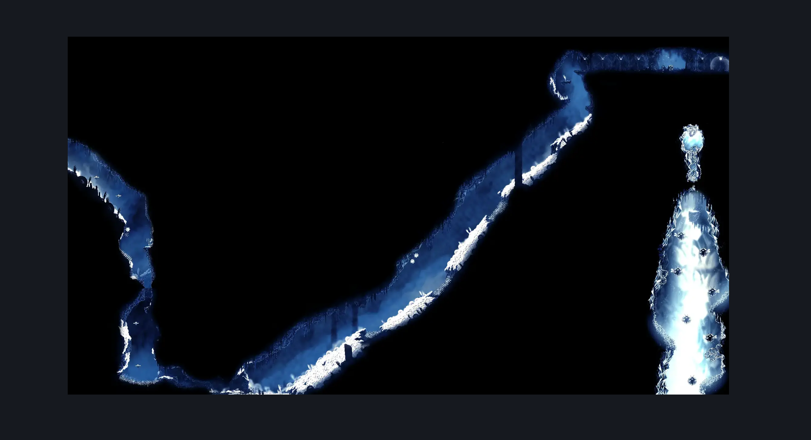

# Mount Fay Upper Slope (Peak_08)

**Game ID:** Peak_08

**Contributors:** Pyxl, Hutyrix

## Subrooms

| No. | Subroom | Annotated |
| --- | --- | --- |
| S1 | Upper Entrance | ✓ |
| S2 | Lower Exit | ✓ |
| S3 | Mask Maker Path | ✓ |
| S4 | Mask Maker Entrance | ✓ |

## Room Transitions

| Alias | Name | From subroom | Destination | Destination alias | Requirements | TODO | Verification | Annotated | Notes |
| --- | --- | --- | --- | --- | --- | --- | --- | --- | --- |
| F | bot1 | Lower Exit | [Mount Fay Lower Slope (Peak_05)](mount-fay-lower-slope.md) | C | None |  | Verified | ✓ |  |
| C | top1 | Mask Maker Entrance | [Mask Maker Passage (Peak_05d)](mask-maker-passage.md) | F | Cling Grip either OR easy Scuttlebrace OR Faydown OR Silk Soar |  | Verified | ✓ |  |
| R | right1 | Upper Entrance | [FayForn (Peak_08b)](fayforn.md) | L1 | None |  | Verified | ✓ |  |

## Subroom Connections

| Alias | Name | Source | Destination | Requirements | TODO | Verification | Annotated | Notes |
| --- | --- | --- | --- | --- | --- | --- | --- | --- |
| BS | Big Slide | Upper Entrance | Lower Exit | cloaked OR (hard naked pogo AND hard damage boost x 4) |  | Verified | ✓ | One Way Slide  It's not technically damage boost, but it'll work for the time being  It's definitely better than "none" -Hutyrix |
| LM | Lower Maker Path | Lower Exit | Mask Maker Path | None |  | Verified | ✓ |  |
| LM | Lower Maker Path | Mask Maker Path | Lower Exit | None |  | Verified | ✓ |  |
| BS | Big Slide | Lower Exit | Upper Entrance | faydown AND proficient movement |  | Verified | ✓ | Two Way Slide (boring) |
| MM | Mask Maker Path | Mask Maker Path | Mask Maker Entrance | (cling grip left OR proficient movement) AND faydown AND intended pogo off driftlin AND ((intended [hunter,reaper,wanderer,beast,architect,shaman] pogo) OR (intended witch pogo AND (ledge grab right OR cling grip right))) |  | Verified | ✓ | old logic: ( Cling Grip Left OR Scuttlebrace OR Faydown Cloak OR Silk Soar ) AND intended pogo off driftlin  ngl, quite terrible  could be wrong, but faydown is hard required? -Hutyrix 11/23/26 |
| MM | Mask Maker Path | Mask Maker Entrance | Mask Maker Path | None |  | Verified | ✓ |  |

## Check Locations

| No. | Check | Subroom | Requirements | TODO | Verification | Location Type | Annotated | Notes |
| --- | --- | --- | --- | --- | --- | --- | --- | --- |
| 1 | Driftlin 1 | Mask Maker Entrance | None |  | Verified | enemy | ✓ |  |
| 2 | Driftlin 2 | Mask Maker Path | dash left OR clawline left x 1 OR easy [reaper,beast,shaman] pogo OR medium [witch,architect] pogo OR easy [hunter,wanderer,witch,architect] charge OR (cloaked AND (attack up OR attack right OR [hunter,reaper,beast,witch,architect,shaman] attack left)) |  | Verified | enemy | ✓ |  |

## Notes

Major overhaul, ready for attack needle randomization 11/23/26 - Hutyrix

## Room Images

### Connections

### Checks

### Scene

