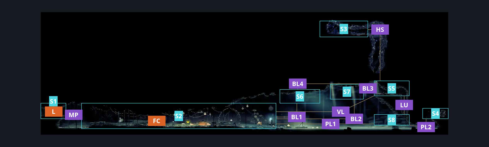
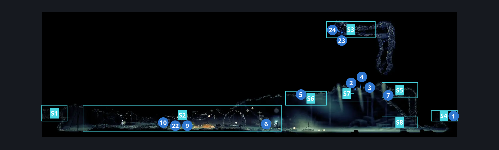
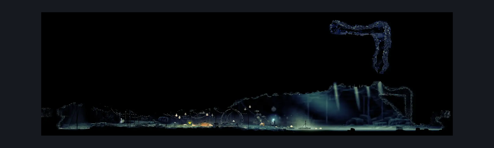

# Fleatopia (Aqueduct_05)

**Game ID:** Aqueduct_05

**Contributors:** Pyxl, Gallos, Hutyrix

## Subrooms

| No. | Subroom | Annotated |
| --- | --- | --- |
| S1 | Entrance | ✓ |
| S2 | Fleatopia | ✓ |
| S3 | The Herald | ✓ |
| S4 | Craftmetal | ✓ |
| S5 | Upper Ledge | ✓ |
| S6 | Above Fleatopia | ✓ |
| S7 | Below Herald | ✓ |
| S8 | Lake Middle | ✓ |

## Room Transitions

| Alias | Name | From subroom | Destination | Destination alias | Requirements | TODO | Verification | Annotated | Notes |
| --- | --- | --- | --- | --- | --- | --- | --- | --- | --- |
| L | left1 | Entrance | [Putrified Ducts Lower Bridge Room (Aqueduct_03)](putrified-ducts-lower-bridge-room.md) | R | None |  | Verified | ✓ |  |
| FC | Flea Caravan | Fleatopia | [Flea Caravan](../fast-travel/flea-caravan.md) | FT | prereq THE flea caravan move to fleatopia |  | Verified | ✓ |  |

## Subroom Connections

| Alias | Name | Source | Destination | Requirements | TODO | Verification | Annotated | Notes |
| --- | --- | --- | --- | --- | --- | --- | --- | --- |
| MP | Maggot Puddle | Entrance | Fleatopia | (Swim AND (easy shaman pogo OR ledge grab right OR cling grip right))  OR Clawline right x 1 OR Drifters Cloak OR dash right OR Sharpdart x 1 OR easy beast pogo OR easy [wanderer,hunter] voltwater pogo x 2 OR medium [wanderer,hunter] voltwater pogo OR ( Faydown AND (run right OR flea brew jump OR easy architect pogo OR medium hunter pogo OR medium plasmium stall x 2 OR (ledge grab right AND (medium flintslate stall x 3 OR medium thread storm stall x 2)) OR (cling grip right AND (medium [thread storm,parry,rune rage,pale nails] stall x 2)) OR hard shaman pogo )) OR ( Sprint Right AND (medium architect pogo OR medium [voltvessels,flea brew] stall x 2)) OR ( Cling grip right AND (medium voltvessels stall x 4)) OR ( Ledge grab right AND (medium flea brew stall x 4 OR medium [voltvessels,plasmium] stall x 5 )) OR medium flea brew stall x 5 OR medium plasmium stall x 6  OR (medium flintslate stall x 3 AND (medium flea brew stall x 3)) OR (hard architect pogo AND hard voltvessels stall x 1) OR (hard [reaper,shaman] pogo AND run right AND cling grip right) OR ((hard hunter pogo OR hard cloakless pogo) AND run right AND ledge grab right) |  | Verified | ✓ | Complete overhaul -Hutyrix 11/18/26 |
| MP | Maggot Puddle | Fleatopia | Entrance | ( Swim AND Cling Grip left ) OR ( Faydown cloak AND ( Clawline left OR ( Sprint left AND Dash left ) ) ) OR medium [wanderer,hunter] voltwater pogo x 2 |  | Verified | ✓ | Syntax is very incomplete, but it's useless even with ER. |
| PL1 | PaleLake1 | Fleatopia | Lake Middle | swim OR (silk soar x 1 AND clawline right x 6) OR ( silk soar x 1 AND easy [hunter,beast] pogo AND clawline right x 5 ) OR (drifters AND clawline right x 5) OR (medium shaman pogo AND clawline right x 7 AND ledge grab right) OR (hard shaman pogo AND clawline right x 8) OR (clawline right x 7 AND ((medium flintslate stall x 3 AND medium flea brew stall x 3) OR (medium flintslate stall x 3 AND medium plasmium stall x 3) OR (medium flea brew stall x 3 AND medium plasmium stall x 3 ))) OR (medium flea brew stall x 5 AND clawline right x 6) OR (hard voltvessels stall x 5 AND faydown AND clawline right x 5) OR medium [hunter,wanderer] voltwater pogo x 6 OR hard hunter voltwater pogo x 5 OR cbt hunter voltwater pogo x 4 |  | Verified | ✓ |  |
| PL1 | PaleLake1 | Lake Middle | Fleatopia | swim |  | Verified | ✓ | Syntax is very incomplete, but it's useless even with ER.  Going from right to left is also slightly easier |
| PL2 | PaleLake2 | Lake Middle | Craftmetal | (Swim AND Faydown Cloak AND ( Cling Grip either OR easy Scuttlebrace ))  OR (Faydown AND clawline right x 2 AND  ((hard [hunter,wanderer] voltwater pogo OR (medium hunter voltwater pogo x 2 AND medium flintslate stall x 1)) AND (Cling Grip either OR medium Scuttlebrace OR ledge grab right OR hard hunter voltwater pogo x 1)))  OR (cbt hunter voltwater pogo x 2 AND faydown)  OR cbt hunter voltwater pogo x 3 |  | Verified | ✓ | Voltvessel water pogo crusade was here 17/11 |
| PL2 | PaleLake2 | Craftmetal | Lake Middle | swim |  | Verified | ✓ |  |
| VL | Volt Lake | Fleatopia | Upper Ledge | (silk soar x 1 AND clawline right x 5 AND faydown AND ((drifters AND (ledge grab left OR medium [flintslate,flea brew] stall x 3)) OR medium flintslate stall x 5 OR medium flea brew stall x 4))  OR (medium [hunter,wanderer] voltwater pogo x 5 AND clawline right x 5 AND faydown AND ledge grab right) OR (hard [hunter,wanderer] voltwater pogo x 5 AND (dash right OR clawline right x 5) AND faydown) |  | Verified | ✓ | Could make some improvement with Festival of Flea active. (Raft) |
| VL | Volt Lake | Upper Ledge | Fleatopia | Clawline left x 4 OR ( Drifters Cloak AND Sprint left AND Faydown Cloak ) OR swim OR medium [hunter,wanderer] voltwater pogo x 5 |  | Verified | ✓ | Voltvessel water pogo crusade was here 17/11 |
| HS | Hidden Shaft | Upper Ledge | The Herald | Silk Soar x 1 |  | Verified | ✓ |  |
| HS | Hidden Shaft | The Herald | Upper Ledge | None |  | Verified | ✓ |  |
| BL1 | Break Lake1 | Fleatopia | Above Fleatopia | (Silk Soar x 1 AND (attack up OR attack right))  OR easy voltvessels use |  | Verified | ✓ | NOT Voltvessel water pogo Just use it from the ledge. |
| BL2 | Break Lake2 | Fleatopia | Below Herald | easy voltvessels use AND swim | TODO | Verified | ✓ | Instead of swim, there will be similar logic to PL1, but with 50% discount on distance |
| BL3 | Break Lake3 | Upper Ledge | Below Herald | (attack up AND (faydown OR (drifters AND proficient movement) OR dash left OR sharpdart)) OR clawline left x 1 OR easy shaman charge OR easy [silkspear,straight pin,threefold pin,longpin,curveclaw,throwing ring,mt fay silkshot,underworks silkshot,deep docks silkshot] use x 1 OR easy voltvessels use x 2 OR medium pale nails use x 1 OR medium sting shard use x 4  OR (medium rosary cannon use) | TODO | Verified | ✓ | Rosary cannon (last check in syntax) should be checked for renewable rosaries, if that is the case, todo mark can be removed  ...or just remove rosary cannon completly |
| BL4 | Break Lake4 | Upper Ledge | Above Fleatopia | (drifters AND clawline left x 4) OR (faydown AND clawline left x 5 AND proficient movement) |  | Verified | ✓ |  |
| LU | LaketoUpper | Lake Middle | Upper Ledge | cling grip right OR easy scuttlebrace OR ((easy [hunter,wanderer] voltwater pogo x 1 OR faydown cloak) AND cling grip left) |  | Verified | ✓ |  |
| LU | LaketoUpper | Upper Ledge | Lake Middle | none (falling) |  | Verified | ✓ |  |

## Check Locations

| No. | Check | Subroom | Requirements | TODO | Verification | Location Type | Annotated | Notes |
| --- | --- | --- | --- | --- | --- | --- | --- | --- |
| 1 | Putrified Ducts - Craft Metal | Craftmetal | None |  | Verified | collectible | ✓ |  |
| 2 | Putrified Ducts - Shell Shard Cache #11 | Below Herald | None |  | Verified | resource | ✓ |  |
| 3 | Putrified Ducts - Shell Shard Cache #10 | Below Herald | None |  | Verified | resource | ✓ |  |
| 4 | Putrified Ducts - Shell Shard Cache #9 | Below Herald | (attack up AND (faydown OR (drifters AND proficient movement) OR dash left OR sharpdart)) OR clawline left x 1 OR easy shaman charge OR easy [silkspear,straight pin,threefold pin,longpin,curveclaw,throwing ring,mt fay silkshot,underworks silkshot,deep docks silkshot] use x 1 OR easy voltvessels use x 2 OR medium pale nails use x 1 OR medium sting shard use x 4 OR (medium rosary cannon use) |  | Verified | resource | ✓ | change to none after everything |
| 5 | Putrified Ducts - Shell Shard Cache #8 | Above Fleatopia | Silk Soar x 1  OR (Elite ball knowledge AND easy voltvessels use x 1) OR hard voltvessels use x 1  OR ((drifters AND clawline left x 3 AND attack up) AND (((Swim OR (Clawline right x 5 AND drifters cloak AND (Faydown cloak OR proficient movement))) AND (cling grip right OR easy scuttlebrace OR (faydown AND cling grip left))) OR (silk soar AND (easy [hunter,beast] pogo AND clawline right x 5 AND (cling grip right OR easy scuttlebrace OR (faydown AND cling grip left)))) OR (easy scuttlebrace AND easy shaman pogo AND silk soar) OR (medium [hunter,wanderer] voltwater pogo AND (clawline right x 4 OR dash right) AND (cling grip right OR easy scuttlebrace OR (faydown AND cling grip left))) OR (hard [hunter,wanderer] voltwater pogo AND (cling grip right OR easy scuttlebrace OR (faydown AND cling grip left))) OR (hard [hunter,wanderer] voltwater pogo AND silk soar AND (dash right OR clawline right x 5) AND faydown AND ledge grab right) OR (cbt [hunter,wanderer] voltwater pogo AND (clawline right x 4 OR dash right) AND faydown))) |  | Verified | resource | ✓ | change to none after everything |
| 6 | Putrified Ducts - White Lake Waver Sign | Fleatopia | Needolin AND ( Act 2 OR ACT 1 ) |  | Verified | lore | ✓ | Missable / no check |
| 7 | Resting Site: Putrified Ducts | Upper Ledge | complete THE A Vassal Lost Wish Promised |  | Verified | event | ✓ |  |
| 8 | Ecstasy of the End Wish Promised | Fleatopia | act 3 AND after THE flea caravan move to fleatopia AND silk soar AND have egg of flealia |  | Verified | event |  | one of two places to accept this wish  spreadsheet flag is vague, so using wiki requirements |
| 9 | Ecstasy of the End Wish Granted | Fleatopia | complete Ecstasy of the End Wish Promised AND complete Flea Juggle High Score AND complete Flea Dodge High Score AND after Flea Bounce High Score |  | Verified | event | ✓ |  |
| 10 | Pale Oil | Fleatopia | complete Ecstasy of the End Wish Granted |  | Verified | collectible | ✓ |  |
| 11 | Fleatopia - Tool Pouch | Fleatopia | get 22 fleas |  | Verified | collectible |  |  |
| 12 | Egg of Flealia | Fleatopia | get 30 fleas |  | Verified | collectible |  | All fleas |
| 13 | Reached Pale Lake | Fleatopia | none |  | Verified | logic-point |  |  |
| 14 | Festival of the Flea | Fleatopia | complete Ecstasy of the End Wish Promised |  | Verified | logic-point |  |  |
| 15 | Flea Juggle High Score | Fleatopia | after Festival of the Flea AND ( Dash both AND Needle Left AND needle Right AND Needle UP ) |  | Verified | event |  | these probably need movement requirements |
| 16 | Flea Dodge High Score | Fleatopia | after Festival of the Flea AND Faydown Cloak |  | Verified | event |  | these probably need movement requirements |
| 17 | Flea Bounce High Score | Fleatopia | after Festival of the Flea AND Faydown Cloak AND ( Proficient movement OR Drifters cloak ) |  | Verified | event |  | these probably need movement requirements |
| 18 | Seth Joins Festival of the Flea | Fleatopia | complete THE Ecstasy of the End Wish Granted AND (  after THE Seth Meeting Grand Gate OR ( after THE Seth Meeting Shellwood AND have Everbloom ) ) |  | Verified | logic-point |  | reflects the skipped grand gate meeting if you have everbloom |
| 19 | Flea Juggle Beat Seth Score | Fleatopia | after Seth Joins Festival of the Flea AND ( Dash both AND Needle Left AND needle Right AND Needle UP ) |  | Verified | event |  | these probably need movement requirements |
| 20 | Flea Dodge Beat Seth Score | Fleatopia | after Seth Joins Festival of the Flea AND Faydown Cloak AND ( Proficient movement OR Drifters cloak ) |  | Verified | event |  | these probably need movement requirements |
| 21 | Flea Bounce Beat Seth Score | Fleatopia | after Seth Joins Festival of the Flea AND Faydown Cloak AND ( Proficient movement OR Drifters cloak ) |  | Verified | event |  | these probably need movement requirements |
| 22 | Guardians Memento | Fleatopia | complete Flea Juggle Beat Seth Score AND complete Flea Dodge Beat Seth Score AND after Flea Bounce Beat Seth Score |  | Verified | collectible | ✓ |  |
| 23 | Passing Of The Age Lore Tablet | The Herald | Act 3 |  | Verified | lore | ✓ |  |
| 24 | Passing Of The Age Wish Promised | The Herald | after Passing Of The Age Lore Tablet |  | Verified | event | ✓ | Reading the lore tablet starts the wish. |
| 25 | Fleatopia Bench | Fleatopia | none | TODO |  | bench |  | Apparently this bench exists even after caravan arrives?  I feel like something can break with this in bench rando...  To conclude this room logic |

## Notes

MASSIVE OVERHAUL. Still there's more to uncover - there's potential for Festival of the Flea specifc skips, because of raft and flea dodge platforms 
-Hutyrix 11/18/26

## Room Images

### Connections

### Checks

### Scene

