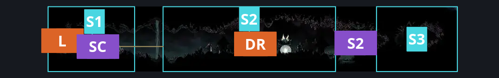
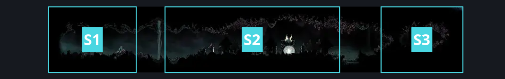
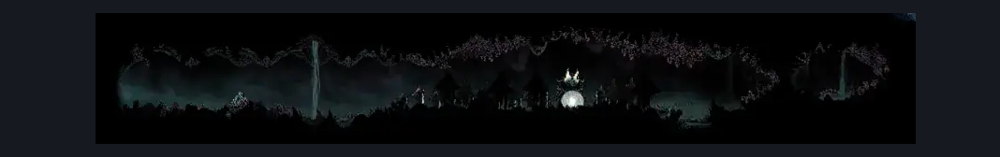

# Coral Tower (Coral_Tower_01)

**Game ID:** Coral_Tower_01

**Contributors:** Pxyl

## Subrooms

| No. | Subroom | Annotated |
| --- | --- | --- |
| S1 | Entrance | ✓ |
| S2 | Main | ✓ |
| S3 | Bench | ✓ |

## Room Transitions

| Alias | Name | From subroom | Destination | Destination alias | Requirements | TODO | Verification | Annotated | Notes |
| --- | --- | --- | --- | --- | --- | --- | --- | --- | --- |
| L | left1 | Entrance | [Coral Tower Entrance (Coral_28)](coral-tower-entrance.md) | D | None |  | Verified | ✓ |  |
| DR | door_wakeOnGround | Main | [Coral Tower Memory (Memory_Coral_Tower)](coral-tower-memory.md) | D | Needolin AND Elegy of the Deep |  | Verified | ✓ | Leads to the Memory Coral Tower, That room only needs silk soar and (Proficient Combat or needle upgrades to beat khan) |

## Subroom Connections

| Alias | Name | Source | Destination | Requirements | TODO | Verification | Annotated | Notes |
| --- | --- | --- | --- | --- | --- | --- | --- | --- |
| SC | Sandcarver Pit | Entrance | Main | Dash Right OR Sprint Right OR Drifters cloak OR Faydown Cloak OR Clawline Right OR easy Beast Crest pogo OR Sharpdart OR easy Architect Crest pogo |  | Verified |  |  |
| SC | Sandcarver PIt | Main | Entrance | Dash Right OR Sprint Right OR Drifters cloak OR Faydown Cloak OR Clawline Right OR easy Beast Crest pogo OR Sharpdart OR easy Architect Crest pogo |  | Verified |  |  |
| S2 | Sandcarver Pit 2 | Main | Bench | Dash Right OR Sprint Right OR Drifters cloak OR Faydown Cloak OR Clawline right OR easy Beast Crest pogo OR Sharpdart OR ( easy Architect Crest pogo AND Ledge Grab right AND easy Needle Strike stall ) |  | Verified |  |  |
| S2 | Sandcarver Pit 2 | Bench | Main | Dash left OR Sprint OR Drifters cloak OR Faydown Cloak OR Clawline left OR easy Beast Crest pogo OR Sharpdart OR easy Architect Crest pogo |  | Verified |  |  |

## Check Locations

| No. | Check | Subroom | Requirements | TODO | Verification | Location Type | Annotated | Notes |
| --- | --- | --- | --- | --- | --- | --- | --- | --- |
| 1 | Conchcutter | Main | None |  | Verified | collectible |  |  |
| 2 | Sands of Karak - Lower Coral Tablet | Entrance | None |  | Verified | lore |  |  |

## Room Images

### Connections

### Checks

### Scene

