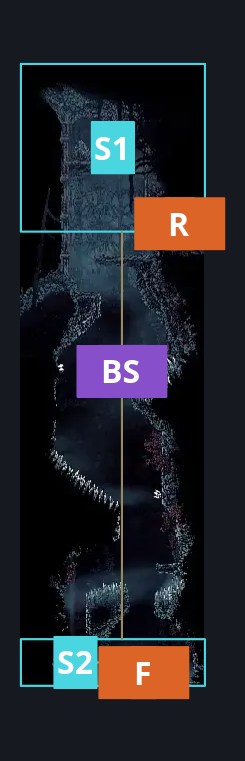
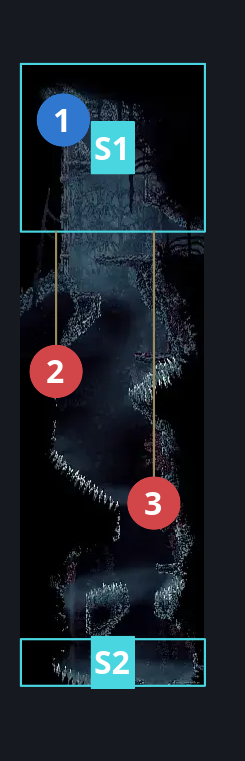
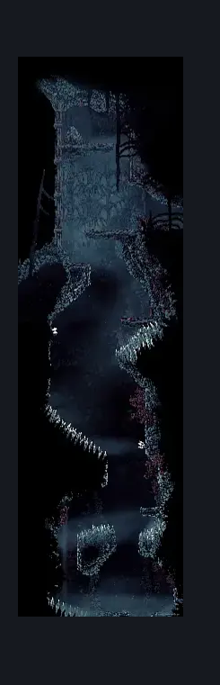

# Sands of Karak Entrance (Coral_25)

**Game ID:** Coral_25

**Contributors:** Pyxl, Hutyrix

## Subrooms

| No. | Subroom | Annotated |
| --- | --- | --- |
| S1 | Top | ✓ |
| S2 | Bottom | ✓ |

## Room Transitions

| Alias | Name | From subroom | Destination | Destination alias | Requirements | TODO | Verification | Annotated | Notes |
| --- | --- | --- | --- | --- | --- | --- | --- | --- | --- |
| F | bot1 | Bottom | [Windy Pinstress Entrance (Coral_34)](../blasted-steps/windy-pinstress-entrance.md) | T | None |  | Verified | ✓ |  |
| R | right1 | Top | [Sands of Karak Lower Left Long Room (Coral_23)](sands-of-karak-lower-left-long-room.md) | LL | None |  | Verified | ✓ |  |

## Subroom Connections

| Alias | Name | Source | Destination | Requirements | TODO | Verification | Annotated | Notes |
| --- | --- | --- | --- | --- | --- | --- | --- | --- |
| BS | Big Shaft | Bottom | Top | easy Silk soar cancel x 3 OR ( Cling Grip left AND ( ( Proficient Movement AND Spike Pogo ) OR Clawline Right x 2) ) OR (faydown AND (cling grip either OR medium scuttlebrace OR medium [reaper,beast,architect,shaman] pogo OR (medium delvers drill stall AND easy pogo off pharlid))) OR hard shaman scuttle slide |  | Verified | ✓ |  |
| BS | Big Shaft | Top | Bottom | None |  | Verified | ✓ |  |

## Check Locations

| No. | Check | Subroom | Requirements | TODO | Verification | Location Type | Annotated | Notes |
| --- | --- | --- | --- | --- | --- | --- | --- | --- |
| 1 | Sands of Karak - Upper Coral Tablet | Top | Silk soar x 1 OR ( Cling grip both AND ( Dash right OR Drifters Cloak OR Clawline right x 1 OR Sharpdart x 1 OR easy [beast,architect] charge OR flea brew jump OR easy plasmium stall x 2 OR medium [flintslate,parry,pale nails] stall x 2 OR hard [thread storm,voltvessels] stall x 2) ) OR (faydown Cloak AND (easy scuttlebrace OR cling grip either)) OR medium shaman scuttle slide |  | Verified | lore | ✓ |  |
| 2 | Pharlid 1 | Top | None |  | Verified | enemy | ✓ |  |
| 3 | Pharlid 2 | Top | None |  | Verified | enemy | ✓ | Kills it self second player gets near |

## Notes

Minor overhaul 11/23/26 - faydown, crest pogo, stalls and scuttlebrace support - Hutyrix

## Room Images

### Connections

### Checks

### Scene

