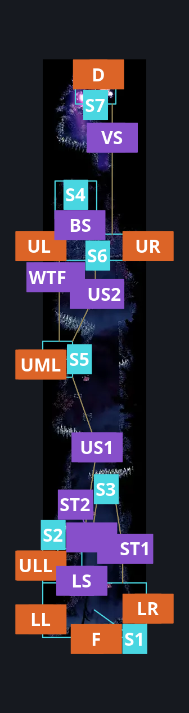
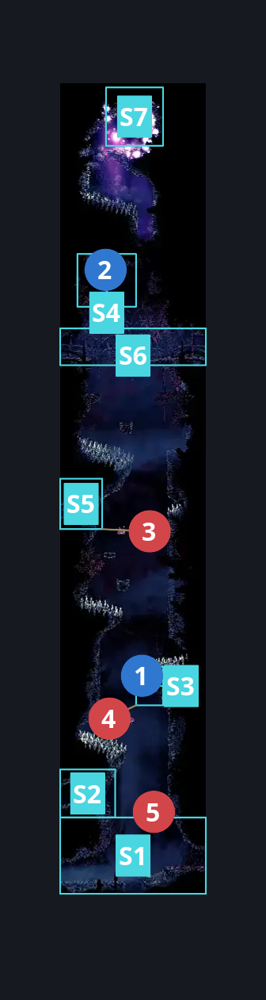
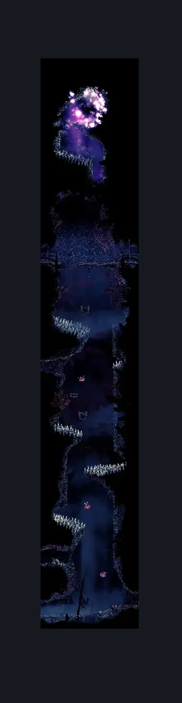

# Sands of Karak Tall Centre Room (Coral_35b)

**Game ID:** Coral_35b

**Contributors:** Pyxl

## Subrooms

| No. | Subroom | Annotated |
| --- | --- | --- |
| S1 | Ground Level | ✓ |
| S2 | Shakra Ledge | ✓ |
| S3 | Stalactite | ✓ |
| S4 | Stalactite 2 | ✓ |
| S5 | Crust Nut Ledge | ✓ |
| S6 | Bridge Level | ✓ |
| S7 | Voltnest Level | ✓ |

## Room Transitions

| Alias | Name | From subroom | Destination | Destination alias | Requirements | TODO | Verification | Annotated | Notes |
| --- | --- | --- | --- | --- | --- | --- | --- | --- | --- |
| D | door1 | Voltnest Level | [Voltnest (Coral_29)](voltnest.md) | L | None |  | Verified | ✓ |  |
| LL | left3 | Ground Level | [Sands of Karak Lower Left Long Room (Coral_23)](sands-of-karak-lower-left-long-room.md) | R | None |  | Verified | ✓ |  |
| F | bot1 | Ground Level | [Blasted Steps Thin Long Vertical (Coral_35)](../blasted-steps/blasted-steps-thin-long-vertical.md) | T | prereq Stalactite |  | Verified | ✓ |  |
| LR | right2 | Ground Level | [Sands of Karak Lower Right Long Room (Coral_24)](sands-of-karak-lower-right-long-room.md) | L | None |  | Verified | ✓ |  |
| UL | left2 | Bridge Level | [Sands of Karak Upper Left Long Room (Coral_27)](sands-of-karak-upper-left-long-room.md) | R | None |  | Verified | ✓ |  |
| UML | left5 | Crust Nut Ledge | [Crustnut (Coral_41)](crustnut.md) | R | None |  | Verified | ✓ |  |
| UR | right1 | Bridge Level | [Sands of Karak Upper Right Long Room (Coral_44)](sands-of-karak-upper-right-long-room.md) | L | None |  | Verified | ✓ |  |
| ULL | left4 | Shakra Ledge | [Sands of Shakra (Coral_40)](sands-of-shakra.md) | R | None |  | Verified | ✓ |  |

## Subroom Connections

| Alias | Name | Source | Destination | Requirements | TODO | Verification | Annotated | Notes |
| --- | --- | --- | --- | --- | --- | --- | --- | --- |
| LS | Lower Shaft | Ground Level | Shakra Ledge | Silk Soar OR ( Faydown Cloak AND ( Cling grip left OR Scuttlebrace ) ) OR ( Cling grip left AND ( ( Dash left OR Sprint left OR Drifters Cloak OR Clawline left OR Sharpdart ) OR ( ( easy Beast Crest pogo OR easy Architect Crest pogo ) AND easy Needle Strike stall ) ) ) |  | Verified | ✓ |  |
| LS | Lower Shaft | Shakra Ledge | Ground Level | None |  | Verified | ✓ |  |
| ST1 | Stalactite | Ground Level | Stalactite | Silk Soar |  | Verified | ✓ |  |
| ST1 | Stalactite | Stalactite | Ground Level | None |  | Verified | ✓ |  |
| ST2 | Stalactite2 | Shakra Ledge | Stalactite | ( ( Scuttlebrace OR Cling grip right ) AND ( Dash right OR Sprint right OR Drifters Cloak OR Faydown Cloak OR SharpDart OR Clawline right ) ) OR ( Cling Grip right AND ( easy Beast Crest pogo OR easy Hunter Crest pogo OR easy Shaman Crest pogo OR ( ( easy Reaper Crest pogo OR easy Architect Crest pogo ) AND easy Needle Strike stall ) ) ) |  | Verified | ✓ |  |
| St2 | Stalactite2 | Stalactite | Shakra Ledge | None |  | Verified | ✓ |  |
| US1 | Upper Shaft1 | Shakra Ledge | Crust Nut Ledge | ( ( Scuttlebrace  OR  Cling grip both )  AND  ( ( Dash both AND ( Ledge Grab either OR easy Shaman Crest pogo ) ) OR Faydown Cloak OR Sharpdart ) ) OR ( Cling Grip both AND ( easy Beast Crest pogo OR easy Hunter Crest pogo OR ( easy Reaper Crest pogo AND easy Needle Strike stall ) ) ) |  | Verified | ✓ |  |
| US1 | Upper Shaft1 | Crust Nut Ledge | Shakra Ledge | None |  | Verified | ✓ |  |
| US2 | Upper Shaft2 | Crust Nut Ledge | Bridge Level | clear Stalactite 2 AND ( (  Scuttlebrace OR ( Cling grip Right AND ( Cling grip left OR ledge grab left ) )OR  Faydown Cloak  OR (  Silk Soar AND ( easy Architect Crest pogo OR easy Witch Crest pogo OR easy Reaper Crest pogo OR easy Shaman Crest pogo OR ( easy Wanderer Crest pogo AND ( ledge grab left OR Sharpdart OR Drifters Cloak ) ) ) ) ) ) |  | Verified | ✓ |  |
| US2 | Upper Shaft2 | Bridge Level | Crust Nut Ledge | Prereq Stalactite 2 |  | Verified | ✓ |  |
| VS | Voltwyrm Shaft | Bridge Level | Voltnest Level | ( Cling Grip both AND Faydown Cloak AND ( Clawline right OR Dash right OR Sharpdart OR ( ( Medium Beast Crest pogo AND medium Needle Strike stall AND Cling Grip both )  OR ( ( ( medium Architect Crest pogo OR medium Reaper Crest pogo )  AND medium Needle Strike stall ) OR medium Shaman Crest pogo )  )  )  ) OR (  Silk soar AND ( Cling Grip left OR Faydown Cloak OR Scuttlebrace ) ) |  | Verified | ✓ |  |
| VS | VoltWyrm Shaft | Voltnest Level | Bridge Level | None |  | Verified | ✓ |  |
| BS | bridge to stalactite 2 | Bridge Level | Stalactite 2 | medium curveclaw use x 3 OR ((faydown OR easy scuttlebrace) AND shaman attack up) OR cling grip left OR silk soar x 2 OR medium conchcutter use x 3 |  | Verified | ✓ | damn someone beat to it |
| WTF | What the fuck | Crust Nut Ledge | Stalactite 2 | Elite ball knowledge AND ( CBT curveclaw use x 3 OR ( Medium curveclaw use x 3 AND medium voltvessels use x 3 ) ) AND ( (  Scuttlebrace OR ( Cling grip Right AND ( Cling grip left OR ledge grab left ) )OR  Faydown Cloak  OR (  Silk Soar AND ( easy Architect Crest pogo OR easy Witch Crest pogo OR easy Reaper Crest pogo OR easy Shaman Crest pogo OR ( easy Wanderer Crest pogo AND ( ledge grab left OR Sharpdart OR Drifters Cloak ) ) ) ) ) ) |  | Verified | ✓ | Blame nio for discovering this |

## Check Locations

| No. | Check | Subroom | Requirements | TODO | Verification | Location Type | Annotated | Notes |
| --- | --- | --- | --- | --- | --- | --- | --- | --- |
| 1 | Stalactite | Stalactite | None |  | Verified | blockade | ✓ |  |
| 2 | Stalactite 2 | Stalactite 2 | None |  | Verified | blockade | ✓ |  |
| 3 | Pokenabbin 1 | Crust Nut Ledge | None |  | Verified | enemy | ✓ |  |
| 4 | Pokenabbin 2 | Stalactite | None |  | Verified | enemy | ✓ |  |
| 5 | Pokenabbin 3 | Ground Level | None |  | Verified | enemy | ✓ |  |

## Room Images

### Connections

### Checks

### Scene

