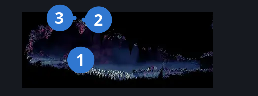
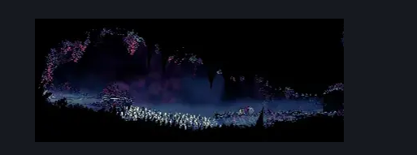

# Sands of Shakra (Coral_40)

**Game ID:** Coral_40

**Contributors:** Pyxl

## Subrooms

No subrooms defined.

## Room Transitions

| Alias | Name | From subroom | Destination | Destination alias | Requirements | TODO | Verification | Annotated | Notes |
| --- | --- | --- | --- | --- | --- | --- | --- | --- | --- |
| R | right1 |  | [Sands of Karak Tall Centre Room (Coral_35b)](sands-of-karak-tall-centre-room.md) | ULL | None |  | Verified | ✓ |  |

## Subroom Connections

No subroom connections defined.

## Check Locations

| No. | Check | Subroom | Requirements | TODO | Verification | Location Type | Annotated | Notes |
| --- | --- | --- | --- | --- | --- | --- | --- | --- |
| 1 | Map: Sands of Karak |  | None |  | Verified | collectible | ✓ |  |
| 2 | Shell Shard Cache: Sands of Karak #9 |  | Thread storm OR Rune rage OR Curveclaw OR faydown Cloak OR Cling grip Left OR Silk Soar OR Easy beast charge |  | Verified | resource | ✓ | Archi drops them checks down so they are obrainable no matter what |
| 3 | Shell Shard Cache: Sands of Karak #10 |  | Thread storm OR Rune rage OR Curveclaw OR faydown Cloak OR Cling grip Left OR Silk Soar OR Easy beast charge |  | Verified | resource | ✓ |  |

## Notes

Add subrooms to account for spike pogo when i get back here

## Room Images

### Connections

### Checks

### Scene

