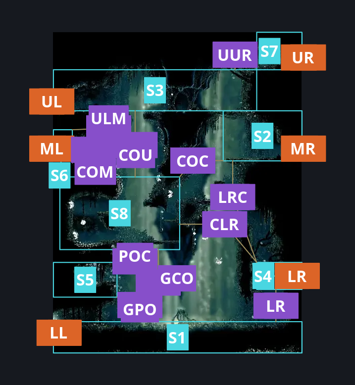
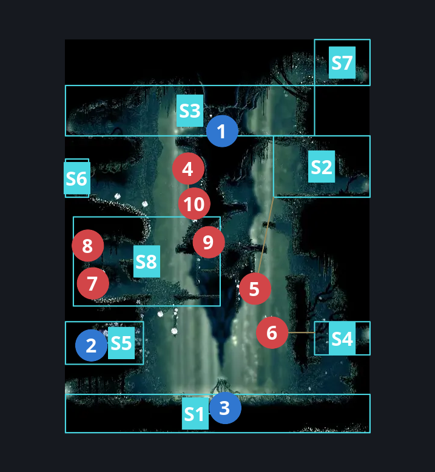
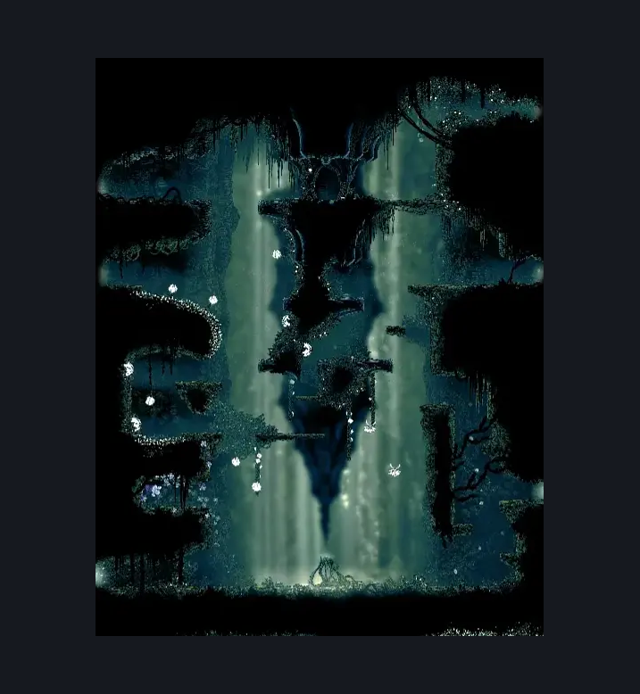

# Cling Grip Room (Shellwood_10)

**Game ID:** Shellwood_10

**Contributors:** Pyxl

## Subrooms

| No. | Subroom | Annotated |
| --- | --- | --- |
| S1 | Ground Level | ✓ |
| S2 | Central Level | ✓ |
| S3 | Upper Level | ✓ |
| S4 | Lower Right Transition | ✓ |
| S5 | Pollip Room | ✓ |
| S6 | Middle Left Transition | ✓ |
| S7 | Upper Right Transition | ✓ |
| S8 | Core | ✓ |

## Room Transitions

| Alias | Name | From subroom | Destination | Destination alias | Requirements | TODO | Verification | Annotated | Notes |
| --- | --- | --- | --- | --- | --- | --- | --- | --- | --- |
| UR | right1 | Upper Right Transition | [Shellwood Top Room (Shellwood_26)](shellwood-top-room.md) | L | None |  | Verified | ✓ |  |
| LR | right2 | Lower Right Transition | [Shellwood Flower Pogo Upper Hall (Shellwood_20)](shellwood-flower-pogo-upper-hall.md) | L | None |  | Verified | ✓ |  |
| ML | left2 | Middle Left Transition | [Cling Grip Side Room (Shellwood_11)](cling-grip-side-room.md) | LR | None |  | Verified | ✓ |  |
| UL | left1 | Upper Level | [Cling Grip Side Room (Shellwood_11)](cling-grip-side-room.md) | UR | None |  | Verified | ✓ |  |
| MR | right3 | Central Level | [Sister Splinter (Shellwood_18)](sister-splinter.md) | L | None |  | Verified | ✓ |  |
| LL | left3 | Ground Level | [Shellwood Lower Left Tall Room (Shellwood_03)](shellwood-lower-left-tall-room.md) | UR | None |  | Verified | ✓ |  |

## Subroom Connections

| Alias | Name | Source | Destination | Requirements | TODO | Verification | Annotated | Notes |
| --- | --- | --- | --- | --- | --- | --- | --- | --- |
| LR | G LR | Ground Level | Lower Right Transition | Ledge grab right OR cling grip Right OR Faydown Cloak OR Silk Soar OR scuttlebrace OR Easy beast charge OR ( Easy flea brew stall AND Easy beast pogo ) OR Medium voltvessels stall OR easy plasmium stall OR easy delvers drill stall OR easy shaman pogo OR ( Easy air bind stall AND Easy Beast pogo ) |  | Verified | ✓ |  |
| LR | G LR | Lower Right Transition | Ground Level | None |  | Verified | ✓ |  |
| GPO | G PO | Ground Level | Pollip Room | Silk Soar OR ( Faydown cloak AND ( Cling grip left OR Scuttlebrace ) ) |  | Verified | ✓ |  |
| GPO | G PO | Pollip Room | Ground Level | None |  | Verified | ✓ |  |
| GCO | G CO | Ground Level | Core | Silk Soar |  | Verified | ✓ |  |
| GCO | G CO | Core | Ground Level | None |  | Verified | ✓ |  |
| LRC | LR CL | Lower Right Transition | Central Level | ( Taunt AND medium pogo off  Phacia AND ( Ledge grab Right OR cling grip right ) ) OR ( Cling grip Left AND ( Proficient movement OR Cling grip Right OR Ledge grab Right OR easy shaman pogo OR Easy plasmium stall OR easy delvers drill stall OR medium voltvessels stall OR ( easy air bind stall AND Easy beast pogo ) ) ) OR Silk Soar OR ( Faydown Cloak AND ( Cling grip either OR Scuttlebrace OR Ledge grab Right ) ) |  | Verified | ✓ |  |
| LRC | LR CL | Central Level | Lower Right Transition | None |  | Verified | ✓ |  |
| CLR | LR CO | Lower Right Transition | Core | Cling grip left OR Silk Soar OR ( Faydown Cloak AND ( cling grip right OR Ledge grab Right OR Scuttlebrace ) ) OR ( Scuttlebrace AND Easy shaman pogo ) |  | Verified | ✓ |  |
| CLR | LR CO | Core | Lower Right Transition | ( Easy damage boost off gahlia OR Ledge grab Right OR Cling grip either OR Easy shaman pogo OR faydown cloak OR silk soar ) AND ( Clawline right OR Faydown cloak OR Silk Soar OR ( Dash right AND Drifters Cloak ) ) |  | Verified | ✓ |  |
| POC | PO CO | Pollip Room | Core | Cling grip either OR easy shaman pogo OR faydown Cloak OR ledge grab either OR Silk Soar OR medium plasmium stall |  | Verified | ✓ |  |
| POC | PO CO | Core | Pollip Room | None |  | Verified | ✓ |  |
| COC | CO CL | Core | Central Level | ( Easy damage boost off gahlia OR Ledge grab Right OR Cling grip either OR Easy shaman pogo OR faydown cloak OR silk soar ) AND ( Clawline right OR Faydown cloak OR Silk Soar OR ( Dash right AND Drifters Cloak ) ) AND ( ( Cling grip left AND Proficient movement ) OR ( Faydown cloak OR Silk Soar OR ledge grab both ) ) |  | Verified | ✓ |  |
| COC | CO CL | Central Level | Core | None |  | Verified | ✓ |  |
| COM | CO MT | Core | Middle Left Transition | Easy pogo off gahlia OR Faydown Cloak OR easy beast pogo OR Dash Left OR Clawline left OR Sharpdart OR silk Soar OR Drifters Cloak OR ( ( Easy plasmium stall x 2 OR Sprint left ) AND Easy hazard respawn ) OR Easy flea brew stall X 3 OR Easy plasmium stall x 4 |  | Verified | ✓ |  |
| COM | CO MT | Middle Left Transition | Core | None |  | Verified | ✓ |  |
| COU | CO UL | Core | Upper Level | Silk Soar OR ( Clawline Right AND Faydown Cloak AND ( Cling grip left OR Scuttlebrace ) ) OR ( Easy pogo off Phacia AND ( ( Cling grip left OR Scuttlebrace ) AND ( Faydown Cloak OR Easy reaper pogo OR easy shaman pogo ) ) ) |  | Verified | ✓ |  |
| COU | CO UL | Upper Level | Core | None |  | Verified | ✓ |  |
| ULM | UL MT | Upper Level | Middle Left Transition | None |  | Verified | ✓ |  |
| UUR | UL UR | Upper Level | Upper Right Transition | Silk Soar OR Cling grip right OR scuttlebrace |  | Verified | ✓ |  |
| UUR | UL UR | Upper Right Transition | Upper Level | None |  | Verified | ✓ |  |
| ULM | UL MT | Middle Left Transition | Upper Level | Clawline Right AND Faydown Cloak AND ( Cling grip left OR Scuttlebrace ) |  | Verified | ✓ |  |

## Check Locations

| No. | Check | Subroom | Requirements | TODO | Verification | Location Type | Annotated | Notes |
| --- | --- | --- | --- | --- | --- | --- | --- | --- |
| 1 | Cling Grip | Upper Level | None |  | Verified | collectible | ✓ |  |
| 2 | Pollip Heart Cling Grip Room | Pollip Room | None |  | Verified | collectible | ✓ |  |
| 3 | Shellwood - Weaver Harp Inscryption | Ground Level | Needolin |  | Verified | lore | ✓ |  |
| 4 | Phacia 1 | Core | None |  | Verified | enemy | ✓ |  |
| 5 | Phacia 2 | Central Level | None |  | Verified | enemy | ✓ |  |
| 6 | Phacia 3 | Lower Right Transition | None |  | Verified | enemy | ✓ |  |
| 7 | Gahlia 1 | Core | None |  | Verified | enemy | ✓ |  |
| 8 | Gahlia 2 | Core | None |  | Verified | enemy | ✓ |  |
| 9 | Gahlia 3 | Core | None |  | Verified | enemy | ✓ |  |
| 10 | Gahlia 4 | Core | None |  | Verified | enemy | ✓ |  |

## Notes

Updated 14/11 - Pyxl

## Room Images

### Connections

### Checks

### Scene

