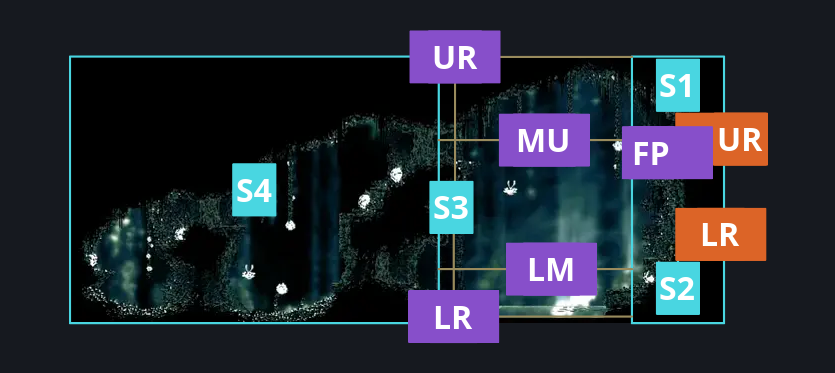
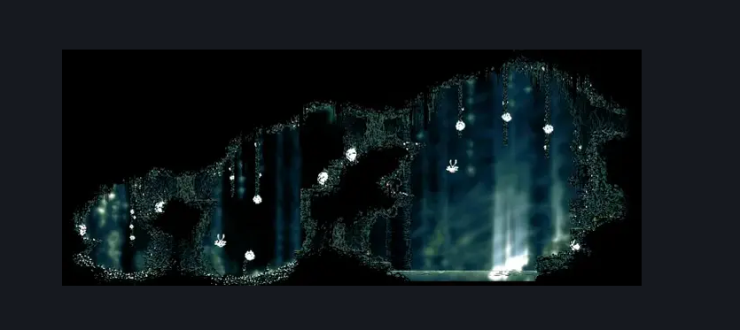

# Cling Grip Side Room (Shellwood_11)

**Game ID:** Shellwood_11

**Contributors:** Pyxl, Gallos

## Subrooms

| No. | Subroom | Annotated |
| --- | --- | --- |
| S1 | Upper Entrance | ✓ |
| S2 | Lower Entrance | ✓ |
| S3 | fucking rosary thing | ✓ |
| S4 | middle zone | ✓ |

## Room Transitions

| Alias | Name | From subroom | Destination | Destination alias | Requirements | TODO | Verification | Annotated | Notes |
| --- | --- | --- | --- | --- | --- | --- | --- | --- | --- |
| LR | right2 | Lower Entrance | [Cling Grip Room (Shellwood_10)](cling-grip-room.md) | ML | None |  | Verified | ✓ |  |
| UR | right1 | Upper Entrance | [Cling Grip Room (Shellwood_10)](cling-grip-room.md) | UL | None |  | Verified | ✓ |  |

## Subroom Connections

| Alias | Name | Source | Destination | Requirements | TODO | Verification | Annotated | Notes |
| --- | --- | --- | --- | --- | --- | --- | --- | --- |
| FP | Flower Pogos | Lower Entrance | Upper Entrance | silk soar  OR cling grip right OR easy scuttlebrace OR (easy [hunter,wanderer] Voltvessels Water Pogo x 2 AND faydown) |  | Verified | ✓ |  |
| FP | Flower Pogos | Upper Entrance | Lower Entrance | None |  | Verified | ✓ |  |
| LR | lower to rosaries | Lower Entrance | fucking rosary thing | (swim AND attack up) OR easy [rosary cannon,silkshot original,threefold pin, straight pin, throwing ring,curveclaw] use |  | Verified | ✓ | rosary snipe |
| UR | upper to rosaries | Upper Entrance | fucking rosary thing | easy [beast,hunter, shaman,architect] pogo OR dash left OR clawline left OR easy naked pogo OR ledge grab left OR faydown OR easy wanderer charge OR easy [flea brew,rune rage,thread storm,parry,pale nails,air heal,plasmium, voltvessels,flintslate] stall |  | Verified | ✓ | rosary snipe |
| LM | low <> middle | Lower Entrance | middle zone | (clawline left x 2 OR sharpdart x 2 OR swim OR (faydown AND (easy beast pogo OR drifters)) OR  (easy pogo off gahlia AND drifters AND easy shaman pogo) OR easy shaman scuttle slide) AND clear Shellwood - CG side room vine Wall |  | Verified | ✓ |  |
| MU | middle <> top | middle zone | Upper Entrance | ((clawline both x 3 OR (easy [wanderer,reaper] pogo AND easy air heal stall AND hard pogo off gahlia AND (clawline right OR sharp dart OR dash right)) OR dash both OR (medium hunter pogo AND medium air heal stall AND medium damage boost off gahlia)) AND complete Shellwood - Vine walls gone) OR ((faydown  OR easy shaman pogo) AND clear  Shellwood - CG side room vine Wall 3 ) |  | Verified | ✓ |  |

## Check Locations

| No. | Check | Subroom | Requirements | TODO | Verification | Location Type | Annotated | Notes |
| --- | --- | --- | --- | --- | --- | --- | --- | --- |
| 1 | Rosary Grave Marker | fucking rosary thing | None |  | Verified | collectible | ✓ |  |
| 2 | Shellwood - CG side room vine Wall | Lower Entrance | attack left |  | Verified | blockade | ✓ |  |
| 3 | Shellwood - CG side room vine Wall 2 | middle zone | attack either |  | Verified | blockade | ✓ |  |
| 4 | Shellwood - CG side room vine Wall 3 | middle zone | attack either |  | Verified | blockade | ✓ |  |
| 5 | Shellwood - Vine walls gone | Lower Entrance | clear Shellwood - CG side room vine Wall AND clear Shellwood - CG side room vine Wall 2 AND clear Shellwood - CG side room vine Wall 3 |  | Verified | logic-point |  |  |
| 6 | Phacia 1 | fucking rosary thing | None |  | Verified | enemy | ✓ | probably LR logic from lower + upper 23/11 |
| 7 | Phacia 2 | middle zone | None |  | Verified | enemy | ✓ | probably unique logic from lower 23/11 |
| 8 | Gahlia 1 | middle zone | None |  | Verified | enemy | ✓ |  |
| 9 | Gahlia 2 | middle zone | None |  | Verified | enemy | ✓ |  |
| 10 | Gahlia 3 | middle zone | None |  | Verified | enemy | ✓ |  |
| 11 | Gahlia 4 | middle zone | None |  | Verified | enemy | ✓ |  |
| 12 | Gahlia 5 | Lower Entrance | None |  | Verified | enemy | ✓ | free, no need to map all gahlias right now 23/11 |

## Notes

Will add more subrooms if someone proves the current logic isnt enough

## Room Images

### Connections

### Checks

### Scene

