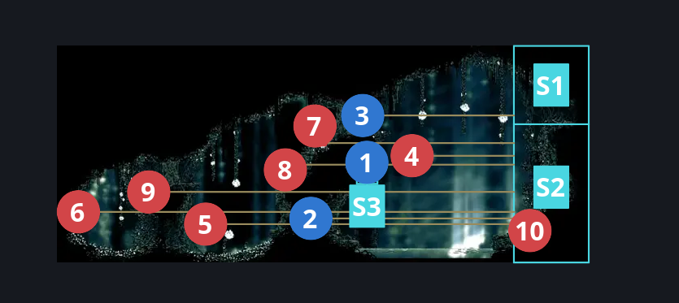

# Cling Grip Side Room (Shellwood_11)

**Game ID:** Shellwood_11

**Contributors:** Pyxl, Gallos

## Subrooms

| No. | Subroom | Annotated |
| --- | --- | --- |
| S1 | Upper Entrance | ✓ |
| S2 | Lower Entrance | ✓ |
| S3 | fucking rosary thing | ✓ |

## Room Transitions

| Alias | Name | From subroom | Destination | Destination alias | Requirements | TODO | Verification | Annotated | Notes |
| --- | --- | --- | --- | --- | --- | --- | --- | --- | --- |
| LR | right2 | Lower Entrance | [Cling Grip Room (Shellwood_10)](cling-grip-room.md) | ML | None |  | Verified | ✓ |  |
| UR | right1 | Upper Entrance | [Cling Grip Room (Shellwood_10)](cling-grip-room.md) | UL | None |  | Verified | ✓ |  |

## Subroom Connections

| Alias | Name | Source | Destination | Requirements | TODO | Verification | Annotated | Notes |
| --- | --- | --- | --- | --- | --- | --- | --- | --- |
| FP | Flower Pogos | Lower Entrance | Upper Entrance | silk soar  OR cling grip right OR easy scuttlebrace OR (swim AND (faydown OR dash both)) OR clawline both x 5 OR (faydown AND easy beast pogo) OR (easy pogo off gahlia AND drifters AND easy shaman pogo) OR (easy [hunter,wanderer] voltwater pogo AND faydown) |  | Verified | ✓ | old reqs ( Easy pogo off gahlia AND Swim ) OR Dash left OR Sprint Left OR SharpDart OR easy Beast Crest pogo OR Faydown Cloak OR Drifters Cloak OR Clawline left OR Scuttlebrace OR Cling Grip Right OR Silk Soar  Double checked looks good - Pyxl 21/11 |
| FP | Flower Pogos | Upper Entrance | Lower Entrance | None |  | Verified | ✓ |  |
| LR | lower to rosaries | Lower Entrance | fucking rosary thing | (swim AND attack up) OR easy [rosary cannon,silkshot original,threefold pin, straight pin, throwing ring,curveclaw] use |  | Verified | ✓ | rosary snipe |
| UR | upper to rosaries | Upper Entrance | fucking rosary thing | none |  | Verified | ✓ | rosary snipe |

## Check Locations

| No. | Check | Subroom | Requirements | TODO | Verification | Location Type | Annotated | Notes |
| --- | --- | --- | --- | --- | --- | --- | --- | --- |
| 1 | Rosary Grave Marker | fucking rosary thing | None |  | Verified | collectible | ✓ |  |
| 2 | Shellwood - CG side room vine Wall | Lower Entrance | attack left |  | Verified | blockade | ✓ |  |
| 3 | Shellwood - CG side room vine Wall 2 | Upper Entrance | attack either |  | Verified | blockade | ✓ |  |
| 4 | Phacia 1 | Lower Entrance | None |  | Verified | enemy | ✓ |  |
| 5 | Phacia 2 | Lower Entrance | None |  | Verified | enemy | ✓ |  |
| 6 | Gahlia 1 | Lower Entrance | None |  | Verified | enemy | ✓ |  |
| 7 | Gahlia 2 | Lower Entrance | None |  | Verified | enemy | ✓ |  |
| 8 | Gahlia 3 | Lower Entrance | None |  | Verified | enemy | ✓ |  |
| 9 | Gahlia 4 | Lower Entrance | None |  | Verified | enemy | ✓ |  |
| 10 | Gahlia 5 | Lower Entrance | None |  | Verified | enemy | ✓ |  |

## Notes

Will add more subrooms if someone proves the current logic isnt enough

## Room Images

### Connections

### Checks

### Scene

