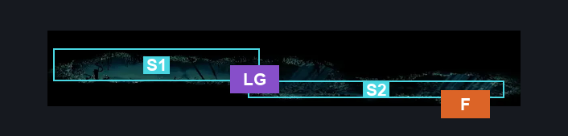
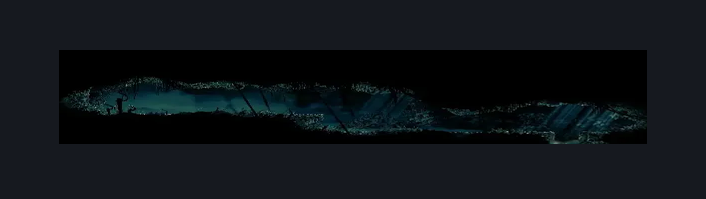

# Shellgrave (Shellgrave)

**Game ID:** Shellgrave

**Contributors:** Pyxl

## Subrooms

| No. | Subroom | Annotated |
| --- | --- | --- |
| S1 | Upper | ✓ |
| S2 | Lower | ✓ |

## Room Transitions

| Alias | Name | From subroom | Destination | Destination alias | Requirements | TODO | Verification | Annotated | Notes |
| --- | --- | --- | --- | --- | --- | --- | --- | --- | --- |
| F | bot1 | Lower | [Shellwood Left Side Long Pond Room (Shellwood_04b)](shellwood-left-side-long-pond-room.md) | RC | None |  | Verified | ✓ |  |

## Subroom Connections

| Alias | Name | Source | Destination | Requirements | TODO | Verification | Annotated | Notes |
| --- | --- | --- | --- | --- | --- | --- | --- | --- |
| LG | Damn Ledge Grab Rando | Lower | Upper | Ledge grab left OR cling grip left OR Scuttlebrace OR Faydown Cloak OR silk Soar OR Easy Beast Charge OR Easy shaman pogo OR Easy silkspear stall OR easy plasmium stall OR easy voltvessels stall OR easy delvers drill stall OR easy beast crest heal stall OR ( Easy pogo off rosary pilgrim AND ( Have tool: straight pin OR Have Tool: threefold pin OR Have Tool: Throwing Ring OR Have Tool: Conchcutter OR Have Tool: Cogwork Wheel ) ) |  | Verified | ✓ |  |
| LG | Damn Ledge Grab Rando | Upper | Lower | None |  | Verified | ✓ |  |

## Check Locations

| No. | Check | Subroom | Requirements | TODO | Verification | Location Type | Annotated | Notes |
| --- | --- | --- | --- | --- | --- | --- | --- | --- |
| 1 | Rosary Cross | Upper | None |  | Verified | resource | ✓ | Not included no id finally getting included? pycl - 8/11 |
| 2 | Save Plinney | Upper | ACT 3 |  | Verified | event | ✓ | Plinney comes here upon starting act 3 and starts an encounter |
| 3 | Pilgrim Bellbearer 1 | Upper | Prereq save plinney |  | Verified | enemy | ✓ |  |
| 4 | Pilgrim Guide 1 | Upper | Prereq save plinney |  | Verified | enemy | ✓ |  |
| 5 | Covetous Pilgrim 1 | Upper | Prereq save plinney |  | Verified | enemy | ✓ |  |
| 6 | Pilgrim Groveller 1 | Upper | Prereq save plinney |  | Verified | enemy | ✓ |  |
| 7 | Pilgrim Pouncer 1 | Upper | Prereq save plinney |  | Verified | enemy | ✓ |  |
| 8 | Pilgrim Pouncer 2 | Upper | Prereq save plinney |  | Verified | enemy | ✓ |  |
| 9 | Pilgrim Bellbearer 2 | Upper | Prereq save plinney |  | Verified | enemy | ✓ |  |
| 10 | Pilgrim Hulk 1 | Upper | Prereq save plinney |  | Verified | enemy | ✓ |  |
| 11 | Pilgrim Groveller 2 | Upper | Prereq save plinney |  | Verified | enemy | ✓ |  |
| 12 | Pilgrim Hulk 2 | Upper | Prereq save plinney |  | Verified | enemy | ✓ |  |
| 13 | Pilgrim Guide 2 | Upper | Prereq save plinney |  | Verified | enemy | ✓ |  |
| 14 | Pilgrim Hulk 3 | Upper | Prereq save plinney |  | Verified | enemy | ✓ |  |
| 15 | Rosary Pilgrim 1 | Upper | None |  | Verified | enemy | ✓ |  |

## Room Images

### Connections

### Checks

### Scene

