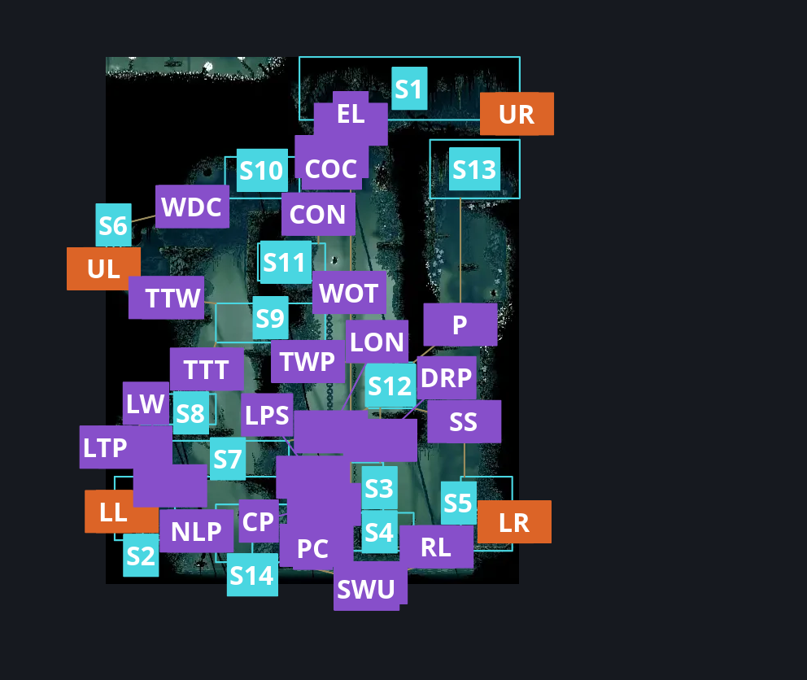
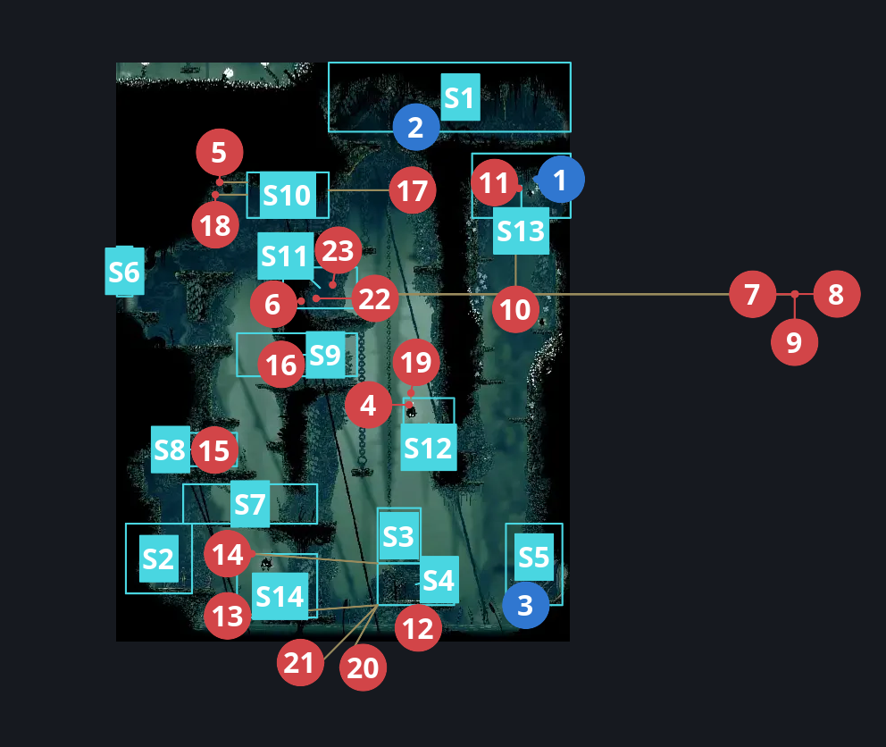
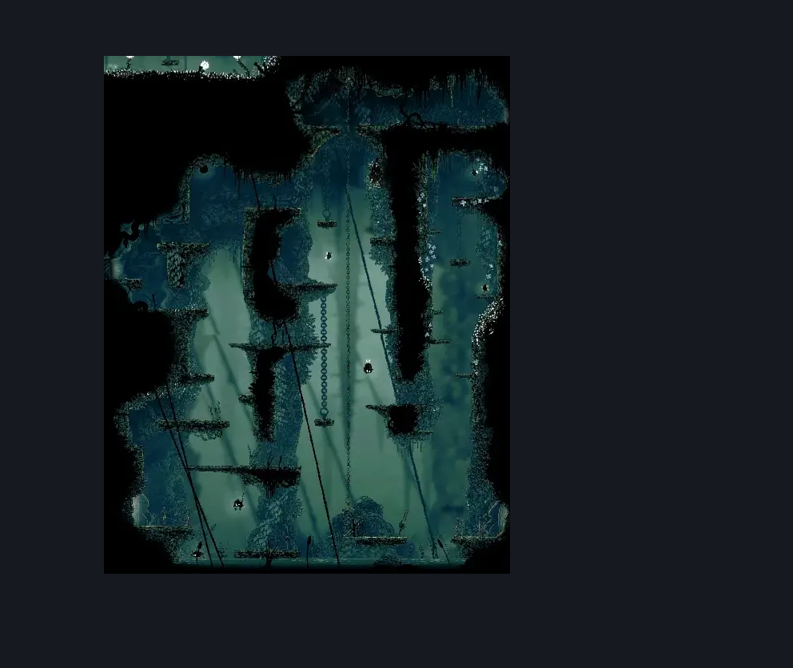

# Shellwood Big Room Left (Shellwood_02)

**Game ID:** Shellwood_02

**Contributors:** Pyxl

## Subrooms

| No. | Subroom | Annotated |
| --- | --- | --- |
| S1 | Ceiling area | ✓ |
| S2 | Ground Left | ✓ |
| S3 | Platform | ✓ |
| S4 | Ground Centre | ✓ |
| S5 | Ground Right | ✓ |
| S6 | Witch Door | ✓ |
| S7 | Lower Left Long Platform | ✓ |
| S8 | Twig Platform | ✓ |
| S9 | Other Twig Platform | ✓ |
| S10 | Yop Left flying cocoon goomba | ✓ |
| S11 | Wood Wasp Nest | ✓ |
| S12 | Below Pollip | ✓ |
| S13 | Pollip | ✓ |
| S14 | Ground other old centre | ✓ |

## Room Transitions

| Alias | Name | From subroom | Destination | Destination alias | Requirements | TODO | Verification | Annotated | Notes |
| --- | --- | --- | --- | --- | --- | --- | --- | --- | --- |
| UR | right1 | Ceiling area | [Shellwood Sister Splinter Bench (Shellwood_01b)](shellwood-sister-splinter-bench.md) | LL | None |  | Verified | ✓ |  |
| LL | left2 | Ground Left | [shellwood Shakra (Shellwood_16)](shellwood-shakra.md) | R | None |  | Verified | ✓ |  |
| UL | left3 | Witch Door | [Shellwood Greyroot Entrance (Shellwood_Witch)](shellwood-greyroot-entrance.md) | R | None |  | Verified | ✓ |  |
| LR | right2 | Ground Right | [Shellwood Right Side Big room (Shellwood_01)](shellwood-right-side-big-room.md) | LL | NOne |  | Verified | ✓ |  |

## Subroom Connections

| Alias | Name | Source | Destination | Requirements | TODO | Verification | Annotated | Notes |
| --- | --- | --- | --- | --- | --- | --- | --- | --- |
| EL | Elevator | Ground Centre | Ceiling area | Prereq Elevator Button |  | Verified | ✓ |  |
| EL | Elevator | Ceiling area | Ground Centre | Prereq Elevator Button |  | Verified | ✓ |  |
| RL | Right Lake | Ground Centre | Ground Right | Sprint Right OR Dash Right OR Drifters Cloak OR Faydown Cloak OR Cling grip left OR silk soar OR sharpdart OR Easy hunter pogo OR easy wanderer charge OR easy reaper pogo OR easy beast pogo OR easy architect pogo OR easy witch charge OR Easy thread storm stall OR easy pale nails stall OR easy cross stitch stall OR easy rune rage stall OR Easy plasmium stall OR easy voltvessels stall OR easy flintslate stall OR medium delvers drill stall OR flea brew jump OR easy pogo off pond skipper |  | Verified | ✓ |  |
| RL | Right Lake | Ground Right | Ground Centre | Sprint Left OR Dash Left OR Drifters Cloak OR Faydown Cloak OR Cling grip Right OR silk soar OR sharpdart OR Easy hunter pogo OR easy wanderer charge OR easy reaper pogo OR easy beast pogo OR easy architect pogo OR easy witch charge OR Easy thread storm stall OR easy pale nails stall OR easy cross stitch stall OR easy rune rage stall OR Easy plasmium stall OR easy voltvessels stall OR easy flintslate stall OR medium delvers drill stall OR flea brew jump OR easy pogo off pond skipper |  | Verified | ✓ |  |
| CP | Central Platforms | Platform | Ground Centre | None |  | Verified | ✓ |  |
| CP | Central Platforms | Ground Centre | Platform | Silk Soar OR ( Faydown Cloak AND ( Cling grip either OR Ledge grab either ) ) OR ( Prereq elevator button AND ( Cling grip left OR ledge grab left OR Easy plasmium stall OR easy heal stall OR easy shaman pogo OR Easy delvers drill stall OR easy voltvessels stall OR easy flea brew stall OR faydown cloak OR Easy beast pogo OR easy thread storm stall OR easy silkspear stall OR easy cross stitch stall ) ) |  | Verified | ✓ |  |
| LW | Left Wall | Ground Left | Lower Left Long Platform | Silk Soar OR ( ( Faydown cloak OR medium pogo off pondcatcher ) AND ( Cling grip left OR Scuttlebrace ) ) OR ( medium shaman pogo AND medium pogo off pondcatcher ) |  | Verified | ✓ |  |
| LW | Left Wall | Lower Left Long Platform | Ground Left | None |  | Verified | ✓ |  |
| LPS | Lower Platforms | Platform | Lower Left Long Platform | Sprint left OR dash left OR  Drifters cloak OR Faydown Cloak OR Clawline left OR Sharpdart OR Easy beast pogo OR Easy flea brew stall x 3 OR ( Cling grip Right AND Medium voltvessels stall x 2 ) OR medium plasmium stall x 4 OR ( cling grip left AND ( Easy plasmium stall x 3 OR Easy flintslate stall x 3 ) ) |  | Verified | ✓ |  |
| LPS | Lower Platforms | Lower Left Long Platform | Platform | Sprint Right OR Dash Right OR Drifters Cloak OR Faydown CLoak OR Clawline Right OR Sharpdart OR Easy hunter pogo OR medium wanderer charge OR Easy beast pogo OR easy architect pogo OR Easy witch charge OR easy voltvessels stall x 2 OR Easy flintslate stall x 2 OR Flea brew jump OR Easy plasmium stall x 2 OR easy thread storm stall x 2 OR Easy cross stitch stall x 2 OR Medium pale nails stall x 3 |  | Verified | ✓ |  |
| LTP | Lower Twig Platform | Lower Left Long Platform | Twig Platform | Cling grip either OR ledge grab left OR sprint left OR dash left OR drifters cloak OR Faydown cloak OR Silk SOar OR Clawline left OR scuttlebrace OR easy hunter pogo OR Easy reaper charge OR Easy beast pogo OR architect attack left OR Easy Architect pogo OR Easy shaman pogo OR Easy pale nails stall OR easy air bind stall OR Easy rune rage stall OR easy pale nails stall OR easy cross stitch stall OR easy delvers drill stall OR easy voltvessels stall OR easy flintslate stall OR flea brew jump OR easy plasmium stall |  | Verified | ✓ |  |
| LTP | Lower Twig Platform | Twig Platform | Lower Left Long Platform | None |  | Verified | ✓ |  |
| TTT | Twig To Twig | Twig Platform | Other Twig Platform | Ledge grab Right OR cling grip Left OR Silk Soar OR  faydown cloak OR easy plasmium stall OR easy delvers drill stall OR easy voltvessels stall OR Easy shaman pogo OR ( easy beast pogo AND Easy air bind stall ) |  | Verified | ✓ | potentially possible with silk spear stall but couldnt get the turnaround to prove it |
| TTT | Twig To Twig | Other Twig Platform | Twig Platform | None |  | Verified | ✓ |  |
| TTW | Twig To Witch | Other Twig Platform | Witch Door | ledge grab left OR cling grip left OR faydown cloak OR SIlk Soar |  | Verified | ✓ |  |
| TTW | Twig To Witch | Witch Door | Other Twig Platform | None |  | Verified | ✓ |  |
| WDC | Witch to Cocoon | Witch Door | Yop Left flying cocoon goomba | cling grip Right OR Faydown CLoak OR Silk Soar |  | Verified | ✓ |  |
| WDC | Witch to Cocoon | Yop Left flying cocoon goomba | Witch Door | None |  | Verified | ✓ |  |
| CON | Cocoon To Nest | Yop Left flying cocoon goomba | Wood Wasp Nest | None |  | Verified | ✓ |  |
| CON | Cocoon To Nest | Wood Wasp Nest | Yop Left flying cocoon goomba | Easy pogo off wood wasp OR cling grip left OR ( Cling grip right AND proficient movement ) OR Faydown Cloak OR silk Soar |  | Verified | ✓ |  |
| COC | Cocoon into ceiling | Yop Left flying cocoon goomba | Ceiling area | prereq elevator button AND Silk Soar |  | Verified | ✓ |  |
| COC | Cocoon into ceiling | Ceiling area | Yop Left flying cocoon goomba | prereq elevator button |  | Verified | ✓ |  |
| WOT | Wasp nest to Twig | Wood Wasp Nest | Other Twig Platform | None |  | Verified | ✓ |  |
| WOT | Wasp nest to Twig | Other Twig Platform | Wood Wasp Nest | ( ( Ledge grab right OR Dash right OR Sprint Right OR clawline Right OR drifters Cloak OR sharpdart OR easy beast pogo OR Easy shaman pogo OR easy air bind stall OR easy plasmium stall OR easy voltvessels stall OR flea brew jump OR easy flintslate stall x 2 OR easy cross stitch stall OR easy rune rage stall OR easy thread storm stall OR easy pale nails stall OR easy hunter pogo OR easy naked pogo OR hard wanderer charge OR easy reaper charge OR Easy architect pogo ) AND Cling grip right ) OR Faydown Cloak OR silk Soar OR easy pogo off shellwood gnat |  | Verified | ✓ |  |
| TWP | Twig drop | Other Twig Platform | Below Pollip | None |  | Verified | ✓ |  |
| TWP | Twig drop | Below Pollip | Other Twig Platform | Silk Soar OR ( ( cling grip Right OR Scuttlebrace ) AND ( Clawline left OR Sharpdart OR faydown Cloak ) ) |  | Verified | ✓ |  |
| LON | Other Route To Pollip | Lower Left Long Platform | Below Pollip | Cling grip left OR Scuttlebrace OR silk soar OR faydown Cloak |  | Verified | ✓ |  |
| LON | Other Route To Pollip | Below Pollip | Lower Left Long Platform | None |  | Verified | ✓ |  |
| P | Pollip | Below Pollip | Pollip | ( easy pogo off shellwood gnat AND easy pogo off wood wasp ) OR ( ( Ledge grab right OR easy shaman pogo ) AND ( ledge grab left OR ( cling grip both AND easy hazard respawn ) ) ) OR ( CBT Shaman pogo AND Elite ball Knowledge ) OR Faydown Cloak OR silk soar |  | Verified | ✓ |  |
| P | Pollip | Pollip | Below Pollip | None |  | Verified | ✓ |  |
| SS | Silk Soar | Ground Right | Below Pollip | Silk Soar |  | Verified | ✓ |  |
| SS | Silk Soar | Below Pollip | Ground Right | None |  | Verified | ✓ |  |
| DRP | Drop pollip | Below Pollip | Platform | None |  | Verified | ✓ |  |
| DRP | Drop pollip | Platform | Below Pollip | Silk soar OR ( Clawline right AND Faydown Cloak ) |  | Verified | ✓ |  |
| NLP | New Left Pond | Ground Left | Ground other old centre | None |  | Verified | ✓ |  |
| NLP | New Left Pond | Ground other old centre | Ground Left | Sprint left OR Dash Left OR  Drifters Cloak OR Faydown Cloak OR Clawline left OR sharpdart OR Cling grip both OR easy wanderer charge OR Easy architect charge OR Easy beast pogo  OR Easy plasmium stall x 2 OR Flea brew jump OR Easy voltvessels stall OR ( ( Cling grip left OR ledge grab left OR Silk Soar ) AND ( Easy rune rage stall OR Easy thread storm stall OR easy pale nails stall OR easy cross stitch stall OR Easy bind stall OR  Easy flintslate stall x 2 ) ) OR ( Easy pogo off pond skipper AND ( Easy shaman pogo OR Cling grip left OR ledge grab left ) ) OR easy [hunter,wanderer] voltwater pogo x 1 |  | Verified | ✓ | Voltvessel water pogo crusade was here 17/11 |
| PC | Pond Centre | Ground other old centre | Ground Centre | Sprint Right OR Dash Right OR Drifters Cloak OR Faydown Cloak OR Clawline Right OR Sharpdart OR Easy voltvessels stall x 2 OR Easy flea brew stall OR Easy plasmium stall x 3 OR Easy beast pogo OR medium Cross stitch stall x 5 OR Hard pale nails stall x 7 OR ( hard thread storm stall x 2 AND Hard rune rage stall x 2 ) OR ( Swim AND ( Easy shaman pogo OR Cling grip either OR ledge Grab either ) ) OR easy pogo off pond skipper OR easy [hunter,wanderer] voltwater pogo x 1 |  | Verified | ✓ |  |
| PC | Pond Centre | Ground Centre | Ground other old centre | Swim OR Sprint left OR dash Left OR Drifters Cloak OR Faydown Cloak OR Clawline left OR easy pogo off pond skipper OR Silk Soar OR Easy hunter pogo OR easy wanderer charge OR ( Easy reaper charge AND easy reaper pogo ) OR Easy beast pogo OR easy Architect pogo OR Easy Witch charge OR easy rune rage stall OR easy thread storm stall OR easy pale nails stall x 2 OR Easy cross stitch stall x 2 OR sharpdart OR easy flintslate stall x 2 OR Easy heal stall OR Easy voltvessels stall OR Flea brew jump OR Easy plasmium stall |  | Verified | ✓ |  |
| SWU | Swim Under | Ground Right | Ground other old centre | Swim |  | Verified | ✓ |  |
| SWU | Swim Under | Ground other old centre | Ground Right | Swim AND ( Easy pogo off pond skipper OR Faydown Cloak OR Easy shaman pogo OR Cling grip right OR ledge grab right ) |  | Verified | ✓ |  |

## Check Locations

| No. | Check | Subroom | Requirements | TODO | Verification | Location Type | Annotated | Notes |
| --- | --- | --- | --- | --- | --- | --- | --- | --- |
| 1 | Pollip Heart Left Big Room | Pollip | None |  | Verified | collectible | ✓ |  |
| 2 | Elevator Button | Ceiling area | None |  | Verified | switch | ✓ |  |
| 3 | Big Door Button | Ground Right | None |  | Verified | switch | ✓ |  |
| 4 | Shellwood Goomba Flyer (3) 1 | Below Pollip | None |  | Verified | enemy | ✓ |  |
| 5 | Shellwood Goomba Flyer 1 | Yop Left flying cocoon goomba | None |  | Verified | enemy | ✓ |  |
| 6 | Control 1 | Wood Wasp Nest | None |  | Verified | enemy | ✓ | The nest counts as an enemy? |
| 7 | Wood Wasp 1 | Wood Wasp Nest | None |  | Verified | enemy | ✓ |  |
| 8 | Wood Wasp 2 | Wood Wasp Nest | None |  | Verified | enemy | ✓ |  |
| 9 | Wood Wasp 3 | Wood Wasp Nest | None |  | Verified | enemy | ✓ |  |
| 10 | Wood Wasp 4 | Pollip | None |  | Verified | enemy | ✓ |  |
| 11 | Wood Wasp 5 | Pollip | None |  | Verified | enemy | ✓ |  |
| 12 | Pond Skipper 1 | Ground Centre | None |  | Verified | enemy | ✓ |  |
| 13 | Pond Skipper 2 | Ground Centre | None |  | Verified | enemy | ✓ |  |
| 14 | Pondcatcher 1 | Ground Centre | None |  | Verified | enemy | ✓ |  |
| 15 | Splinter 1 | Twig Platform | None |  | Verified | enemy | ✓ |  |
| 16 | Splinterhorn 1 | Other Twig Platform | None |  | Verified | enemy | ✓ |  |
| 17 | Void Mass 1 | Yop Left flying cocoon goomba | Black Thread World Spawn |  | Verified | enemy | ✓ |  |
| 18 | Shellwood Gnat 1 | Yop Left flying cocoon goomba | None |  | Verified | enemy | ✓ |  |
| 19 | Shellwood Gnat 2 | Below Pollip | None |  | Verified | enemy | ✓ |  |
| 20 | Shellwood Gnat 3 | Ground Centre | None |  | Verified | enemy | ✓ | Dunno where these 2 are |
| 21 | Shellwood Gnat 4 | Ground Centre | None |  | Verified | enemy | ✓ | Dunno where these 2 are |
| 22 | Wood Wasp 6 | Wood Wasp Nest | None |  | Verified | enemy | ✓ |  |
| 23 | Wood Wasp 7 | Wood Wasp Nest | None |  | Verified | enemy | ✓ |  |

## Notes

Add more subrooms and checks,
the hanging shellshard things need to be added and gotta split platforms up and fix logic so faydown or the elevator isnt required

## Room Images

### Connections

### Checks

### Scene

