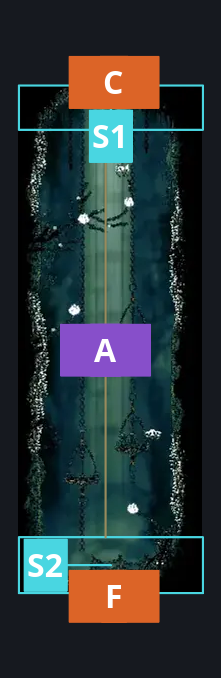
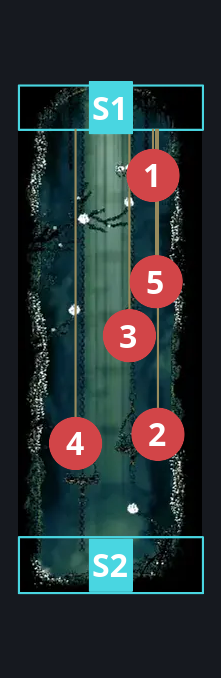
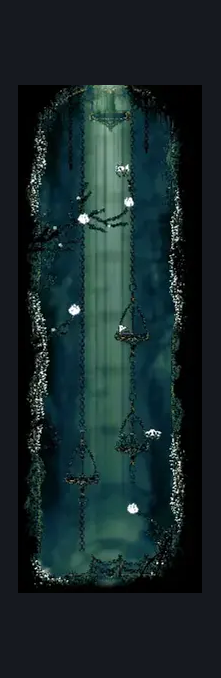

# shellwood Far Left Tall Room (Shellwood_04c)

**Game ID:** Shellwood_04c

**Contributors:** Pyxl

## Subrooms

| No. | Subroom | Annotated |
| --- | --- | --- |
| S1 | Top | ✓ |
| S2 | Bottom | ✓ |

## Room Transitions

| Alias | Name | From subroom | Destination | Destination alias | Requirements | TODO | Verification | Annotated | Notes |
| --- | --- | --- | --- | --- | --- | --- | --- | --- | --- |
| C | top1 | Top | [Shellwood Connection To Blasted steps (Shellwood_08)](shellwood-connection-to-blasted-steps.md) | F | None |  | Verified | ✓ |  |
| F | bot1 | Bottom | [Shellwood Left Side Long Pond Room (Shellwood_04b)](shellwood-left-side-long-pond-room.md) | LC | None |  | Verified | ✓ |  |

## Subroom Connections

| Alias | Name | Source | Destination | Requirements | TODO | Verification | Annotated | Notes |
| --- | --- | --- | --- | --- | --- | --- | --- | --- |
| A | 04c | Bottom | Top | ( ( ACT 1 OR ACT 2 ) AND ( ( easy shaman pogo AND faydown AND ( medium pogo off winged pilgrim bellbearer OR ( ( drifters OR easy air bind stall OR easy cross stitch stall OR easy pale nails stall OR easy rune rage stall OR easy silkspear stall OR easy flintslate stall OR easy plasmium stall OR easy voltvessels stall OR easy flea brew stall ) AND medium pogo off winged pilgrim ) ) ) OR ( Faydown Cloak AND Hard pogo off winged pilgrim bellbearer AND hard pogo off winged pilgrim ) OR cling grip both OR silk soar OR ( ( Medium Scuttlebrace AND Easy Hazard Respawn AND ( Faydown Cloak OR Cling grip Right ) ) ) ) ) OR ( ACT 3 AND ( Silk Soar OR ( Cling grip both AND Faydown Cloak ) OR ( Cling grip Both AND Clawline both AND ( Proficient Movement OR ( Sharpdart OR Drifters Cloak OR Dash Right OR Easy flintslate stall OR easy Flea brew Stall OR easy plasmium stall OR easy air bind stall OR easy cross stitch stall OR easy pale nails stall OR easy thread storm stall OR easy rune rage stall ) ) ) OR ( Hard pogo off winged pilgrim AND hard pogo off winged pilgrim bellbearer ) ) ) |  | Verified | ✓ |  |
| A | 04c | Top | Bottom | None |  | Verified | ✓ |  |

## Check Locations

| No. | Check | Subroom | Requirements | TODO | Verification | Location Type | Annotated | Notes |
| --- | --- | --- | --- | --- | --- | --- | --- | --- |
| 1 | Winged Pilgrim Bellbearer 1 | Top | None |  | Verified | enemy | ✓ |  |
| 2 | Winged Pilgrim Bellbearer 2 | Top | Normal World Spawn |  | Verified | enemy | ✓ |  |
| 3 | Winged Pilgrim 1 | Top | Normal World Spawn |  | Verified | enemy | ✓ |  |
| 4 | Winged Pilgrim Bellbearer 3 | Top | Black Thread World Spawn |  | Verified | enemy | ✓ |  |
| 5 | Winged Pilgrim 2 | Top | Black Thread World Spawn |  | Verified | enemy | ✓ |  |

## Notes

Updated 14/11 - Pyxl

## Room Images

### Connections

### Checks

### Scene

