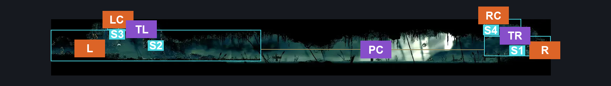
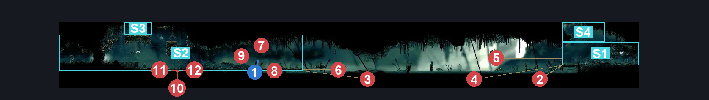
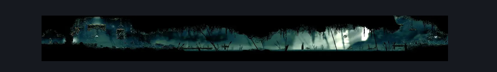

# Shellwood Left Side Long Pond Room (Shellwood_04b)

**Game ID:** Shellwood_04b

**Contributors:** Pyxl

## Subrooms

| No. | Subroom | Annotated |
| --- | --- | --- |
| S1 | Right Lake | ✓ |
| S2 | Left Lake | ✓ |
| S3 | Top Left | ✓ |
| S4 | Shellgrave Plaform | ✓ |

## Room Transitions

| Alias | Name | From subroom | Destination | Destination alias | Requirements | TODO | Verification | Annotated | Notes |
| --- | --- | --- | --- | --- | --- | --- | --- | --- | --- |
| R | right1 | Right Lake | [Shellwood Lower Left Tall Room (Shellwood_03)](shellwood-lower-left-tall-room.md) | LL | None |  | Verified | ✓ |  |
| RC | top2 | Shellgrave Plaform | [Shellgrave (Shellgrave)](shellgrave.md) | F | None |  | Verified | ✓ |  |
| L | left1 | Left Lake | [Shellwood Lower Toll bench (Shellwood_08c)](shellwood-lower-toll-bench.md) | R | Break Vines Left |  | Verified | ✓ |  |
| LC | top1 | Top Left | [shellwood Far Left Tall Room (Shellwood_04c)](shellwood-far-left-tall-room.md) | F | None |  | Verified | ✓ |  |

## Subroom Connections

| Alias | Name | Source | Destination | Requirements | TODO | Verification | Annotated | Notes |
| --- | --- | --- | --- | --- | --- | --- | --- | --- |
| PC | Pond Crossing | Left Lake | Right Lake | ((Act 1 OR Act 2 ) AND ( Swim OR Clawline Right OR ( Sprint Right AND Drifters Cloak ) OR ( Faydown Cloak AND easy pogo off pond skipper) OR ( Drifters Cloak AND easy Pogo off pond skipper ) OR ( Faydown Cloak AND Hard pogo off pondcatcher ) ) )OR ( ACT 3 AND ( ( Swim AND ( Ledge grab Right OR Cling grip Right OR Faydown Cloak OR Easy flea brew stall OR easy plasmium stall OR easy delvers drill stall OR easy voltvessels stall OR Clawline Right OR Easy heal stall OR easy rune rage stall OR easy thread storm stall OR easy cross stitch stall OR sharpdart OR Easy silkspear stall OR easy shaman pogo OR Easy beast pogo OR Medium hunter pogo (You literally just clip up the ledge when pogoing????) OR medium reaper pogo OR medium pogo off pond skipper OR medium pogo off pondcatcher OR medium naked pogo ) ) OR ( Faydown Cloak AND Drifters Cloak AND Clawline Right AND Medium pogo off pond skipper ) ) ) |  | Verified | ✓ |  |
| PC | Pond Crossing | Right Lake | Left Lake | ( ( ACT 1 OR ACT 2 ) AND ( Swim OR Clawline left OR ( Sprint left AND ( Drifters Cloak OR ( Dash left AND medium shaman pogo ) ) ) OR ( Faydown Cloak AND easy Pogo off pond skipper ) OR ( Drifters Cloak AND easy Pogo off pond skipper ) ) ) OR ( ACT 3 AND ( Swim OR ( Faydown Cloak AND Drifters Cloak AND Clawline Left AND Medium pogo off pond skipper ) ) ) |  | Verified | ✓ |  |
| TL | Top Left | Top Left | Left Lake | None |  | Verified | ✓ |  |
| TL | Top Left | Left Lake | Top Left | Cling grip either OR Scuttlebrace OR Faydown CLoak OR Medium pogo off pondcatcher OR Silk Soar |  | Verified | ✓ |  |
| TR | Top Right | Shellgrave Plaform | Right Lake | None |  | Verified | ✓ |  |
| TR | Top Right | Right Lake | Shellgrave Plaform | Ledge grab either OR Cling grip either OR Faydown Cloak OR Medium pogo off pondcatcher |  | Verified | ✓ |  |

## Check Locations

| No. | Check | Subroom | Requirements | TODO | Verification | Location Type | Annotated | Notes |
| --- | --- | --- | --- | --- | --- | --- | --- | --- |
| 1 | Garmond and Zaza Act 3 Meeting Shellwood | Left Lake | Act 3 |  | Verified | event | ✓ |  |
| 2 | Pond Skipper 1 | Right Lake | None |  | Verified | enemy | ✓ |  |
| 3 | Pond Skipper 2 | Left Lake | None |  | Verified | enemy | ✓ |  |
| 4 | Pond Skipper 3 | Right Lake | None |  | Verified | enemy | ✓ |  |
| 5 | Pondcatcher 1 | Right Lake | None |  | Verified | enemy | ✓ |  |
| 6 | Pondcatcher 2 | Left Lake | Normal World Spawn |  | Verified | enemy | ✓ |  |
| 7 | Void Mass 1 | Left Lake | Black Thread World Spawn |  | Verified | enemy | ✓ |  |
| 8 | Pilgrim Hornfly 1 | Left Lake | Black Thread World Spawn |  | Verified | enemy | ✓ |  |
| 9 | Pondcatcher 3 | Left Lake | Black Thread World Spawn |  | Verified | enemy | ✓ |  |
| 10 | Shellwood Gnat 1 | Left Lake | None |  | Verified | enemy | ✓ |  |
| 11 | Shellwood Gnat 2 | Left Lake | None |  | Verified | enemy | ✓ |  |
| 12 | Shellwood Gnat 3 | Left Lake | None |  | Verified | enemy | ✓ |  |

## Room Images

### Connections

### Checks

### Scene

