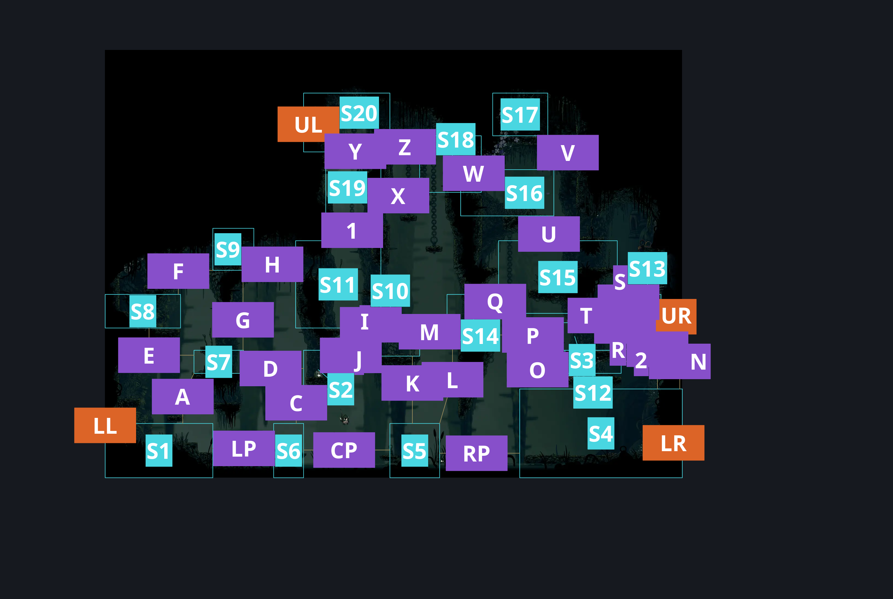
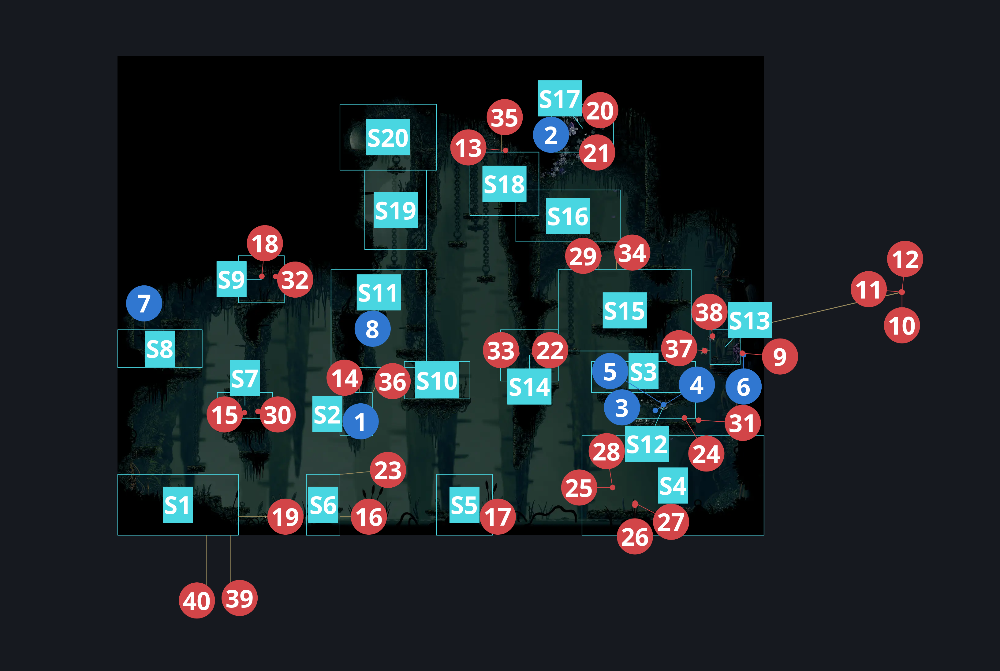
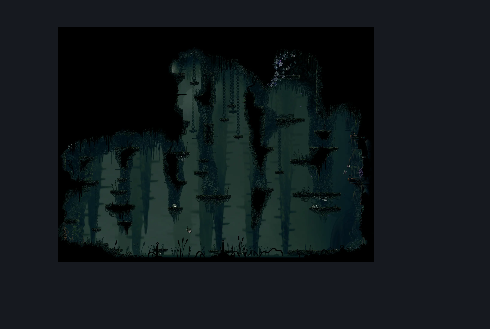

# Shellwood Right Side Big room (Shellwood_01)

**Game ID:** Shellwood_01

**Contributors:** Pyxl

## Subrooms

| No. | Subroom | Annotated |
| --- | --- | --- |
| S1 | Ground Level Left | ✓ |
| S2 | Central Platforms | ✓ |
| S3 | Right Platforms | ✓ |
| S4 | Ground Level Right | ✓ |
| S5 | Right pond platform | ✓ |
| S6 | Left Pond Platform | ✓ |
| S7 | Goomba Platform | ✓ |
| S8 | Left Hanging shards | ✓ |
| S9 | Top Goomba Platform | ✓ |
| S10 | Platform to the right of central platforms | ✓ |
| S11 | The hanging shard platforms above Platform to the right of central platforms | ✓ |
| S12 | Shell Platform | ✓ |
| S13 | Nested Door | ✓ |
| S14 | Central flying goomba platform | ✓ |
| S15 | Below Below Pollip | ✓ |
| S16 | Below Pollip | ✓ |
| S17 | Pollip | ✓ |
| S18 | next to below pollip | ✓ |
| S19 | Below Top Exit | ✓ |
| S20 | Top Exit | ✓ |

## Room Transitions

| Alias | Name | From subroom | Destination | Destination alias | Requirements | TODO | Verification | Annotated | Notes |
| --- | --- | --- | --- | --- | --- | --- | --- | --- | --- |
| UR | right1 | Nested Door | [Long Pin (Belltown_Room_shellwood)](long-pin.md) | L | Prereq Longpin Nest |  | Verified | ✓ |  |
| UL | left1 | Top Exit | [Shellwood Sister Splinter Bench (Shellwood_01b)](shellwood-sister-splinter-bench.md) | LR | None |  | Verified | ✓ |  |
| LR | right2 | Ground Level Right | [Bellhart Hallway to Shellwood (Belltown_07)](../bellhart/bellhart-hallway-to-shellwood.md) | L | None |  | Verified | ✓ |  |
| LL | left2 | Ground Level Left | [Shellwood Big Room Left (Shellwood_02)](shellwood-big-room-left.md) | LR | Prereq Big Door Button IN Shellwood Big Room Left |  | Verified | ✓ |  |

## Subroom Connections

| Alias | Name | Source | Destination | Requirements | TODO | Verification | Annotated | Notes |
| --- | --- | --- | --- | --- | --- | --- | --- | --- |
| LP | Left Pond | Ground Level Left | Left Pond Platform | Swim OR Sprint Right OR Dash RIght OR Faydown Cloak OR Drifters Cloak OR Clawline RIght OR sharpdart  OR Easy beast pogo OR ( Flea brew jump AND Easy flea brew stall x 1 ) OR Easy voltvessels stall OR Easy plasmium stall x 2 OR Easy flintslate stall x 6 OR ( medium rune rage stall x 2 AND medium thread storm stall x 2 ) OR easy cross stitch stall x 4 OR hard pale nails stall x 5 OR easy pogo off pond skipper OR easy pogo off pondcatcher |  | Verified | ✓ |  |
| LP | Left Pond | Left Pond Platform | Ground Level Left | Swim OR Sprint Left OR Dash Left OR Faydown Cloak OR Drifters Cloak OR Clawline Left OR sharpdart  OR Easy beast pogo OR ( Flea brew jump AND Easy flea brew stall x 1 ) OR Easy voltvessels stall OR Easy plasmium stall x 2 OR Easy flintslate stall x 6 OR ( medium rune rage stall x 2 AND medium thread storm stall x 2 ) OR easy cross stitch stall x 4 OR hard pale nails stall x 5 OR easy pogo off pond skipper OR easy pogo off pondcatcher |  | Verified | ✓ |  |
| CP | Central Pond | Left Pond Platform | Right pond platform | Swim OR Drifters Cloak OR Sharpdart OR clawline RIght OR ( ( Dash right OR Sprint Right OR Faydown Cloak OR flea brew jump ) AND ( flea brew jump OR Dash right OR sprint Right OR Faydown Cloak ) ) OR easy pogo off pond skipper OR medium plasmium stall x 5 OR ( Flea brew jump AND medium flea brew stall x 5 ) OR ( Elite ball knowledge AND ( Hard cross stitch stall x 11 OR CBT Pale nails stall x 14 ( requires a use of a silk eater mid jump ) ) ) OR easy [hunter,wanderer] voltwater pogo x 1 |  | Verified | ✓ |  |
| CP | Central Pond | Right pond platform | Left Pond Platform | Swim OR Drifters Cloak OR Sharpdart OR clawline Left OR ( ( Dash Left OR Sprint Left OR Faydown Cloak OR flea brew jump ) AND ( flea brew jump OR Dash Left OR sprint left OR Faydown Cloak ) ) OR easy pogo off pond skipper OR medium plasmium stall x 6 OR ( Flea brew jump AND medium flea brew stall x 6 ) OR ( Elite ball knowledge AND steel soul off AND ( Hard cross stitch stall x 12 OR CBT Pale nails stall x 15 ( requires a use of a silk eater mid jump ) ) )   OR (medium voltvessels stall x 1 AND medium architect pogo) OR easy [hunter,wanderer] voltwater pogo x 1 |  | Verified | ✓ | If a Silkeater is consumed while no Cocoon exists, it does nothing. per wiki.   Between 8 and 14 skips have to be steel soul off |
| RP | Right Pond | Right pond platform | Ground Level Right | Swim OR Clawline right x 2 OR Sharpdart x 2 OR Medium pogo off pond skipper OR ( Drifters Cloak AND ( Sprint RIght OR Dash Right OR Faydown Cloak OR easy flintslate stall x 1 OR Easy plasmium stall x 1 OR easy flea brew stall x 1 OR easy voltvessels stall x 1 OR easy air bind stall x 1 OR easy cross stitch stall x 1 OR easy thread storm stall x 1 OR easy pale nails stall x 1 OR  easy rune rage stall x 1 ) ) OR CBT cross stitch stall x 24 ( Literally impossible to get this much silk but i need to show that i did test it ) OR ( sprint Right AND easy pogo off pond skipper )  OR easy [hunter,wanderer] voltwater pogo x 2 OR medium hunter voltwater pogo x 1 |  | Verified | ✓ |  |
| RP | Right Pond | Ground Level Right | Right pond platform | Swim OR Clawline Left x 2 OR Sharpdart x 2 OR Medium pogo off pond skipper OR ( Drifters Cloak AND ( Sprint Left OR Dash Left OR Faydown Cloak OR easy flintslate stall x 1 OR Easy plasmium stall x 1 OR easy flea brew stall x 1 OR easy voltvessels stall x 1 OR easy air bind stall x 1 OR easy cross stitch stall x 1 OR easy thread storm stall x 1 OR easy pale nails stall x 1 OR  easy rune rage stall x 1 ) ) OR CBT cross stitch stall x 24 ( Literally impossible to get this much silk but i need to show that i did test it ) OR ( sprint left AND ( easy pogo off pond skipper OR ( Faydown cloak AND ( Easy hunter pogo OR easy architect pogo OR medium heal stall OR easy beast pogo ) ) ) ) OR easy [hunter,wanderer] voltwater pogo x 2 OR hard hunter voltwater pogo x 1 |  | Verified | ✓ |  |
| A | GLL-GP | Ground Level Left | Goomba Platform | Ledge grab both OR Cling grip Both OR ( Ledge grab Left AND Cling grip Right ) OR ( Ledge grab Right AND CLing grip Left ) OR ( ( Ledge grab left OR cling grip Left ) AND ( easy shaman pogo OR easy plasmium stall x 1 OR Easy flea brew stall x 1 OR easy flintslate stall x 1 OR easy voltvessels stall x 1 OR easy cross stitch stall x 1 OR easy delvers drill stall x 1 OR easy thread storm stall x 1 OR easy rune rage stall x 1 OR easy pale nails stall x 1 OR easy air bind stall x 1 OR easy beast pogo OR sprint right OR dash right OR drifters cloak OR faydown Cloak OR clawline right OR sharpdart  OR easy reaper charge OR easy wanderer charge OR easy pogo off pondcatcher ) ) OR Faydown Cloak OR Silk Soar OR Medium pogo off pondcatcher |  | Verified | ✓ | Hey Pyxl, I didn't change anything here. But... I couldn't replicate ledge grab left + easy hunter pogo, which was supposed to be an easy pogo skip, so something is not right? -Hutyrix 19/11 |
| A | GLL-GP | Goomba Platform | Ground Level Left | None |  | Verified | ✓ |  |
| C | LPP-CP | Left Pond Platform | Central Platforms | Cbt pogo off pondcatcher OR SILK Soar OR ( Faydown Cloak AND Medium pogo off pondcatcher ) |  | Verified | ✓ |  |
| C | LPP-CP | Central Platforms | Left Pond Platform | None |  | Verified | ✓ |  |
| D | GP-CP | Goomba Platform | Central Platforms | Sprint Right OR dash RIght OR Drifters cloak OR faydown Cloak OR clawline Right OR sharpdart OR easy beast pogo OR easy voltvessels stall x 3 OR medium flintslate stall x 6 OR easy flea brew stall x 2 OR Easy plasmium stall x 3 OR ( medium thread storm stall x 3 AND medium rune rage stall x 2 ) OR medium cross stitch stall x 5 OR medium pale nails stall x 6 |  | Verified | ✓ |  |
| D | GP-CP | Central Platforms | Goomba Platform | Sprint Left OR ( dash left AND Ledge grab left ) OR Drifters cloak OR faydown Cloak OR clawline left OR sharpdart OR easy beast pogo OR easy voltvessels stall x 3 OR medium flintslate stall x 6 OR easy flea brew stall x 2 OR Easy plasmium stall x 3 OR ( medium thread storm stall x 3 AND medium rune rage stall x 2 ) OR medium cross stitch stall x 5 OR medium pale nails stall x 6 |  | Verified | ✓ |  |
| E | GP-LHS | Goomba Platform | Left Hanging shards | Easy pogo off shellwood gnat OR ledge grab either OR cling grip either OR faydown cloak OR silk soar OR easy shaman pogo OR Easy plasmium stall x 1 OR easy voltvessels stall x 1 OR easy delvers drill stall x 1 OR easy flea brew stall x 1 OR easy beast crest bind stall OR easy beast charge |  | Verified | ✓ |  |
| E | GP-LHS | Left Hanging shards | Goomba Platform | None |  | Verified | ✓ |  |
| F | LHS-TGP | Left Hanging shards | Top Goomba Platform | Silk Soar OR faydown Cloak OR easy beast charge OR Cling grip right OR ( Cling grip left AND Ledge grab right ) OR Silk soar OR ( ( Cling grip either OR scuttlebrace OR Ledge grab right OR easy shaman pogo OR easy delvers drill stall x 1 OR easy plasmium stall x 1 OR ( ( easy flea brew stall x 1 OR easy air bind stall x 1 OR easy thread storm stall x 1 OR easy rune rage stall x 1 ) AND easy voltvessels stall x 1 ) OR easy beast crest bind stall ) AND ( Dash right OR sprint right OR drifters cloak OR clawline right OR flea brew jump OR Easy voltvessels stall x 2 OR easy plasmium stall x 2 OR ( medium rune rage stall x 2 AND medium thread storm stall x 1 ) OR easy cross stitch stall x 3 OR easy pale nails stall x 4 ) ) |  | Verified | ✓ |  |
| F | LHS-TGP | Top Goomba Platform | Left Hanging shards | None |  | Verified | ✓ |  |
| G | GP-TGP | Goomba Platform | Top Goomba Platform | Silk soar AND Cling grip left |  | Verified | ✓ |  |
| G | GP-TGP | Top Goomba Platform | Goomba Platform | None |  | Verified | ✓ |  |
| H | TGP-THSPAPTTROCP | Top Goomba Platform | The hanging shard platforms above Platform to the right of central platforms | cling grip either OR dash right OR sprint right OR Drifters cloak OR faydown CLoak OR clawline right OR Scuttlebrace OR easy hunter pogo OR easy wanderer charge OR easy reaper charge OR easy beast pogo OR easy architect pogo OR Easy pale nails stall x 1 OR easy cross stitch stall x 1 OR easy rune rage stall x 1 OR easy thread storm stall x 1 OR sharpdart x 1 OR easy flintslate stall x 1 OR easy plasmium stall x 1 OR easy flea brew stall x 1 OR easy voltvessels stall x 1 OR easy air bind stall x 1 |  | Verified | ✓ |  |
| H | TGP-THSPAPTTROCP | The hanging shard platforms above Platform to the right of central platforms | Top Goomba Platform | Sprint left OR dash Left OR drifters cloak OR faydown cloak OR clawline left OR sharpdart x 1 OR easy pale nails stall x 3 OR easy cross stitch stall x 3 OR ( medium rune rage stall x 2 AND medium thread storm stall x 1 ) OR easy voltvessels stall x 2 OR flea brew jump OR easy plasmium stall x 2 OR easy flintslate stall x 3 OR easy beast pogo OR easy architect pogo |  | Verified | ✓ |  |
| I | THSPAPTTROFCP-PTTROCP | The hanging shard platforms above Platform to the right of central platforms | Platform to the right of central platforms | None |  | Verified | ✓ |  |
| I | THSPAPTTROFCP-PTTROCP | Platform to the right of central platforms | The hanging shard platforms above Platform to the right of central platforms | Ledge grab left OR cling grip left OR faydown cloak OR easy shaman pogo OR silk soar OR easy voltvessels stall x 1 OR easy plasmium stall x 1 OR easy delvers drill stall x 1 |  | Verified | ✓ |  |
| J | CP-PTTROCP | Central Platforms | Platform to the right of central platforms | None |  | Verified | ✓ | barely possible with nothing but ive already done the subrooms so oh well |
| J | CP-PTTROCP | Platform to the right of central platforms | Central Platforms | None |  | Verified | ✓ |  |
| K | RPP-PTTROCP | Right pond platform | Platform to the right of central platforms | silk soar OR ( Faydown cloak AND ( Cling grip right OR Scuttlebrace ) ) |  | Verified | ✓ |  |
| K | RPP-PTTROCP | Platform to the right of central platforms | Right pond platform | None |  | Verified | ✓ |  |
| L | RPP-CFGP | Right pond platform | Central flying goomba platform | silk soar OR ( Faydown cloak AND ( Cling grip right OR Scuttlebrace ) ) |  | Verified | ✓ |  |
| L | RPP-CFGP | Central flying goomba platform | Right pond platform | None |  | Verified | ✓ |  |
| M | PTTROCP-CFGP | Platform to the right of central platforms | Central flying goomba platform | cling grip right OR scuttlebrace OR dash right OR sprint right OR drifters cloak OR faydown Cloak OR silk soar OR clawline right OR sharpdart OR flea brew jump OR easy voltvessels stall x 1 OR easy plasmium stall x 1 OR easy flintslate stall x 3 OR easy cross stitch stall x 2 OR easy pale nails stall x 3 OR ( ( easy thread storm stall x 1 AND ( Easy air bind stall x 1 OR easy rune rage stall x 1 ) ) ) OR easy beast pogo |  | Verified | ✓ |  |
| M | PTTROCP-CFGP | Central flying goomba platform | Platform to the right of central platforms | None |  | Verified | ✓ |  |
| N | GLR-SP | Ground Level Right | Shell Platform | Silk Soar |  | Verified | ✓ |  |
| N | GLR-SP | Shell Platform | Ground Level Right | None |  | Verified | ✓ |  |
| O | SP-RP | Shell Platform | Right Platforms | easy pogo off shellwood gnat OR Cling grip left OR ledge grab left OR easy shaman pogo OR easy plasmium stall x 1 OR easy delvers drill stall x 1 |  | Verified | ✓ |  |
| O | SP-RP | Right Platforms | Shell Platform | None |  | Verified | ✓ |  |
| P | CFGP-RP | Central flying goomba platform | Right Platforms | Dash right OR sprint right OR ledge grab right OR cling grip either OR drifters cloak OR faydown cloak OR silk soar OR clawline right OR sharpdart x 1 OR easy hunter pogo OR easy wanderer charge OR easy reaper charge OR easy beast pogo OR easy architect pogo OR easy witch charge OR easy pale nails stall x 1 OR easy thread storm stall x 1 OR easy cross stitch stall x 1 OR easy rune rage stall x 1 OR easy plasmium stall x 1 OR easy flintslate stall x 1 OR flea brew jump OR easy voltvessels stall x 1 OR easy air heal stall |  | Verified | ✓ |  |
| P | CFGP-RP | Right Platforms | Central flying goomba platform | Dash left OR sprint left OR  Cling grip either OR Ledge grab left OR Drifters cloak OR faydown Cloak OR Clawline left OR sharpdart x 1 OR Easy hunter pogo OR easy wanderer charge OR easy reaper pogo OR easy beast pogo OR easy architect pogo OR hard witch pogo OR Easy witch charge OR easy shaman pogo OR Silk Soar OR easy cross stitch stall x 1 OR easy thread storm stall x 1 OR easy rune rage stall x 1 OR easy pale nails stall x 1 OR easy air bind stall x 1 OR flea brew jump OR easy delvers drill stall x 1 OR easy voltvessels stall x 1 OR easy plasmium stall x 1 OR easy flintslate stall x 1 |  | Verified | ✓ |  |
| Q | CFGP-BBP | Central flying goomba platform | Below Below Pollip | Ledge grab right OR cling grip Right OR faydown Cloak OR Silk Soar |  | Verified | ✓ | potenitally some stall combineations could be enough, but i dont have the patience to test every possible combination of stalls to see if one gets up |
| Q | CFGP-BBP | Below Below Pollip | Central flying goomba platform | None |  | Verified | ✓ |  |
| R | RP-ND | Right Platforms | Nested Door | Easy pogo off wood wasp OR Ledge grab right OR cling grip Right OR faydown Cloak OR silk soar OR easy plasmium stall x 1 OR easy delvers drill stall OR easy shaman crest pogo OR Easy beast charge OR easy beast crest heal stall OR easy pogo off shellwood gnat |  | Verified | ✓ |  |
| R | RP-ND | Nested Door | Right Platforms | None |  | Verified | ✓ |  |
| S | ND-BBP | Nested Door | Below Below Pollip | Silk soar OR ( Cling grip Right AND ( Ledge grab left OR Cling grip left ) AND ( Faydown Cloak OR Clawline left OR sharpdart OR flea brew ) ) |  | Verified | ✓ |  |
| S | ND-BBP | Below Below Pollip | Nested Door | None |  | Verified | ✓ |  |
| T | BBP-RP | Below Below Pollip | Right Platforms | None |  | Verified | ✓ |  |
| T | BBP-RP | Right Platforms | Below Below Pollip | Silk Soar |  | Verified | ✓ |  |
| U | BBP-BP | Below Below Pollip | Below Pollip | Ledge grab either OR Cling grip Either OR Dash Left OR sprint Left OR Drifters CLoak OR Faydown Cloak OR silk soar OR Clawline left OR Easy hunter pogo OR easy wanderer charge OR Easy reaper pogo OR easy beast pogo OR easy architect pogo OR easy witch pogo OR easy shaman pogo OR easy air heal stall ( Even shaman can do this air stall ) OR Sharpdart x 1 OR Easy rune rage stall x 1 OR easy thread storm stall x 1 OR easy cross stitch stall x 1 OR easy pale nails stall x 1 OR Easy voltvessels stall x 1 OR easy flintslate stall x 1 OR easy plasmium stall x 1 OR easy delvers drill stall x 1 OR flea brew jump |  | Verified | ✓ |  |
| U | BBP-BP | Below Pollip | Below Below Pollip | None |  | Verified | ✓ |  |
| V | BP-P | Below Pollip | Pollip | Silk soar OR cling grip Right OR scuttlebrace OR  medium pogo off shellwood gnat |  | Verified | ✓ |  |
| V | BP-P | Pollip | Below Pollip | None |  | Verified | ✓ |  |
| W | BP-NTBP | Below Pollip | next to below pollip | Ledge grab left OR cling grip left OR faydown Cloak OR silk soar OR easy delvers drill stall x 1 OR easy plasmium stall x 1 OR easy voltvessels stall x 1 OR easy shaman pogo OR easy beast crest heal stall OR scuttlebrace |  | Verified | ✓ | Someone do this with a flea brew stall cause i swear this is possible but im always a pixel off |
| W | BP-NTBP | next to below pollip | Below Pollip | None |  | Verified | ✓ |  |
| X | NTBP-BTE | next to below pollip | Below Top Exit | None |  | Verified | ✓ |  |
| X | NTBP-BTE | Below Top Exit | next to below pollip | Cling grip Either OR ledge grab right OR Faydown Cloak OR Silk soar OR Easy shaman pogo OR Easy thread storm stall x 1 OR easy rune rage stall x 1 OR easy plasmium stall x 1 OR easy air heal stall x 1 OR easy delvers drill stall x 1 OR easy flea brew stall x 1 OR easy beast pogo |  | Verified | ✓ |  |
| Y | BTE-TE | Below Top Exit | Top Exit | Cling grip Either OR ledge grab right OR Faydown Cloak OR Silk soar OR Easy shaman pogo OR Easy thread storm stall x 1 OR easy rune rage stall x 1 OR easy plasmium stall x 1 OR easy beast heal stall OR easy delvers drill stall x 1 OR easy flea brew stall x 1 OR easy beast charge |  | Verified | ✓ |  |
| Y | BTE-TE | Top Exit | Below Top Exit | None |  | Verified | ✓ |  |
| Z | TE-NTBP | Top Exit | next to below pollip | None |  | Verified | ✓ |  |
| Z | TE-NTBP | next to below pollip | Top Exit | Cling grip left OR silk soar OR scuttlebrace |  | Verified | ✓ |  |
| 1 | BTE-SPAPTTROCP | Below Top Exit | The hanging shard platforms above Platform to the right of central platforms | None |  | Verified | ✓ |  |
| 1 | BTE-SPAPTTROCP | The hanging shard platforms above Platform to the right of central platforms | Below Top Exit | Scuttlebrace OR silk soar OR cling grip right |  | Verified | ✓ |  |
| 2 | forgot about this | Ground Level Right | Right Platforms | Silk soar |  | Verified | ✓ |  |
| 2 | forgot about this | Right Platforms | Ground Level Right | None |  | Verified | ✓ |  |

## Check Locations

| No. | Check | Subroom | Requirements | TODO | Verification | Location Type | Annotated | Notes |
| --- | --- | --- | --- | --- | --- | --- | --- | --- |
| 1 | Shellwood - Frayed Rosary String | Central Platforms | None |  | Verified | collectible | ✓ |  |
| 2 | Pollip Heart Right Side Big Room | Pollip | None |  | Verified | collectible | ✓ |  |
| 3 | Shell shard Cache: Outside Longpin 1 | Shell Platform | None |  | Verified | resource | ✓ |  |
| 4 | Shell shard Cache: Outside Longpin 2 | Shell Platform | None |  | Verified | resource | ✓ |  |
| 5 | Shell shard Cache: Outside Longpin 3 | Shell Platform | None |  | Verified | resource | ✓ |  |
| 6 | Longpin Nest | Nested Door | None |  | Verified | blockade | ✓ |  |
| 7 | Shellwood Hanging shard bundle 1 | Left Hanging shards | None |  | Verified | resource | ✓ |  |
| 8 | Shellwood Hanging shard bundle 2 | The hanging shard platforms above Platform to the right of central platforms | None |  | Verified | resource | ✓ |  |
| 9 | Control 1 | Nested Door | Normal World Spawn |  | Verified | enemy | ✓ |  |
| 10 | Wood Wasp 1 | Nested Door | Normal World Spawn |  | Verified | enemy | ✓ |  |
| 11 | Wood Wasp 2 | Nested Door | Normal World Spawn |  | Verified | enemy | ✓ |  |
| 12 | Wood Wasp 3 | Nested Door | Normal World Spawn |  | Verified | enemy | ✓ |  |
| 13 | Shellwood Goomba Flyer (2) 1 | next to below pollip | None |  | Verified | enemy | ✓ |  |
| 14 | Shellwood Goomba Flyer (1) 1 | Central Platforms | None |  | Verified | enemy | ✓ |  |
| 15 | Shellwood Goomba 1 | Goomba Platform | None |  | Verified | enemy | ✓ |  |
| 16 | Pond Skipper 1 | Left Pond Platform | None |  | Verified | enemy | ✓ |  |
| 17 | Pond Skipper 2 | Right pond platform | None |  | Verified | enemy | ✓ |  |
| 18 | Shellwood Goomba (2) 1 | Top Goomba Platform | None |  | Verified | enemy | ✓ |  |
| 19 | Pond Skipper 3 | Ground Level Left | None |  | Verified | enemy | ✓ |  |
| 20 | Wood Wasp 4 | Pollip | None |  | Verified | enemy | ✓ |  |
| 21 | Wood Wasp 5 | Pollip | None |  | Verified | enemy | ✓ |  |
| 22 | Shellwood Goomba Flyer 1 | Central flying goomba platform | Normal World Spawn |  | Verified | enemy | ✓ |  |
| 23 | Pondcatcher 1 | Left Pond Platform | Normal World Spawn |  | Verified | enemy | ✓ |  |
| 24 | Shellwood Goomba (6) 1 | Shell Platform | Normal World Spawn |  | Verified | enemy | ✓ |  |
| 25 | Pondcatcher 2 | Ground Level Right | Black Thread World Spawn |  | Verified | enemy | ✓ |  |
| 26 | Pilgrim Hornfly 1 | Ground Level Right | Black Thread World Spawn |  | Verified | enemy | ✓ |  |
| 27 | Elder Pilgrim 1 | Ground Level Right | Black Thread World Spawn |  | Verified | enemy | ✓ |  |
| 28 | Pondcatcher 3 | Ground Level Right | Black Thread World Spawn |  | Verified | enemy | ✓ |  |
| 29 | Shellwood Goomba Flyer (4) 1 | Below Below Pollip | Black Thread World Spawn |  | Verified | enemy | ✓ |  |
| 30 | Shellwood Gnat 1 | Goomba Platform | Prereq shellwood goomba flyer 1 |  | Verified | enemy | ✓ |  |
| 31 | Shellwood Gnat 2 | Shell Platform | Prereq shellwood goomba flyer 1 |  | Verified | enemy | ✓ |  |
| 32 | Shellwood Gnat 3 | Top Goomba Platform | Prereq shellwood goomba flyer 1 |  | Verified | enemy | ✓ |  |
| 33 | Shellwood Gnat 4 | Central flying goomba platform | Prereq shellwood goomba flyer 1 |  | Verified | enemy | ✓ |  |
| 34 | Shellwood Gnat 5 | Below Below Pollip | Prereq shellwood goomba flyer 1 |  | Verified | enemy | ✓ |  |
| 35 | Shellwood Gnat 6 | next to below pollip | Prereq shellwood goomba flyer 1 |  | Verified | enemy | ✓ |  |
| 36 | Shellwood Gnat 7 | Central Platforms | Prereq shellwood goomba flyer 1 |  | Verified | enemy | ✓ |  |
| 37 | Wood Wasp 6 | Nested Door | None |  | Verified | enemy | ✓ |  |
| 38 | Wood Wasp 7 | Nested Door | None |  | Verified | enemy | ✓ |  |
| 39 | Shellwood Gnat 8 | Ground Level Left | Prereq shellwood goomba flyer 1 |  | Verified | enemy | ✓ | Dunno which one these 2 link up with |
| 40 | Shellwood Gnat 9 | Ground Level Left | Prereq shellwood goomba flyer 1 |  | Verified | enemy | ✓ | Dunno which one these 2 link up with |

## Notes

And maybe some ledge grab requirements?

## Room Images

### Connections

### Checks

### Scene

