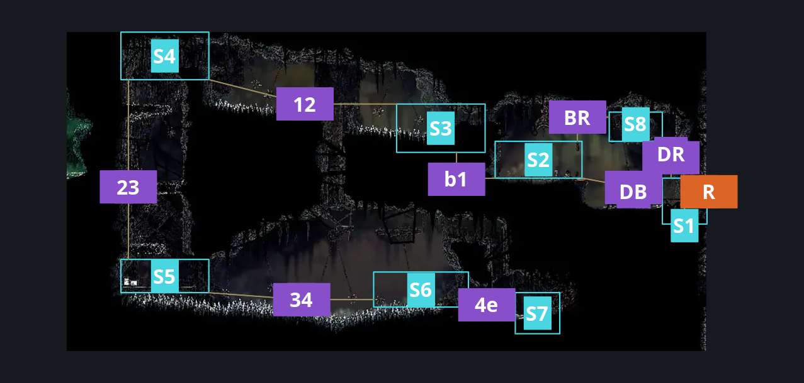
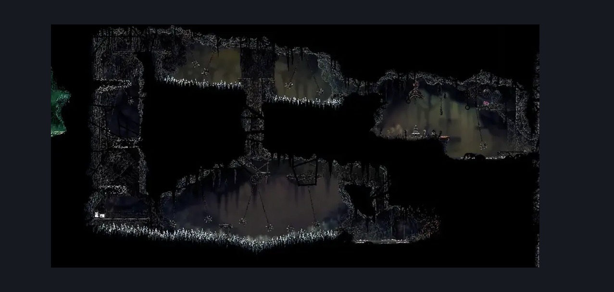

# Sinner's Road Bench (Dust_10)

**Game ID:** Dust_10

**Contributors:** Gallos, herchey when he was chillin'

## Subrooms

| No. | Subroom | Annotated |
| --- | --- | --- |
| S1 | door | ✓ |
| S2 | bench | ✓ |
| S3 | spike hall 1 | ✓ |
| S4 | spike hall 2 | ✓ |
| S5 | spike hall 3 | ✓ |
| S6 | spike hall 4 | ✓ |
| S7 | end | ✓ |
| S8 | rosary plat | ✓ |

## Room Transitions

| Alias | Name | From subroom | Destination | Destination alias | Requirements | TODO | Verification | Annotated | Notes |
| --- | --- | --- | --- | --- | --- | --- | --- | --- | --- |
| R | right | door | [Sinner's Road Vertical Hall West (Dust_02)](sinner-s-road-vertical-hall-west.md) | ML | none |  | Verified | ✓ |  |

## Subroom Connections

| Alias | Name | Source | Destination | Requirements | TODO | Verification | Annotated | Notes |
| --- | --- | --- | --- | --- | --- | --- | --- | --- |
| DB | to the bench | door | bench | ((ACT 1 OR ACT 2) AND (ledge grab left OR cling grip left OR easy [hunter,wanderer,beast,reaper,shaman] pogo OR medium naked pogo OR medium [architect,witch] pogo OR clawline left OR faydown)) OR ( ACT 3 AND ((clawline left AND (ledge grab left OR cling grip left OR faydown)) OR (faydown AND (drifters OR dash left OR run OR (swim AND ledge grab left) OR easy beast pogo OR easy architect charge OR flea brew OR (easy shaman pogo AND easy  scuttlebrace))))) |  | Verified | ✓ |  |
| DB | to the bench | bench | door | ((ACT 1 OR ACT 2) AND (easy [hunter,wanderer, beast,reaper,shaman, witch,architect] pogo OR easy naked pogo OR swim)) OR (ACT 3 AND (swim OR clawline right OR faydown OR drifters OR easy beast pogo OR run)) |  | Verified | ✓ |  |
| b1 | going to fix the bench | bench | spike hall 1 | (cling grip left OR silk soar OR easy scuttlebrace OR (activate Sinner's - Bench full up AND clawline left AND (drifters OR easy [flintslate,parry] stall x 2))) AND break wall left |  | Verified | ✓ |  |
| 12 | upper spike hall | spike hall 1 | spike hall 2 | proficient movement OR clawline left OR faydown cloak OR (drifter's cloak AND (ledge grab left OR cling grip left)) |  | Verified | ✓ |  |
| 23 | spike drop | spike hall 2 | spike hall 3 | proficient movement OR cling grip both |  | Verified | ✓ |  |
| 34 | lower spike hall | spike hall 3 | spike hall 4 | proficient movement OR drifter's cloak OR faydown cloak OR spike pogo |  | Verified | ✓ |  |
| 4e | end | spike hall 4 | end | swim OR (drifter's cloak AND (clawline OR sharpdart)) OR (faydown cloak AND (drifter's cloak OR dash OR sharpdart OR clawline)) OR (proficient movement AND (clawline OR sharpdart OR (drifter's cloak AND dash AND (ledge grab right OR cling grip right)))) |  | Verified | ✓ |  |
| DR | door to rosaries | door | rosary plat | Silk soar OR ((Faydown OR clawline right OR sharpdart OR (easy shaman pogo AND dash right)) AND (cling grip right OR easy scuttlebrace)) |  | Verified | ✓ |  |
| DR | door to rosaries | rosary plat | door | none |  | Verified | ✓ |  |
| BR | bench to rosaries | bench | rosary plat | (faydown AND (ledge grab right OR cling grip right OR (proficient movement AND medium beast pogo))) OR  (dash right AND drifter's) OR (run AND (clawline right OR sharpdart)) OR (activate Sinner's - Bench full up AND easy [hunter,wanderer,reaper,beast,architect,witch,shaman] pogo AND (clawline right x 2 OR (dash right AND sharpdart) OR ((faydown OR dash right) AND drifters))) |  | Verified | ✓ |  |
| BR | bench to rosaries | rosary plat | bench | none |  | Verified | ✓ | falling |

## Check Locations

| No. | Check | Subroom | Requirements | TODO | Verification | Location Type | Annotated | Notes |
| --- | --- | --- | --- | --- | --- | --- | --- | --- |
| 1 | Rosary Snipe | bench | use tool Throwing Ring |  |  | logic-point | ✓ |  |
| 2 | Sinner's Road - Rosaries Looking Over The Sinner's Bench | rosary plat | complete Rosary Snipe OR  attack right  OR (activate Sinner's - Bench full up AND  easy [hunter,wanderer,reaper,beast,architect,witch,shaman] pogo AND use tool [longpin,pimpillo,straight pin,threefold pin,sting shard, throwing ring,conchcutter])  OR use tool [curveclaw,voltvessels] OR easy shaman charge |  | Verified | collectible | ✓ | Formerly: Rosary Cache: Sinner’s Road #8  (volt vessels in the water) |
| 3 | Sinner's Road - Map Purchase | bench | none |  | Verified | collectible | ✓ |  |
| 4 | Sinner's Road - Please Help Me Fix This Bench, Shakra | bench | Spend 40 Rosaries AND complete Unclogging The Overly Complicated Bench |  | Verified | bench | ✓ | Formerly: Sinner's Road Bench |
| 5 | Craw Summons | bench | Craw Summons Ready |  | Verified | collectible |  |  |
| 6 | Unclogging The Overly Complicated Bench | end | break vines right |  | Verified | blockade | ✓ | Formerly: Sinner's Road Bench |
| 7 | Sinner's - Bench full up | bench | Spend 40 Rosaries AND complete Unclogging The Overly Complicated Bench |  |  | logic-point |  | used for skips |

## Room Images

### Connections

### Checks

### Scene

