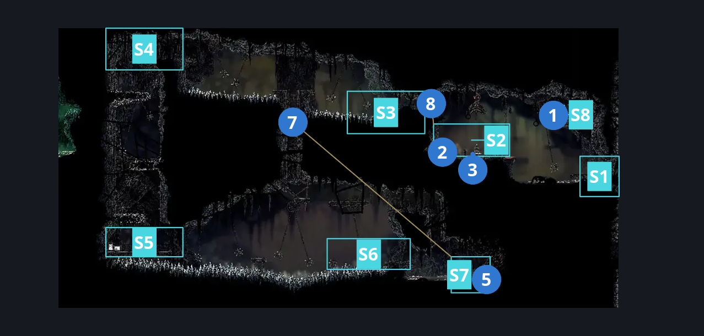

# Sinner's Road Bench (Dust_10)

**Game ID:** Dust_10

**Contributors:** Gallos, herchey when he was chillin'

## Subrooms

| No. | Subroom | Annotated |
| --- | --- | --- |
| S1 | door | ✓ |
| S2 | bench | ✓ |
| S3 | spike hall 1 | ✓ |
| S4 | spike hall 2 | ✓ |
| S5 | spike hall 3 | ✓ |
| S6 | spike hall 4 | ✓ |
| S7 | end | ✓ |
| S8 | rosary plat | ✓ |

## Room Transitions

| Alias | Name | From subroom | Destination | Destination alias | Requirements | TODO | Verification | Annotated | Notes |
| --- | --- | --- | --- | --- | --- | --- | --- | --- | --- |
| R | right | door | [Sinner's Road Vertical Hall West (Dust_02)](sinner-s-road-vertical-hall-west.md) | ML | none |  | Verified | ✓ |  |

## Subroom Connections

| Alias | Name | Source | Destination | Requirements | TODO | Verification | Annotated | Notes |
| --- | --- | --- | --- | --- | --- | --- | --- | --- |
| DB | to the bench | door | bench | ((ACT 1 OR ACT 2) AND (ledge grab left OR cling grip left OR easy [hunter,wanderer,beast,reaper,shaman] pogo OR medium naked pogo OR medium [architect,witch] pogo OR clawline left OR faydown OR ((Faydown OR clawline right OR sharpdart OR (easy shaman pogo AND dash right)) AND (cling grip right OR easy scuttlebrace)))) OR ( ACT 3 AND (((faydown AND (cling grip right OR easy scuttlebrace)) OR (clawline left AND (ledge grab left OR cling grip left OR faydown))) OR (faydown AND (drifters OR dash left OR run OR (swim AND ledge grab left) OR easy beast pogo OR easy architect charge OR flea brew OR (easy shaman pogo AND easy scuttlebrace) OR medium [hunter,wanderer] voltwater pogo x 1))))  OR silk soar |  | Verified | ✓ |  |
| DB | to the bench | bench | door | ((ACT 1 OR ACT 2) AND (easy [hunter,wanderer, beast,reaper,shaman, witch,architect] pogo OR easy naked pogo OR swim)) OR (ACT 3 AND (swim OR clawline right OR faydown OR drifters OR easy beast pogo OR run OR medium [hunter,wanderer] voltwater pogo x 1)) |  | Verified | ✓ |  |
| b1 | going to fix the bench | bench | spike hall 1 | ((cling grip left OR silk soar OR easy scuttlebrace OR (activate Sinner's - Bench full up AND clawline left AND (drifters OR easy [flintslate,parry] stall x 2))) AND break wall left) AND clear Sinner's - Bench wall |  | Verified | ✓ |  |
| 12 | upper spike hall | spike hall 1 | spike hall 2 | proficient movement OR clawline left OR faydown cloak OR (drifter's cloak AND (ledge grab left OR cling grip left)) |  | Verified | ✓ |  |
| 23 | spike drop | spike hall 2 | spike hall 3 | proficient movement OR cling grip both |  | Verified | ✓ |  |
| 34 | lower spike hall | spike hall 3 | spike hall 4 | proficient movement OR drifter's cloak OR faydown cloak OR spike pogo |  | Verified | ✓ |  |
| 4e | end | spike hall 4 | end | swim OR (drifter's cloak AND (clawline right OR sharpdart)) OR (faydown cloak AND (drifter's cloak OR (dash right AND (easy beast pogo OR run)) OR sharpdart OR clawline right)) OR (proficient movement AND (clawline right OR sharpdart OR (drifter's cloak AND dash right AND (ledge grab right OR cling grip right)))) OR medium [hunter,wanderer] voltwater pogo x 2 |  | Verified | ✓ |  |
| DR | door to rosaries | door | rosary plat | silk soar OR ((Faydown OR clawline right OR sharpdart OR (easy shaman pogo AND dash right)) AND (cling grip right OR easy scuttlebrace)) OR easy voltvessels use OR (faydown AND shaman attack up) OR ((ACT 1 OR ACT 2) AND (faydown AND easy [hunter,wanderer, reaper,beast,architect,witch,shaman] pogo AND attack up)) |  | Verified | ✓ | needed for rosary snipe |
| BR | bench to rosaries | bench | rosary plat | (faydown AND (ledge grab right OR cling grip right)) OR (activate Sinner's - Bench full up AND easy [hunter,wanderer,reaper,beast,architect,witch,shaman] pogo AND (clawline right x 2 OR (dash right AND sharpdart) OR ((faydown OR dash right) AND drifters) OR easy [longpin,pimpillo,straight pin,threefold pin,sting shard, throwing ring,conchcutter] use)) OR easy shaman charge OR easy curveclaw use |  | Verified | ✓ | needed for rosary snipe |
| e1 | end to spike hall | end | spike hall 1 | ((faydown AND (cling grip either OR easy scuttlebrace)) OR (clawline left AND (cling grip left OR easy scuttlebrace)) OR ((swim OR clawline left) AND silksoar AND (faydown OR cling grip left OR ledge grab left))) AND clear Sinner's - Spike hell end wall |  | Verified | ✓ |  |
| b1 | going to fix the bench | spike hall 1 | bench | clear Sinner's - Bench wall |  | Verified | ✓ |  |

## Check Locations

| No. | Check | Subroom | Requirements | TODO | Verification | Location Type | Annotated | Notes |
| --- | --- | --- | --- | --- | --- | --- | --- | --- |
| 1 | Sinner's Road - Rosaries Looking Over The Sinner's Bench | rosary plat | none |  | Verified | collectible | ✓ | Formerly: Rosary Cache: Sinner’s Road #8 |
| 2 | Sinner's Road - Map Purchase | bench | none |  | Verified | collectible | ✓ |  |
| 3 | Sinner's Road - Please Help Me Fix This Bench, Shakra | bench | Spend 40 Rosaries AND complete Unclogging The Overly Complicated Bench |  | Verified | bench | ✓ | Formerly: Sinner's Road Bench |
| 4 | Craw Summons | bench | Craw Summons Ready |  | Verified | collectible |  |  |
| 5 | Unclogging The Overly Complicated Bench | end | break vines right |  | Verified | blockade | ✓ | Formerly: Sinner's Road Bench |
| 6 | Sinner's - Bench full up | bench | Spend 40 Rosaries AND complete Unclogging The Overly Complicated Bench |  | Verified | logic-point |  | used for skips |
| 7 | Sinner's - Spike hell end wall | end | break wall up |  | Verified | blockade | ✓ |  |
| 8 | Sinner's - Bench wall | bench | break wall left |  | Verified | blockade | ✓ |  |

## Room Images

### Connections

### Checks

### Scene

