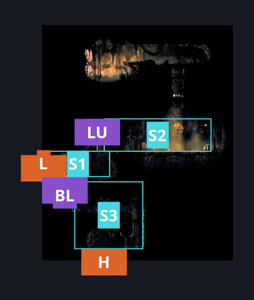
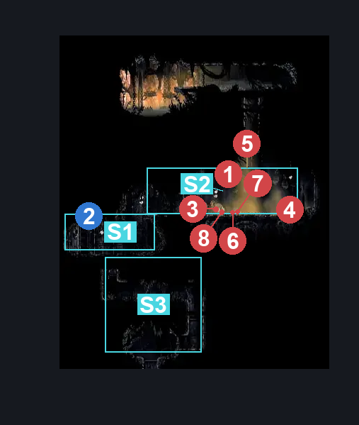
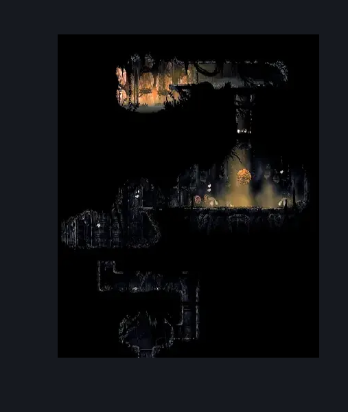

# Sinner's Road Chef's Kitchen (Dust_Chef)

**Game ID:** Dust_Chef

**Contributors:** herchey, hutyrix and some pop-tarts

## Subrooms

| No. | Subroom | Annotated |
| --- | --- | --- |
| S1 | lower | ✓ |
| S2 | upper | ✓ |
| S3 | basement | ✓ |

## Room Transitions

| Alias | Name | From subroom | Destination | Destination alias | Requirements | TODO | Verification | Annotated | Notes |
| --- | --- | --- | --- | --- | --- | --- | --- | --- | --- |
| L | left | lower | [Sinner's Road Hanging Cages (Dust_04)](sinner-s-road-hanging-cages.md) | R | prereq Unlock the Kitchen Deadbolt  OR (elite ball knowledge AND   ([reaper,witch,architect,shaman] attack right OR easy [hunter,wanderer,beast] charge OR (easy beast heal stall AND beast longclaw right))) |  | Verified | ✓ | ebk shouldn't be considered outside entrance randomizer, because Dust_04 prereq unlock stays the same -Hutyrix 11/26 |
| H | hatch | basement | [Sinner's Road Muckroach Cages (Dust_03)](sinner-s-road-muckroach-cages.md) | C | none |  | Verified | ✓ |  |

## Subroom Connections

| Alias | Name | Source | Destination | Requirements | TODO | Verification | Annotated | Notes |
| --- | --- | --- | --- | --- | --- | --- | --- | --- |
| LU | lower to upper | lower | upper | faydown cloak OR silk soar x 1  OR (cbt shaman pogo AND cbt pale nails stall x 3 AND ledge grab right) |  | Verified | ✓ | Could be better. don't want to include cling grip right for now -Hutyrix 11/26/26 |
| LU | lower to upper | upper | lower | none |  | Verified | ✓ |  |
| BL | basement to lower | basement | lower | scuttlebrace OR cling grip either OR silk soar x 1 OR (faydown AND ledge grab left) OR (medium pale nails stall x 1 AND medium shaman pogo AND faydown) |  | Verified | ✓ |  |
| BL | basement to lower | lower | basement | invalid (true one-way) |  | Verified | ✓ |  |

## Check Locations

| No. | Check | Subroom | Requirements | TODO | Verification | Location Type | Annotated | Notes |
| --- | --- | --- | --- | --- | --- | --- | --- | --- |
| 1 | Boss: Disgraced Chef Lugoli | upper | Combat Requirements |  | Verified | boss | ✓ |  |
| 2 | Unlock the Kitchen Deadbolt | lower | hit switch up OR hit switch left |  | Verified | switch | ✓ | Formerly: Sinner's Road Chef's Kitchen Door Switch |
| 3 | Makenna, the Roachserver | upper | none |  | Verified | enemy | ✓ | Formerly: Roachserver 1 |
| 4 | Eden, the Roachserver | upper | none |  | Verified | enemy | ✓ | Formerly: Roachserver 2 |
| 5 | Disgraced Chef Lugoli 1 | upper | none |  | Verified | enemy | ✓ |  |
| 6 | Roachserver 3 | upper | invalid |  | Verified | enemy | ✓ | Just fucks off as soon as the fight starts and never comes back. |
| 7 | Roachserver 4 | upper | invalid |  | Verified | enemy | ✓ | WHERE  these are the background dudes; you can't fight them - hero, 10/29 |
| 8 | Roachserver 5 | upper | invalid |  | Verified | enemy | ✓ | WHERE  these are the background dudes; you can't fight them - hero, 10/29 |

## Notes

minor overhaul (faydown leftledge, various shaman techs) - hutyrix, 11/26/26

## Room Images

### Connections

### Checks

### Scene

