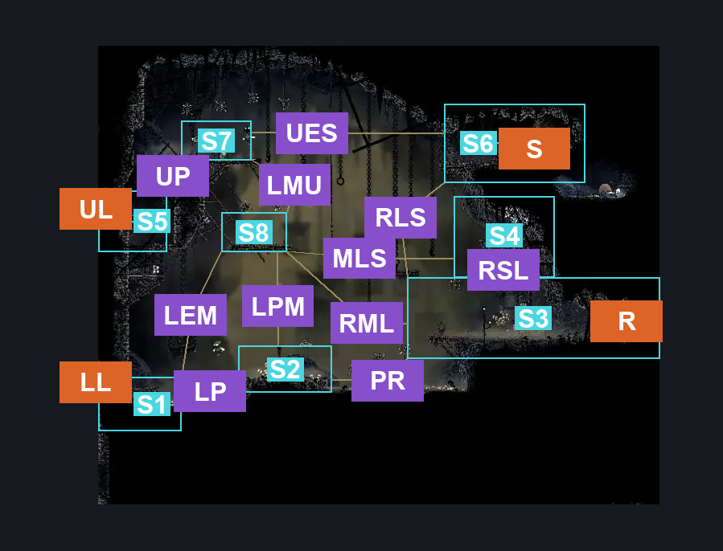
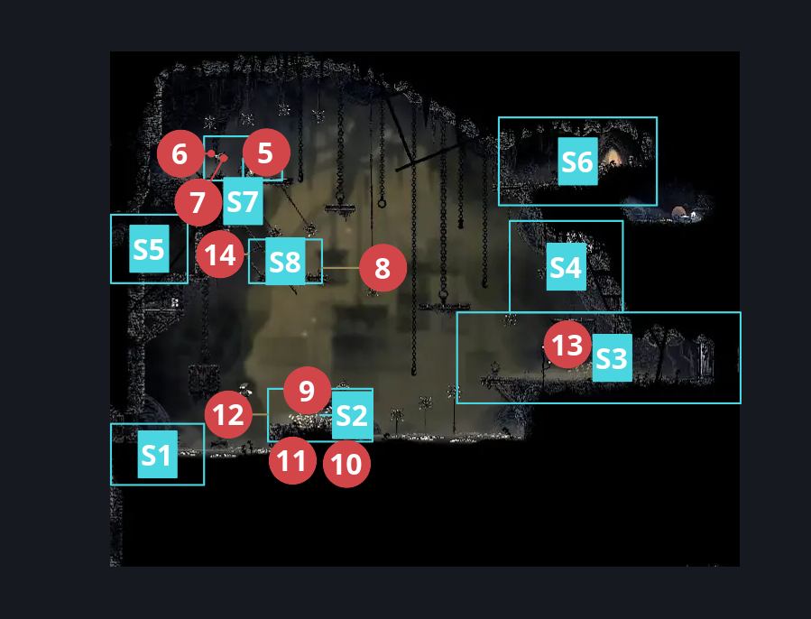
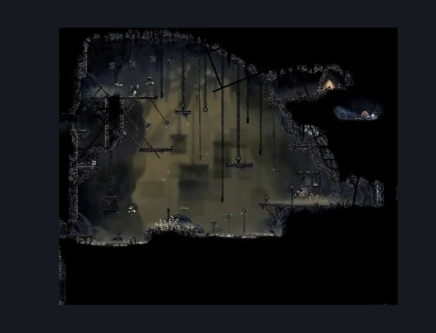

# Sinner's Road Hanging Cages (Dust_04)

**Game ID:** Dust_04

**Contributors:** herchey and Lace (she didn't help at all because she was on the phone with Hornet the whole time)

## Subrooms

| No. | Subroom | Annotated |
| --- | --- | --- |
| S1 | lower entry | ✓ |
| S2 | lower platform | ✓ |
| S3 | right ledge | ✓ |
| S4 | shard ledge | ✓ |
| S5 | upper entry | ✓ |
| S6 | shack | ✓ |
| S7 | plat above upper door | ✓ |
| S8 | middle left plat | ✓ |

## Room Transitions

| Alias | Name | From subroom | Destination | Destination alias | Requirements | TODO | Verification | Annotated | Notes |
| --- | --- | --- | --- | --- | --- | --- | --- | --- | --- |
| LL | lower left | lower entry | [Sinner's Road Vertical Hall West (Dust_02)](sinner-s-road-vertical-hall-west.md) | MR | none |  | Verified | ✓ |  |
| R | right | right ledge | [Sinner's Road Chef's Kitchen (Dust_Chef)](sinner-s-road-chef-s-kitchen.md) | L | complete Unlock the Kitchen Deadbolt IN Sinner's Road Chef's Kitchen |  | Verified | ✓ |  |
| UL | upper left | upper entry | [Sinner's Road Vertical Hall West (Dust_02)](sinner-s-road-vertical-hall-west.md) | UR | none |  | Verified | ✓ |  |
| S | shack | shack | [Sinner's Road Shack (dust_shack)](sinner-s-road-shack.md) | L | none |  | Verified | ✓ |  |

## Subroom Connections

| Alias | Name | Source | Destination | Requirements | TODO | Verification | Annotated | Notes |
| --- | --- | --- | --- | --- | --- | --- | --- | --- |
| RSL | right ledge to shard ledge | right ledge | shard ledge | (Faydown cloak AND (ledge grab either OR cling grip either)) OR silk soar |  | Verified | ✓ |  |
| RSL | right ledge to shard ledge | shard ledge | right ledge | none |  | Verified | ✓ |  |
| UES | upper entry to shack | plat above upper door | shack | Clawline right 3 OR ((Cling grip left OR silk soar) AND (drifter’s cloak OR sharpdart 2 OR clawline right 2)) |  | Verified | ✓ |  |
| UES | upper entry to shack | shack | plat above upper door | (run AND (drifter's cloak OR clawline left OR sharpdart)) OR (dash AND faydown cloak) OR clawline left 2 OR sharpdart 2 |  | Verified | ✓ |  |
| RLS | right ledge to shack | right ledge | shack | silk soar |  | Verified | ✓ |  |
| RLS | right ledge to shack | shack | right ledge | none |  | Verified | ✓ |  |
| LP | lower entry to lower platform | lower entry | lower platform | ledge grab right OR cling grip right OR clawline right OR sharpdart OR run OR drifter's cloak OR faydown cloak OR easy beast pogo OR easy wanderer needle strike OR easy architect needle strike |  | Verified | ✓ |  |
| LP | lower entry to lower platform | lower platform | lower entry | none |  | Verified | ✓ |  |
| PR | lower platform to right ledge | lower platform | right ledge | none |  | Verified | ✓ | Can be done with just bouncing on the spikes as-is. Keeping notes because I'm weird and paranoid.  Formerly: clawline right OR (faydown cloak AND drifter's cloak AND ledge grab right AND (sharpdart OR dash right OR run right)) |
| PR | lower platform to right ledge | right ledge | lower platform | none |  | Verified | ✓ | Same as above.  Formerly: clawline left OR sharpdart OR swim OR enemy pogo OR drifter's cloak OR dash left |
| UP | upper entry to upper plat | upper entry | plat above upper door | ledge grab right OR cling grip right OR silk soar OR faydown cloak |  | Verified | ✓ |  |
| UP | upper entry to upper plat | plat above upper door | upper entry | none |  | Verified | ✓ |  |
| LPM | lower plat to mid left plat | lower platform | middle left plat | silk soar |  | Verified | ✓ |  |
| LPM | lower plat to mid left plat | middle left plat | lower platform | none |  | Verified | ✓ |  |
| LEM | lower entry to mid left plat | lower entry | middle left plat | cling grip left AND faydown cloak |  | Verified | ✓ |  |
| LEM | lower entry to mid left plat | middle left plat | lower entry | none |  | Verified | ✓ |  |
| LMU | middle left plat to upper | middle left plat | plat above upper door | silk soar OR cling grip left OR faydown cloak |  | Verified | ✓ |  |
| LMU | middle left plat to upper | plat above upper door | middle left plat | none |  | Verified | ✓ |  |
| MLS | middle left to shard | middle left plat | shard ledge | faydown cloak OR (run AND (ledge grab right OR cling grip right)) OR (clawline right AND (ledge grab right OR cling grip right)) |  | Verified | ✓ |  |
| MLS | middle left to shard | shard ledge | middle left plat | ((ledge grab left OR cling grip left) AND (dash left OR clawline left x 2 OR sharpdart x 2)) |  | Verified | ✓ |  |
| RML | right ledge to middle left | right ledge | middle left plat | ((cling grip left OR silk soar OR (faydown cloak AND ledge grab left)) AND (((enemy pogo OR clawline left OR (dash left AND drifter's cloak) OR sharpdart x 2) AND (ledge  grab left OR cling grip left)) OR (faydown cloak AND dash left))) |  | Verified | ✓ |  |
| RML | right ledge to middle left | middle left plat | right ledge | run right OR clawline right OR sharpdart OR drifter's cloak OR faydown cloak |  | Verified | ✓ |  |

## Check Locations

| No. | Check | Subroom | Requirements | TODO | Verification | Location Type | Annotated | Notes |
| --- | --- | --- | --- | --- | --- | --- | --- | --- |
| 1 | My Missing Brother Wish Granted | upper entry | complete THE My Missing Brother Wish Promised |  | Verified | event |  |  |
| 2 | Sinner's Road - Shell Shards Lugoli Probably Threw Out: The First | shard ledge | none |  | Verified | collectible |  | Formerly: Shell Shard Cache: Sinner’s Road #4 |
| 3 | Sinner's Road - Shell Shards Lugoli Probably Threw Out: The Second | shard ledge | none |  | Verified | collectible |  | Formerly: Shell Shard Cache: Sinner’s Road #5 |
| 4 | Upper Entry Switch | upper entry | hit switch left OR hit switch up |  | Verified | switch |  |  |
| 5 | Roachfeeder 1 | plat above upper door | prereq THE my missing brother wish promised |  | Verified | enemy | ✓ | Spawn conditions: Save Courier Tall accepted=true, Save Courier Tall completed=false |
| 6 | Roachcatcher 1 | plat above upper door | prereq THE my missing brother wish promised |  | Verified | enemy | ✓ | Spawn conditions: Save Courier Tall accepted=true, Save Courier Tall completed=false |
| 7 | Picnic Partner, the Roachcatcher | plat above upper door | none |  | Verified | enemy | ✓ | Formerly: Roachcatcher 2 |
| 8 | Maximillian, the Roachfeeder | middle left plat | none |  | Verified | enemy | ✓ | Formerly: Roachfeeder 2 |
| 9 | Roachcatcher 3 | lower platform | none |  | Verified | enemy | ✓ | Formerly: Roachcatcher 3 |
| 10 | Roachcatcher 4 | lower platform | invalid |  | Verified | enemy | ✓ | set to ambush hornet in fsm. unused or untriggered perhaps? - hero, 10/29 |
| 11 | Roachcatcher 5 | lower platform | invalid |  | Verified | enemy | ✓ | set to ambush hornet in fsm. unused or untriggered perhaps? - hero, 10/29 |
| 12 | Roachfeeder 3 | lower platform | none |  | Verified | enemy | ✓ | Formerly: Roachfeeder 3 |
| 13 | Dog, the Mite | right ledge | none |  | Verified | enemy | ✓ | Formerly: Mite 1 |
| 14 | Tiny Man, the Mite | middle left plat | none |  | Verified | enemy | ✓ | Formerly: Mite 2 |

## Room Images

### Connections

### Checks

### Scene

