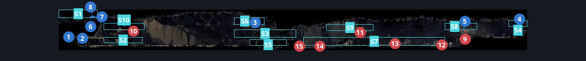

# Sinner's Road North Hall (Dust_05)

**Game ID:** Dust_05

**Contributors:** herchey boi and hutyrix who inhaled some noxious fumes just around the corner

## Subrooms

| No. | Subroom | Annotated |
| --- | --- | --- |
| S1 | behind left wall | ✓ |
| S2 | left area | ✓ |
| S3 | middle area | ✓ |
| S4 | right door | ✓ |
| S5 | hatch | ✓ |
| S6 | chest plat | ✓ |
| S7 | low right | ✓ |
| S8 | right plat | ✓ |
| S9 | right keeper plat | ✓ |
| S10 | left area upper | ✓ |

## Room Transitions

| Alias | Name | From subroom | Destination | Destination alias | Requirements | TODO | Verification | Annotated | Notes |
| --- | --- | --- | --- | --- | --- | --- | --- | --- | --- |
| L | left | behind left wall | [Sinner's Road Mist Maze Completed (Dust_Maze_08_completed)](sinner-s-road-mist-maze-completed.md) | LR | none |  | Verified | ✓ |  |
| C | center | hatch | [Sinner's Road Vertical Hall West (Dust_02)](sinner-s-road-vertical-hall-west.md) | C | none |  | Verified | ✓ |  |
| R | right | right door | [Sinner's Road Vertical Hall East (Dust_06)](sinner-s-road-vertical-hall-east.md) | L | complete The Lever Gettin' You Outta The North Hall |  | Verified | ✓ |  |

## Subroom Connections

| Alias | Name | Source | Destination | Requirements | TODO | Verification | Annotated | Notes |
| --- | --- | --- | --- | --- | --- | --- | --- | --- |
| LWL | Behind left wall to left area upper | behind left wall | left area upper | complete Secret Wall Logic |  | Verified | ✓ |  |
| LWL | Behind left wall to left area upper | left area upper | behind left wall | (Silk soar OR faydown cloak OR cling grip left OR scuttlebrace OR medium [hunter,wanderer] voltwater pogo x 1) |  | Verified | ✓ | Should NOT be problematic until breakable wall rando  temporarily removed "complete Secret Wall Logic AND" before whole syntax, it feels like it could disallow any mist logic:  https://discord.com/channels/522404910445232130/1539856853159387137/1575010264678662174 |
| LAM | Left area to middle area | left area | middle area | clawline right OR (sharpdart x 3 AND (drifter’s cloak OR faydown cloak)) OR (drifter’s cloak AND ((cling grip right AND ledge grab right) OR faydown cloak)) OR (swim AND ledge grab right)  OR proficient movement |  | Verified | ✓ |  |
| LAM | Left area to middle area | middle area | left area | clawline left OR (sharpdart AND (drifter’s cloak OR faydown cloak)) OR (drifter’s cloak AND faydown cloak) OR (swim AND (ledge grab left OR cling grip left))  OR proficient movement |  | Verified | ✓ |  |
| MAH | Middle area to hatch | middle area | hatch | none OR  attack either |  | Verified | ✓ | Technically "any attack" is the requirement  Fair point! |
| MAH | Middle area to hatch | hatch | middle area | Ledge grab either OR cling grip either OR faydown cloak OR silk soar OR easy scuttlebrace |  | Verified | ✓ |  |
| MAC | mid to chest | middle area | chest plat | faydown cloak OR silk soar |  | Verified | ✓ |  |
| MAC | mid to chest | chest plat | middle area | none (falling) |  | Verified | ✓ |  |
| LC | left to chest | left area upper | chest plat | (dash right AND faydown cloak AND drifter's cloak) OR (clawline right x 5) OR medium naked pogo |  | Verified | ✓ |  |
| LC | left to chest | chest plat | left area upper | (dash left AND faydown cloak AND drifter's cloak) OR (clawline left x 5) |  | Verified | ✓ |  |
| MLR | mid to low right | middle area | low right | none (falling) |  | Verified | ✓ |  |
| MLR | mid to low right | low right | middle area | faydown cloak OR ledge grab left OR silk soar OR cling grip left |  | Verified | ✓ |  |
| LRR | low right to right | low right | right plat | faydown cloak OR silk soar |  | Verified | ✓ |  |
| LRR | low right to right | right plat | low right | none |  | Verified | ✓ | falling |
| LRK | low right to keeper | low right | right keeper plat | faydown cloak OR ledge grab either OR silk soar OR cling grip either OR easy damage boost OR proficient movement |  | Verified | ✓ | Proficient movement can get a pogo from the swinging spikes. |
| LRK | low right to keeper | right keeper plat | low right | none |  | Verified | ✓ | falling |
| MRK | mid to right keep | middle area | right keeper plat | none |  | Verified | ✓ | spike balls |
| MRK | mid to right keep | right keeper plat | middle area | none |  | Verified | ✓ | Just pogoing them spikey ball pendulums thingermajingers |
| MKR | mid keeper to right | right keeper plat | right plat | (easy beast pogo OR ledge grab right OR cling grip right) AND (drifter's cloak OR clawline right OR sharpdart OR dash right) |  | Verified | ✓ |  |
| MKR | mid keeper to right | right plat | right keeper plat | (proficient movement AND clawline left) OR ((ledge grab left OR clawline left OR dash left) AND ledge grab left) OR (faydown cloak AND drifter's cloak) |  | Verified | ✓ |  |
| RPD | right plat to door | right plat | right door | ledge grab right OR cling grip right OR faydown cloak OR clawline right OR sharpdart OR dash right OR easy beast pogo |  | Verified | ✓ |  |
| RPD | right plat to door | right door | right plat | none |  | Verified | ✓ | Can be done with regular pogos |
| LAU | left area to upper -\|\|- | left area | left area upper | Silk soar OR faydown cloak OR cling grip left OR scuttlebrace OR medium [hunter,wanderer] voltwater pogo x 1 OR (cloaked AND medium damage boost x 1) |  | Verified | ✓ |  |
| LAU | left area to upper -\|\|- | left area upper | left area | none (Falling) |  | Verified | ✓ |  |

## Check Locations

| No. | Check | Subroom | Requirements | TODO | Verification | Location Type | Annotated | Notes |
| --- | --- | --- | --- | --- | --- | --- | --- | --- |
| 1 | Sinner's Road - Left Shards Below Mist Entrance | left area | (attack up AND ((swim OR clawline left x 1 OR sharpdart x 1 OR (run left AND (drifter's cloak OR faydown cloak)) OR (dash right AND proficient movement (harder with some crests)) OR medium [hunter,wanderer] voltwater pogo x 2 OR hard hunter voltwater pogo x 1))) OR (easy [threefold pin,curveclaw, original silkshot, deep docks silkshot, underworks silkshot, voltvessels] use x 1 OR medium [sting shard,throwing ring] use ) OR (run left AND (easy [straight pin, longpin] use OR medium [silkspear,thread storm,pimpillo] use x 1 OR medium [rune rage,pale nails] use x 2)) OR medium shaman charge |  | Verified | collectible | ✓ | Formerly: Shell Shard Cache: Sinner’s Road #6 |
| 2 | Sinner's Road - Right Shards Below Mist Entrance | left area | (attack up AND ((swim OR clawline left x 1 OR sharpdart x 1 OR (run left AND (drifter's cloak OR faydown cloak)) OR (dash right AND proficient movement (harder with some crests)) OR medium [hunter,wanderer] voltwater pogo x 2 OR hard hunter voltwater pogo x 1))) OR (easy [threefold pin,curveclaw, original silkshot, deep docks silkshot, underworks silkshot, voltvessels] use x 1 OR medium [sting shard,throwing ring] use ) OR (run left AND (easy [straight pin, longpin] use OR medium [silkspear,thread storm,pimpillo] use x 1 OR medium [rune rage,pale nails] use x 2)) OR medium shaman charge |  | Verified | collectible | ✓ | Formerly: Shell Shard Cache: Sinner’s Road #7  This syntax should account more combinations, but who would like to break one of those shell shards, and then going back there to break another one Seriously, syntax diffrence is not that big of a deal with all skips enabled. There are SO MANY tools that are enough to break both of those that you shouldn't complain. Thanks. -Hutyrix, 11/24/26 |
| 3 | Sinner's Road - That Rosary Chest in the Halls of the Spike Swingers that's RIGHT THERE | chest plat | none |  | Verified | collectible | ✓ | Formerly: Sinner's Road - Rosary Chest |
| 4 | The Lever Gettin' You Outta The North Hall | right door | hit switch up OR hit switch right OR hit switch left |  | Verified | switch | ✓ | Formerly: North Hall Door Switch |
| 5 | Garmond and Zaza Act 3 Meeting Sinner's Road | right plat | Act 3 |  | Verified | event | ✓ |  |
| 6 | Secret Wall To The Mists Left | behind left wall | break wall right |  | Verified | blockade | ✓ |  |
| 7 | Secret Wall To The Mists Right | behind left wall | break wall left |  | Verified | blockade | ✓ |  |
| 8 | Secret Wall Logic | behind left wall | complete Secret Wall to The Mists Left OR complete Secret Wall to The Mists Right |  | Verified | logic-point | ✓ | Should NOT be problematic until breakable wall rando |
| 9 | Steven, the Roachkeeper | right plat | none |  | Verified | enemy | ✓ | Formerly: Roachkeeper 1 |
| 10 | Sturgis, the Roachkeeper | left area upper | none |  | Verified | enemy | ✓ | Formerly: Roachkeeper 2 |
| 11 | Phillip, the Roachkeeper | right keeper plat | none |  | Verified | enemy | ✓ | Formerly: Roachkeeper 3 |
| 12 | Trash, the Muckroach | low right | none |  | Verified | enemy | ✓ | Formerly: Muckroach 1 |
| 13 | Aneurysm, the Muckroach | low right | none |  | Verified | enemy | ✓ | Formerly: Muckroach 2 |
| 14 | Tumor, the Muckroach | low right | none |  | Verified | enemy | ✓ | Formerly: Muckroach 3 |
| 15 | Leech, the Muckroach | low right | Normal World Spawn |  | Verified | enemy | ✓ | Formerly: Muckroach 4 |

## Room Images

### Connections

### Checks

### Scene

