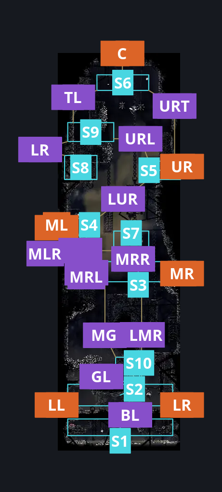
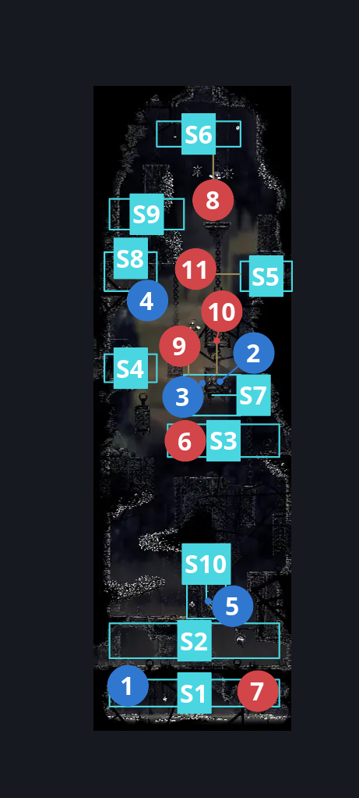
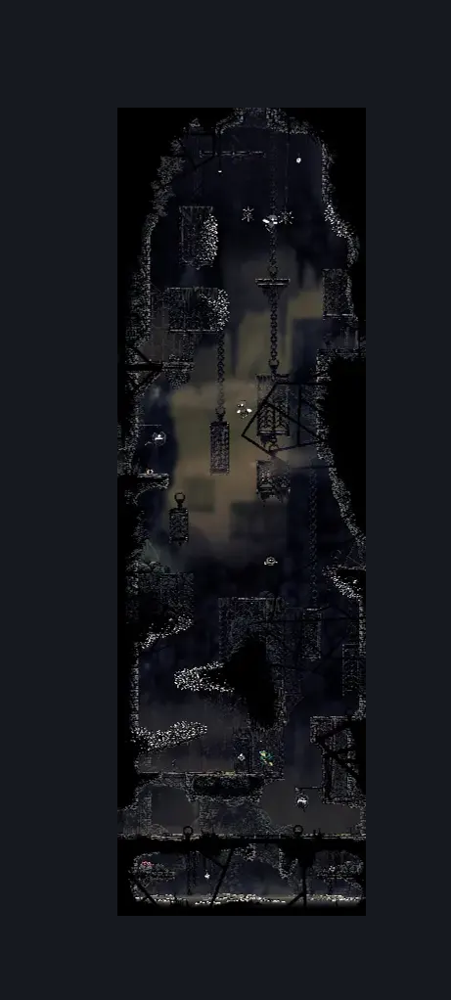

# Sinner's Road Vertical Hall West (Dust_02)

**Game ID:** Dust_02

**Contributors:** Gallos, Hutyrix, herchey's going to bed

## Subrooms

| No. | Subroom | Annotated |
| --- | --- | --- |
| S1 | basement | ✓ |
| S2 | lower | ✓ |
| S3 | middle right | ✓ |
| S4 | middle left | ✓ |
| S5 | upper right | ✓ |
| S6 | top | ✓ |
| S7 | rosary cage | ✓ |
| S8 | lever room | ✓ |
| S9 | above lever | ✓ |
| S10 | green cell | ✓ |

## Room Transitions

| Alias | Name | From subroom | Destination | Destination alias | Requirements | TODO | Verification | Annotated | Notes |
| --- | --- | --- | --- | --- | --- | --- | --- | --- | --- |
| LL | lower left | lower | [Sinner's Road Entrance (Dust_01)](sinner-s-road-entrance.md) | R | none |  | Verified | ✓ |  |
| ML | middle left | middle left | [Sinner's Road Bench (Dust_10)](sinner-s-road-bench.md) | R | none |  | Verified | ✓ |  |
| C | ceiling | top | [Sinner's Road North Hall (Dust_05)](sinner-s-road-north-hall.md) | C | none |  | Verified | ✓ |  |
| LR | lower right | lower | [Sinner's Road Muckroach Cages (Dust_03)](sinner-s-road-muckroach-cages.md) | L | none |  | Verified | ✓ |  |
| MR | middle right | middle right | [Sinner's Road Hanging Cages (Dust_04)](sinner-s-road-hanging-cages.md) | LL | none |  | Verified | ✓ |  |
| UR | upper right | upper right | [Sinner's Road Hanging Cages (Dust_04)](sinner-s-road-hanging-cages.md) | UL | prereq Upper Entry Switch IN Sinner's Road Hanging Cages |  | Verified | ✓ |  |

## Subroom Connections

| Alias | Name | Source | Destination | Requirements | TODO | Verification | Annotated | Notes |
| --- | --- | --- | --- | --- | --- | --- | --- | --- |
| BL | basement to lower | lower | basement | none |  | Verified | ✓ | Technically "any attack" is a requirement |
| BL | basement to lower | basement | lower | cling grip right OR (faydown cloak AND cling grip left) |  | Verified | ✓ |  |
| LMR | low to mid right | lower | middle right | silk soar OR cling grip right OR (cling grip left AND (faydown OR proficient movement)) OR easy scuttlebrace |  | Verified | ✓ | pilky written easy scuttlebrace here |
| LMR | low to mid right | middle right | lower | none |  | Verified | ✓ |  |
| MRL | mid right to middle left | middle right | middle left | silk soar OR (complete Lever That Gets You A Shortcut To The Bullshit Bench Door AND (cling grip either OR (faydown cloak AND (ledge grab either OR easy shaman pogo OR easy beast charge OR medium beast bind stall)))) |  | Verified | ✓ |  |
| MRL | mid right to middle left | middle left | middle right | none |  | Verified | ✓ |  |
| LUR | mid left to upper right | middle left | upper right | Cling grip right OR faydown cloak |  | Verified | ✓ |  |
| LUR | mid left to upper right | upper right | middle left | none |  | Verified | ✓ |  |
| URT | upper right to top | upper right | top | Silk soar OR (faydown AND proficient movement) |  | Verified | ✓ | faydown spike pogos. naked can't use faydown |
| URT | upper right to top | top | upper right | none |  | Verified | ✓ |  |
| MRR | mid right to rosaries | middle right | rosary cage | silk soar OR (easy enemy pogo off roachcatcher AND (drifters OR faydown OR (easy shaman pogo AND (cling grip either OR scuttlebrace)))) OR (medium enemy pogo off roachcatcher AND easy shaman pogo) |  | Verified | ✓ |  |
| MRR | mid right to rosaries | rosary cage | middle right | none |  | Verified | ✓ |  |
| MLR | mid left to rosaries | middle left | rosary cage | faydown cloak OR cling grip right OR easy scuttlebrace  OR (cling grip left  AND (easy [beast,hunter,architect,shaman] pogo  OR easy [beast,architect,wanderer] charge  OR medium [reaper,witch] charge  OR sharpdart OR flea brew OR clawline right OR dash right OR medium [pale nails,cross stitch,rune rage,thread storm,flintslate] stall OR easy [plasmium,voltvessels] stall OR easy flintslate stall x 2 OR (ledge grab right AND (medium [witch,reaper] pogo OR easy [pale nails,cross stitch,rune rage,thread storm] stall OR medium silkspear stall OR (hard beast bind stall AND (clawline right)) OR (medium shaman pogo AND (sprint right OR hard pale nails stall)))))) OR (hard shaman pogo AND hard pale nails stall x 5) |  | Verified | ✓ |  |
| MLR | mid left to rosaries | rosary cage | middle left | faydown cloak OR cling grip either OR ledge grab either OR easy shaman pogo OR easy beast charge OR (medium beast bind stall AND (easy beast pogo OR activate Lever That Gets You A Shortcut To The Bullshit Bench Door)) OR silk soar |  | Verified | ✓ |  |
| TL | top to lever | top | above lever | none |  | Verified | ✓ |  |
| TL | top to lever | above lever | top | silk soar OR faydown cloak OR (cling grip right AND (drifter's cloak OR (dash left AND proficient movement) OR (dash left AND ledge grab left) OR sharpdart OR clawline left OR easy beast pogo)) OR ((medium shaman pogo OR medium scuttlebrace) AND (clawline left x 1 OR sharpdart) AND (ledge grab left OR cling grip left)) OR (hard shaman pogo AND ((hard scuttlebrace AND hard pale nails stall x 2) OR hard pale nails stall x 3)) |  | Verified | ✓ |  |
| LR | lever room | above lever | lever room | none |  | Verified | ✓ |  |
| LR | lever room | lever room | above lever | silk soar OR cling grip either OR scuttlebrace |  | Verified | ✓ |  |
| URL | upper right to lever | upper right | above lever | cling grip right OR scuttlebrace |  | Verified | ✓ |  |
| URL | upper right to lever | above lever | upper right | none |  | Verified | ✓ |  |
| GL | cell -> lower | green cell | lower | none |  | Verified | ✓ |  |
| MG | middle -> cell | middle right | green cell | clawline both OR ((cling grip both OR drifters) AND dash both) OR (proficient movement AND hard shaman scuttle slide) OR (hard beast pogo AND faydown) |  | Verified | ✓ |  |

## Check Locations

| No. | Check | Subroom | Requirements | TODO | Verification | Location Type | Annotated | Notes |
| --- | --- | --- | --- | --- | --- | --- | --- | --- |
| 1 | Sinner's Road - Gross Rosaries In the Sinner's Basement | basement | (swim AND (attack up OR Ledge grab left OR cling grip left))  OR  (faydown cloak AND ((drifter's cloak AND ledge grab left) OR clawline left OR sharpdart OR swim)) OR (clawline left AND ((drifter's cloak OR proficient movement ) AND ledge grab left)) OR  (clawline left AND (easy [longpin,pimpillo,cogwork wheel, voltvessels, conchcutter, silkspear] use)) OR easy [straight pin, threefold pin,throwing ring, silkshot forge daugther, silkshot original, underworks silkshot, rosary cannon] use OR medium [sting shard,curveclaw] use OR medium pale nails use x 2 OR (drifters AND medium [flea brew, flintslate, plasmium] stall x 3 AND attack up) OR (elite ball knowledge AND easy voltvessels use(it can break cache through the floor)) |  | Verified | collectible | ✓ | Formerly: Rosary Cache: Sinner’s Road #1  most likely stuff you can do with drifters or swim + tools  or swim and attack up :) refined - 24/11 Hutyrix |
| 2 | Sinner's Road - First Half of the Rosaries They Took From the Gay Frog When They Put Him In Prison | rosary cage | none |  | Verified | collectible | ✓ | Formerly: Rosary Cache: Sinner’s Road #2 |
| 3 | Sinner's Road - Second Half of the Rosaries They Took From the Gay Frog When They Put Him In Prison | rosary cage | none |  | Verified | collectible | ✓ | Formerly: Rosary Cache: Sinner’s Road #3 |
| 4 | Lever That Gets You A Shortcut To The Bullshit Bench Door | lever room | flip switch either |  | Verified | lock | ✓ |  |
| 5 | Sinner's road - Green Prince freedom | green cell | have Simple Key Green Prince |  | Verified | event | ✓ |  |
| 6 | Amy, the Roachcatcher | middle right | none |  | Verified | enemy | ✓ | Formerly: Roachcatcher 1 |
| 7 | Puddles, the Mite | basement | none |  | Verified | enemy | ✓ | Formerly: Mite 1 |
| 8 | Dickson, the Roachfeeder | top | Normal World Spawn |  | Verified | enemy | ✓ | Formerly: Roachfeeder 1 |
| 9 | Liam, the Roachfeeder | rosary cage | Normal World Spawn |  | Verified | enemy | ✓ | Formerly: Roachfeeder 2 |
| 10 | Aiden, the Roachfeeder | rosary cage | Black Thread World Spawn |  | Verified | enemy | ✓ | Formerly: Roachfeeder 3 |
| 11 | Creed, the Roachfeeder | upper right | Black Thread World Spawn |  | Verified | enemy | ✓ | Formerly: Roachfeeder 4 |

## Room Images

### Connections

### Checks

### Scene

