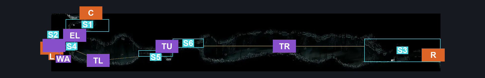
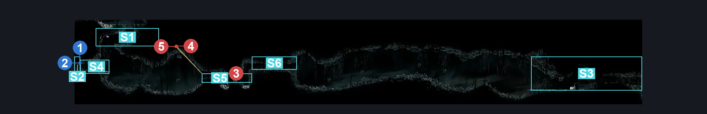
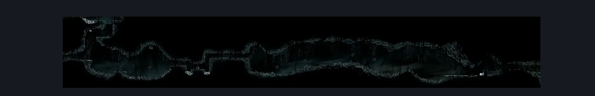

# Abyss Escape Hallway (Abyss_13)

**Game ID:** Abyss_13

**Contributors:** Pyxl

## Subrooms

| No. | Subroom | Annotated |
| --- | --- | --- |
| S1 | Escape Ledge | ✓ |
| S2 | Left Exit | ✓ |
| S3 | Right Exit | ✓ |
| S4 | Left Ledge | ✓ |
| S5 | Tunnel Left | ✓ |
| S6 | Tunnel Right | ✓ |

## Room Transitions

| Alias | Name | From subroom | Destination | Destination alias | Requirements | TODO | Verification | Annotated | Notes |
| --- | --- | --- | --- | --- | --- | --- | --- | --- | --- |
| L | left1 | Left Exit | [Abyss Drop Down From Escape Hall (Abyss_11)](abyss-drop-down-from-escape-hall.md) | R | None |  | Verified | ✓ |  |
| R | right1 | Right Exit | [Abyss Landing Zone (Abyss_03)](abyss-landing-zone.md) | UL | None |  | Verified | ✓ |  |
| C | top1 | Escape Ledge | [Abyss Escape (Abyss_09)](abyss-escape.md) | F | None |  | Verified | ✓ |  |

## Subroom Connections

| Alias | Name | Source | Destination | Requirements | TODO | Verification | Annotated | Notes |
| --- | --- | --- | --- | --- | --- | --- | --- | --- |
| EL | Escape Ledge | Left Ledge | Escape Ledge | Silk Soar OR Cling Grip |  | Verified | ✓ |  |
| EL | Escape Ledge | Escape Ledge | Left Ledge | None |  | Verified | ✓ |  |
| WA | Wall | Left Exit | Left Ledge | prereq Abyss escape wall right side OR Prereq Abyss escape wall Left side |  | Verified | ✓ |  |
| WA | Wall | Left Ledge | Left Exit | prereq Abyss escape wall right side OR Prereq Abyss escape wall Left side |  | Verified | ✓ |  |
| TL | Thorns Left | Left Ledge | Tunnel Left | Easy Beast pogo OR ( Flea brew jump AND easy flea brew stall ) OR Drifters Cloak OR Faydown Cloak OR Clawline Right OR Sharpdart OR Dash Right |  | Verified | ✓ |  |
| TL | Thorns Left | Tunnel Left | Left Ledge | CBT pogo off gloomsac OR Faydown Cloak OR ( Clawline left AND ( Ledge grab left OR Cling grip Left OR easy Hazard respawn OR ( Easy heal stall AND easy beast pogo ) OR Easy shaman Pogo OR Silk soar ) ) OR ( Easy Beast pogo AND easy hazard respawn ) |  | Verified | ✓ | Someone kill me why can these nobs carrys you places |
| TU | Tunnel | Tunnel Left | Tunnel Right | Ledge Grab Right OR Cling grip Either OR Faydown CLoak OR medium pogo off shadow creeper OR Easy scuttlebrace OR Hard delvers drill stall OR easy flea brew stall OR easy plasmium stall OR Easy voltvessels stall OR easy heal stall OR medium thread storm stall OR medium rune rage stall OR easy shaman pogo OR easy beast charge |  | Verified | ✓ |  |
| TU | Tunnel | Tunnel Right | Tunnel Left | None |  | Verified | ✓ |  |
| TR | Thorns Right | Tunnel Right | Right Exit | ( Faydown cloak AND ( ( Flea brew jump AND ( Drifters Cloak OR clawline Right OR Easy beast pogo OR  ( Dash right AND Easy Flea brew stall ) ) ) OR ( Drifters cloak AND ( Easy Voltvessels stall OR easy flintslate stall OR Easy plasmium stall OR Easy cross stitch stall OR easy flea brew stall ) ) ) ) OR ( Clawline Right AND ( Drifters Cloak OR Easy shaman pogo OR Easy Thread storm Stall OR Easy pale nails stall OR easy cross stitch stall OR easy rune rage stall OR sharpdart ) ) |  | Verified | ✓ |  |
| TR | Thorns Right | Right Exit | Tunnel Right | ( Faydown Cloak AND ( Drifters cloak OR Clawline left ) ) OR ( Cling grip left AND ( Flea brew jump AND Medium flea brew stall AND Drifters cloak ) ) |  | Verified | ✓ |  |

## Check Locations

| No. | Check | Subroom | Requirements | TODO | Verification | Location Type | Annotated | Notes |
| --- | --- | --- | --- | --- | --- | --- | --- | --- |
| 1 | Abyss escape wall right side | Left Ledge | Needle left OR needle up OR Needle Down |  | Verified | blockade | ✓ | These are the same wall just needed for both sides of the subroom |
| 2 | Abyss escape wall Left side | Left Exit | Needle Up OR needle Down OR Needle Right |  | Verified | blockade | ✓ | These are the same wall just needed for both sides of the subroom |
| 3 | Shadow Creeper 1 | Tunnel Left | NOne |  | Verified | enemy | ✓ |  |
| 4 | Gloomsac 1 | Tunnel Left | None |  | Verified | enemy | ✓ | Hate these guys so much |
| 5 | Gloomsac 2 | Tunnel Left | None |  | Verified | enemy | ✓ |  |

## Room Images

### Connections

### Checks

### Scene

