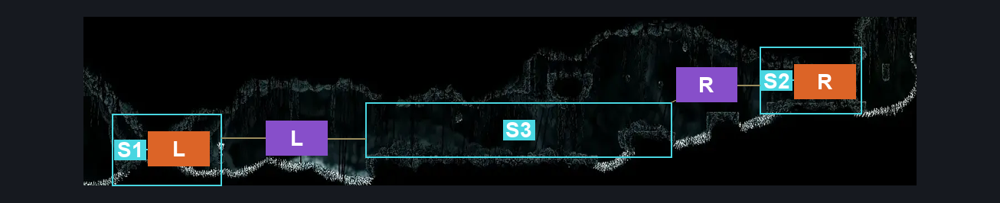
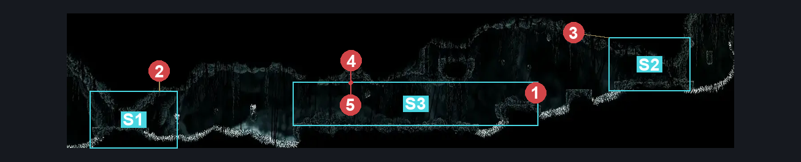
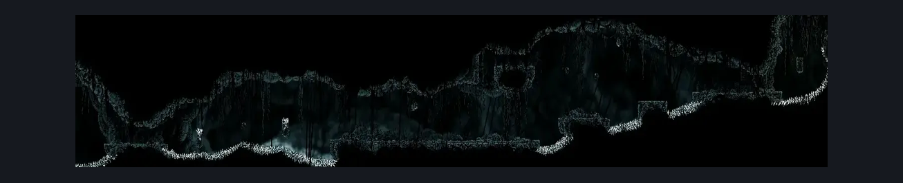

# Abyss Hallway To Upper Big Room (Abyss_02)

**Game ID:** Abyss_02

**Contributors:** Pyxl

## Subrooms

| No. | Subroom | Annotated |
| --- | --- | --- |
| S1 | Left Exit | ✓ |
| S2 | Right Exit | ✓ |
| S3 | Centre platform | ✓ |

## Room Transitions

| Alias | Name | From subroom | Destination | Destination alias | Requirements | TODO | Verification | Annotated | Notes |
| --- | --- | --- | --- | --- | --- | --- | --- | --- | --- |
| L | left1 | Left Exit | [Abyss Upper Big Room (Abyss_02b)](abyss-upper-big-room.md) | R | None |  | Verified | ✓ |  |
| R | right1 | Right Exit | [Abyss Landing Zone (Abyss_03)](abyss-landing-zone.md) | LL | None |  | Verified | ✓ |  |

## Subroom Connections

| Alias | Name | Source | Destination | Requirements | TODO | Verification | Annotated | Notes |
| --- | --- | --- | --- | --- | --- | --- | --- | --- |
| L | Left | Left Exit | Centre platform | ( Spike pogo AND ( easy reaper pogo OR Easy beast pogo OR easy shaman pogo OR  Cling grip Right OR medium flea brew stall OR easy plasmium stall OR dash right OR drifters cloak OR faydown cloak OR clawline right OR sharpdart OR hard enemy pogo off gloomsac ) ) OR ( Clawline right AND ( Cling grip left OR Drifters Cloak OR Easy flea brew stall OR easy plasmium stall OR easy flintslate stall ) ) |  | Verified | ✓ |  |
| L | Left | Centre platform | Left Exit | Clawline left OR ( Faydown Cloak AND Cling grip left AND ( Cling grip right OR dash left OR Drifters Cloak ) ) OR ( Spike pogo AND ( easy beast pogo OR easy shaman pogo OR Faydown cloak OR ( Dash left AND Proficient movement ) OR Drifters cloak ) ) |  | Verified | ✓ |  |
| R | Right | Right Exit | Centre platform | none |  | Verified | ✓ |  |
| R | Right | Centre platform | Right Exit | sprint right OR dash right OR drifters cloak OR faydown cloak OR clawline right OR sharpdart OR Flea brew jump OR easy beast pogo OR spike pogo ( Any crest ) |  | Verified | ✓ |  |

## Check Locations

| No. | Check | Subroom | Requirements | TODO | Verification | Location Type | Annotated | Notes |
| --- | --- | --- | --- | --- | --- | --- | --- | --- |
| 1 | Shadow Creeper 1 | Centre platform | None |  | Verified | enemy | ✓ |  |
| 2 | Gloomsac 1 | Left Exit | None |  | Verified | enemy | ✓ |  |
| 3 | Gloomsac 2 | Right Exit | None |  | Verified | enemy | ✓ |  |
| 4 | Gloomsac 3 | Centre platform | None |  | Verified | enemy | ✓ |  |
| 5 | Gloomsac 4 | Centre platform | None |  | Verified | enemy | ✓ |  |

## Room Images

### Connections

### Checks

### Scene

