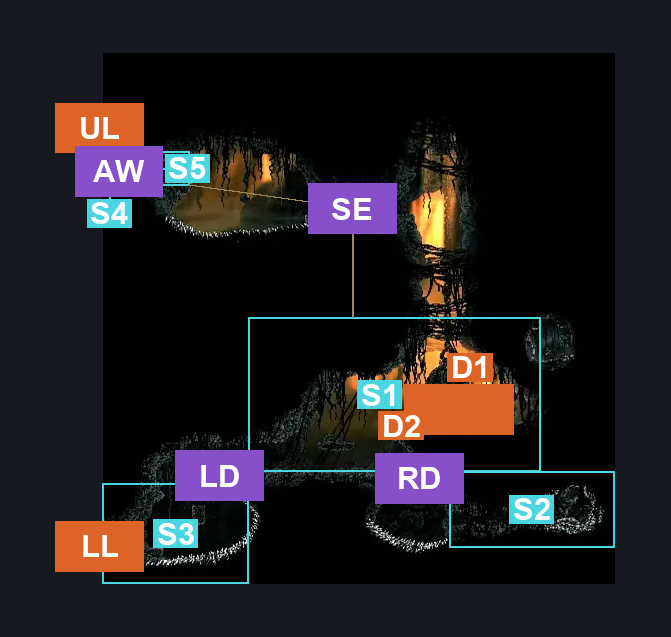
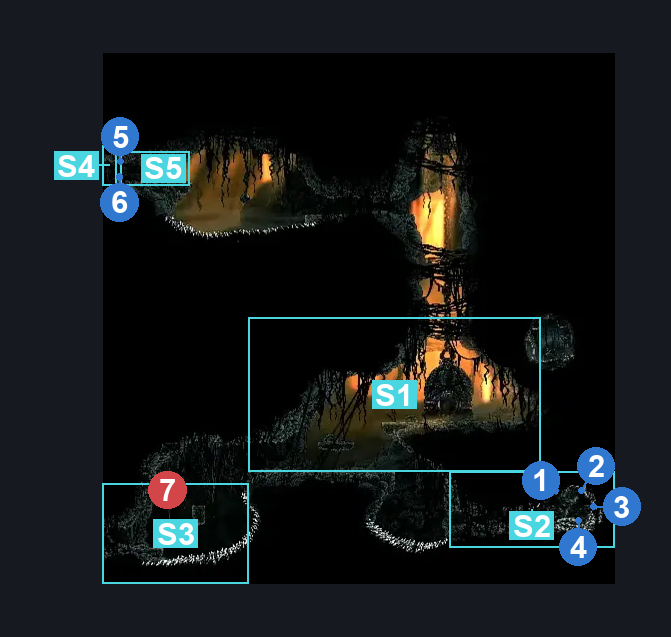
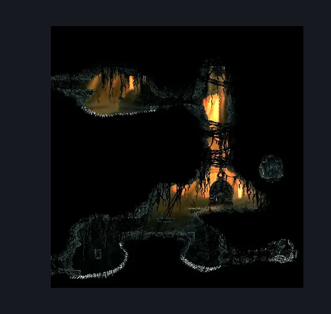

# Abyss Landing Zone (Abyss_03)

**Game ID:** Abyss_03

**Contributors:** Pyxl

## Subrooms

| No. | Subroom | Annotated |
| --- | --- | --- |
| S1 | Landing Zone | ✓ |
| S2 | Shard room | ✓ |
| S3 | Lower Exit | ✓ |
| S4 | Upper Exit | ✓ |
| S5 | Upper ledge | ✓ |

## Room Transitions

| Alias | Name | From subroom | Destination | Destination alias | Requirements | TODO | Verification | Annotated | Notes |
| --- | --- | --- | --- | --- | --- | --- | --- | --- | --- |
| UL | left2 | Upper Exit | [Abyss Escape Hallway (Abyss_13)](abyss-escape-hallway.md) | R | None |  | Verified | ✓ |  |
| D1 | door1 | Landing Zone | [Abyss Diving Bell Broken (Room_Diving_Bell_Abyss)](abyss-diving-bell-broken.md) | L | invalid |  | Verified | ✓ | logic always keeps the bell fixed |
| D2 | door2 | Landing Zone | [Abyss Diving Bell Fixed (Room_Diving_Bell_Abyss_Fixed)](abyss-diving-bell-fixed.md) | L | Have Everbloom |  | Verified | ✓ | So am i taking away the everbloom req here? pyxl 28/10 |
| LL | left1 | Lower Exit | [Abyss Hallway To Upper Big Room (Abyss_02)](abyss-hallway-to-upper-big-room.md) | R | None |  | Verified | ✓ |  |

## Subroom Connections

| Alias | Name | Source | Destination | Requirements | TODO | Verification | Annotated | Notes |
| --- | --- | --- | --- | --- | --- | --- | --- | --- |
| RD | Right Drop | Landing Zone | Shard room | Spike pogo OR easy hunter pogo OR Easy Reaper pogo OR easy beast pogo OR Easy Witch pogo OR easy Architect pogo OR easy Shaman pogo OR easy naked pogo OR ledge grab right OR sprint right OR dash right OR drifters cloak OR Faydown cloak OR Cling grip either OR Clawline right OR Sharpdart OR Easy rune rage stall OR easy pale nails stall OR easy thread storm stall OR easy cross stitch stall OR easy delvers drill stall OR easy flea brew stall OR easy plasmium stall OR easy voltvessels stall OR easy flintslate stall |  | Verified | ✓ |  |
| RD | Right Drop | Shard room | Landing Zone | Cling grip right OR ( Faydown cloak AND ( easy hazard respawn OR Cling grip left OR ledge grab left OR Scuttlebrace OR easy delvers drill stall OR  Easy heal stall OR Easy shaman Pogo OR Easy flea brew stall OR easy plasmium stall ) ) OR ( Scuttlebrace AND Clawline left ) |  | Verified | ✓ |  |
| LD | Left Drop | Landing Zone | Lower Exit | None |  | Verified | ✓ |  |
| LD | Left Drop | Lower Exit | Landing Zone | ( spike pogo AND easy Reaper Crest pogo ) OR Cling Grip right OR Faydown Cloak OR ( Silk Soar AND ( Spike pogo OR Ledge grab Right OR ( Cling grip left AND ( Clawline right OR drifters cloak ) ) OR easy plasmium stall OR hard delvers drill stall OR easy shaman pogo ) ) OR medium Scuttlebrace |  | Verified | ✓ |  |
| SE | Silk Soar Escape | Landing Zone | Upper ledge | Silk Soar AND ( Easy beast pogo OR Dash left OR drifters cloak OR faydown cloak OR Clawline left OR sharpdart OR Medium flea brew stall ) |  | Verified | ✓ |  |
| SE | Silk Soar Escape | Upper ledge | Landing Zone | spike pogo OR easy naked pogo OR easy hunter pogo OR easy reaper pogo OR easy beast pogo OR easy architect pogo OR easy shaman pogo OR dash right OR drifters cloak OR Faydown Cloak OR clawline right OR sharpdart OR easy flea brew stall OR easy plasmium stall OR easy flintslate stall OR easy voltvessels stall OR easy cross stitch stall OR easy rune rage stall OR easy thread storm stall OR easy pale nails stall |  | Verified | ✓ |  |
| AW | Abyss Wall | Upper Exit | Upper ledge | Prereq Abyss landing wall right side OR prereq Abyss landing wall left side |  | Verified | ✓ |  |
| AW | Abyss Wall | Upper ledge | Upper Exit | Prereq Abyss landing wall right side OR prereq Abyss landing wall left side |  | Verified | ✓ |  |

## Check Locations

| No. | Check | Subroom | Requirements | TODO | Verification | Location Type | Annotated | Notes |
| --- | --- | --- | --- | --- | --- | --- | --- | --- |
| 1 | Shell Shard Cache: Abyss #1 | Shard room | None |  | Verified | collectible | ✓ |  |
| 2 | Shell Shard Cache: Abyss #2 | Shard room | None |  | Verified | collectible | ✓ |  |
| 3 | Shell Shard Cache: Abyss #3 | Shard room | None |  | Verified | collectible | ✓ |  |
| 4 | Shell Shard Cache: Abyss #4 | Shard room | None |  | Verified | collectible | ✓ |  |
| 5 | Abyss Landing Wall Left side | Upper ledge | None |  | Verified | blockade | ✓ |  |
| 6 | Abyss Landing Wall Right side | Upper Exit | None |  | Verified | blockade | ✓ |  |
| 7 | Shadow Creeper 1 | Lower Exit | None |  | Verified | enemy | ✓ |  |

## Room Images

### Connections

### Checks

### Scene

