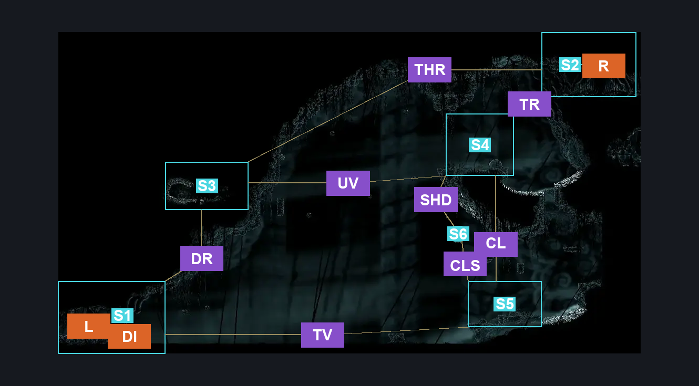
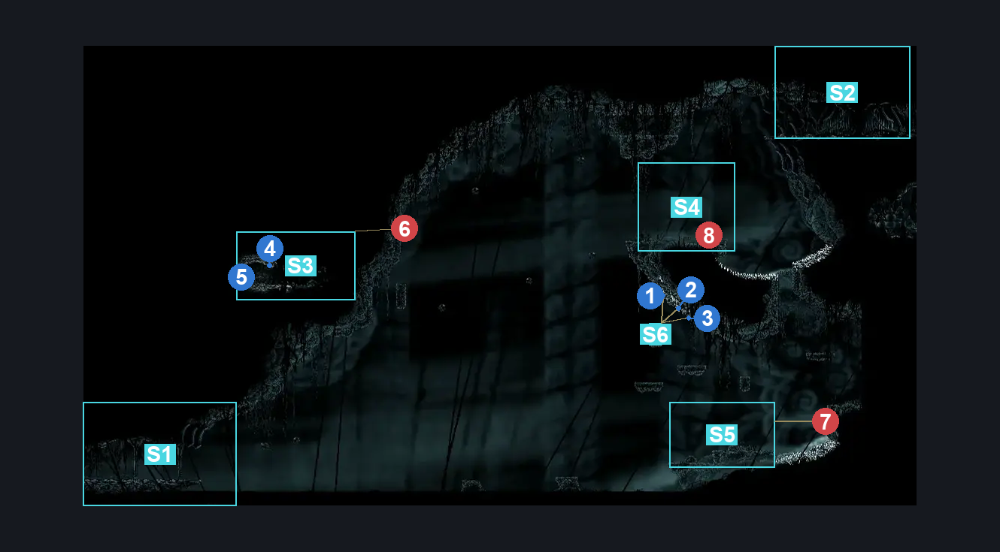
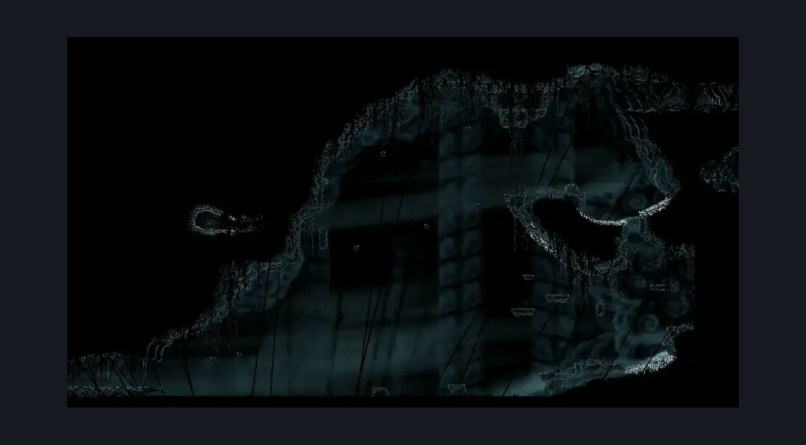

# Abyss Lower Big Room (Abyss_05)

**Game ID:** Abyss_05

**Contributors:** Pyxl

## Subrooms

| No. | Subroom | Annotated |
| --- | --- | --- |
| S1 | Start | ✓ |
| S2 | End | ✓ |
| S3 | Hidden Shellshards | ✓ |
| S4 | Centre Platform | ✓ |
| S5 | Right Void Coast | ✓ |
| S6 | Below Shell Shards | ✓ |

## Room Transitions

| Alias | Name | From subroom | Destination | Destination alias | Requirements | TODO | Verification | Annotated | Notes |
| --- | --- | --- | --- | --- | --- | --- | --- | --- | --- |
| R | right1 | End | [Weavenest Absolom (Abyss_08)](weavenest-absolom.md) | L | Needolin |  | Verified | ✓ |  |
| L | left2 | Start | [Abyss Final Bench (Abyss_12)](abyss-final-bench.md) | R | None |  | Verified | ✓ |  |
| DI | Dive | Start | [Last Dive (Last_Dive)](last-dive.md) | D | Have Everbloom |  | Verified | ✓ |  |

## Subroom Connections

| Alias | Name | Source | Destination | Requirements | TODO | Verification | Annotated | Notes |
| --- | --- | --- | --- | --- | --- | --- | --- | --- |
| TV | The Void | Start | Right Void Coast | ( Clawline RIght AND ( Drifters Cloak OR Sprint Right OR Dash Right OR Drifters Cloak OR Faydown Cloak OR silk soar OR easy cross stitch stall OR easy thread storm stall OR easy rune rage stall OR easy pale nails stall OR sharpdart OR easy flea brew stall OR easy plasmium stall OR easy flintslate stall OR easy voltvessels stall OR easy beast pogo OR easy witch pogo OR hard architect pogo OR easy shaman pogo ) ) OR ( Swim AND Own Everbloom AND Faydown Cloak ) |  | Verified | ✓ |  |
| TV | The Void | Right Void Coast | Start | ( clawline left x 8 AND ( ( Swim AND have everbloom ) OR Drifters Cloak OR Easy flea brew stall x 3 OR easy cross stitch stall x 3 OR easy shaman pogo OR easy thread storm stall x 3 OR Easy Pale nails stall x 3 OR Faydown Cloak ) ) OR ( Swim AND Have Everbloom AND ( Ledge grab Left OR Faydown Cloak OR Drifters cloak OR ( Sprint left AND ( Dash Left OR Easy wanderer charge OR Easy witch charge OR Easy architect pogo OR easy flintslate stall x 3 ) ) OR Sharpdart x 1 OR Cling grip left OR Scuttlebrace OR ( Easy heal stall AND intended beast pogo ) OR Medium beast pogo OR Easy shaman pogo OR easy flea brew stall x 1 OR easy delvers drill stall x 1 OR easy plasmium stall x 1 OR easy voltvessels stall x 1 ) ) OR ( Faydown Cloak AND Drifters Cloak AND Sprint left AND Dash Left AND Medium flea brew stall x 4 ) |  | Verified | ✓ |  |
| DR | Drop | Hidden Shellshards | Start | Clawline left OR Drifters Cloak OR Easy Architect pogo OR Easy hunter pogo OR  Easy Beast pogo OR Easy flea brew stall x 4 OR Easy voltvessels stall x 7 OR Easy plasmium stall x 4 |  | Verified | ✓ |  |
| TR | Top Right | Centre Platform | End | Silk Soar |  | Verified | ✓ |  |
| TR | Top Right | End | Centre Platform | None |  | Verified | ✓ |  |
| CL | Climb | Right Void Coast | Centre Platform | Cling grip Left AND ( ( Faydown Cloak AND Drifters Cloak AND ( Easy pogo off shadow creeper OR cling grip right ) ) OR ( Silk Soar AND Spike Pogo ) OR ( Clawline left AND ( Cling grip left OR ( spike pogo AND Easy pogo off shadow creeper ) ) AND ( Clawline Right OR Faydown Cloak ) ) ) |  | Verified | ✓ |  |
| CL | Climb | Centre Platform | Right Void Coast | None |  | Verified | ✓ |  |
| UV | Upper Void | Centre Platform | Hidden Shellshards | Clawline left OR Faydown Cloak OR ( ( Drifters Cloak OR Easy beast pogo ) AND ( Cling grip Left OR Scuttlebrace ) ) |  | Verified | ✓ |  |
| UV | Upper Void | Hidden Shellshards | Centre Platform | Clawline Right OR Faydown Cloak |  | Verified | ✓ |  |
| CLS | Climb Shell Shards | Right Void Coast | Below Shell Shards | Silk Soar OR ( ( cling grip left OR ledge grab left OR scuttlebrace OR faydown Cloak OR Easy flea brew stall x 1 OR Easy plasmium stall x 1 OR easy delvers drill stall x 1 OR Easy beast charge OR ( easy heal stall AND Intended beast pogo ) OR Easy shaman pogo ) AND ( ( Spike pogo AND ( Faydown Cloak OR Cling grip Right OR Scuttlebrace ) ) AND ( Cling grip Left OR Scuttlebrace OR Faydown cloak ) AND ( Clawline Left OR Drifters Cloak OR sharpdart ) ) ) |  | Verified | ✓ |  |
| CLS | Climb Shell Shards | Below Shell Shards | Right Void Coast | None |  | Verified | ✓ |  |
| SHD | Shell Shard Drop | Centre Platform | Below Shell Shards | None |  | Verified | ✓ |  |
| THR | The Roof | Hidden Shellshards | End | Faydown Cloak AND Cling grip Left AND Clawline Right |  | Verified | ✓ |  |
| THR | The Roof | End | Hidden Shellshards | Clawline left OR ( Sprint left AND ( Dash Left OR Easy Beast pogo OR Drifters CLoak ) ) OR ( Faydown Cloak AND ( Drifters Cloak OR Dash left OR Easy Beast pogo OR Easy Flea brew stall ) ) |  | Verified | ✓ |  |

## Check Locations

| No. | Check | Subroom | Requirements | TODO | Verification | Location Type | Annotated | Notes |
| --- | --- | --- | --- | --- | --- | --- | --- | --- |
| 1 | Shell Shard Cache: Abyss_05 #1 | Below Shell Shards | None |  | Verified | collectible | ✓ |  |
| 2 | Shell Shard Cache: Abyss_05 #2 | Below Shell Shards | None |  | Verified | collectible | ✓ |  |
| 3 | Shell Shard Cache: Abyss_05 #3 | Below Shell Shards | None |  | Verified | collectible | ✓ |  |
| 4 | Shell Shard Cache: Abyss_05 #4 | Hidden Shellshards | None |  | Verified | collectible | ✓ |  |
| 5 | Shell Shard Cache: Abyss_05 #5 | Hidden Shellshards | None |  | Verified | collectible | ✓ |  |
| 6 | Shadow Creeper 1 | Hidden Shellshards | None |  | Verified | enemy | ✓ |  |
| 7 | Shadow Creeper 2 | Right Void Coast | None |  | Verified | enemy | ✓ |  |
| 8 | Shadow Charger 1 | Centre Platform | None |  | Verified | enemy | ✓ |  |

## Room Images

### Connections

### Checks

### Scene

