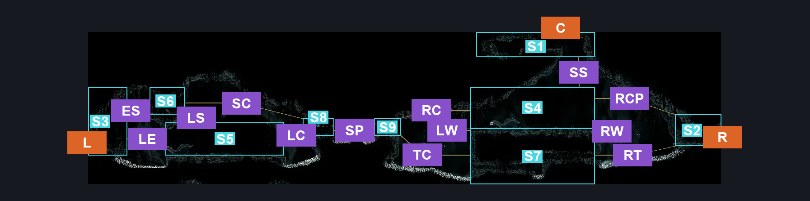
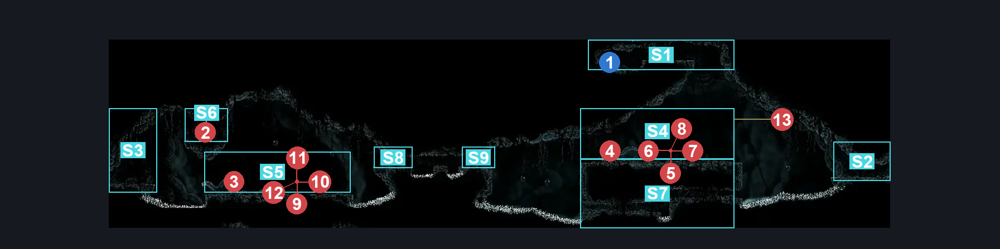
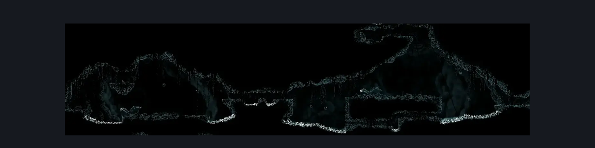

# Abyss Upper Big Room (Abyss_02b)

**Game ID:** Abyss_02b

**Contributors:** Pyxl

## Subrooms

| No. | Subroom | Annotated |
| --- | --- | --- |
| S1 | Upper Zone | ✓ |
| S2 | Right Exit | ✓ |
| S3 | Left Exit | ✓ |
| S4 | Centre Right Platform | ✓ |
| S5 | Centre Left Platform | ✓ |
| S6 | Shadow Creedper Platform | ✓ |
| S7 | Tunnels | ✓ |
| S8 | Central spike left | ✓ |
| S9 | Central Spike Right | ✓ |

## Room Transitions

| Alias | Name | From subroom | Destination | Destination alias | Requirements | TODO | Verification | Annotated | Notes |
| --- | --- | --- | --- | --- | --- | --- | --- | --- | --- |
| L | left2 | Left Exit | [Abyss Tall Room (Abyss_01)](abyss-tall-room.md) | UR | None |  | Verified | ✓ |  |
| C | top1 | Upper Zone | [Abyss Drop Down From Escape Hall (Abyss_11)](abyss-drop-down-from-escape-hall.md) | F | Prereq Abyss Drop Down Wall IN Abyss Drop down from escape hall |  | Verified | ✓ |  |
| R | right1 | Right Exit | [Abyss Hallway To Upper Big Room (Abyss_02)](abyss-hallway-to-upper-big-room.md) | L | None |  | Verified | ✓ |  |

## Subroom Connections

| Alias | Name | Source | Destination | Requirements | TODO | Verification | Annotated | Notes |
| --- | --- | --- | --- | --- | --- | --- | --- | --- |
| RT | Right To Tunnels | Right Exit | Tunnels | Spike Pogo ( Any Crest Works ) OR Clawline Left OR Dash Left OR Easy Flea brew stall OR Faydown Cloak OR Drifters Cloak OR Sharpdart |  | Verified | ✓ |  |
| RT | Right To Tunnels | Tunnels | Right Exit | Spike Pogo ( Any Crest ) OR Clawline Right OR ( Faydown cloak AND easy flea brew stall ) |  | Verified | ✓ |  |
| RCP | Right To Centre Right | Right Exit | Centre Right Platform | Clawline Left OR Faydown Cloak OR ( ( Spike Pogo ( Any Crest Works ) OR Dash Left OR Easy Flea brew stall OR Drifters Cloak OR Sharpdart  ) AND Cling grip left ) |  | Verified | ✓ |  |
| RCP | Right To Centre Right | Centre Right Platform | Right Exit | Spike Pogo ( Any Crest ) OR Clawline Right OR Faydown Cloak OR Drifters Cloak OR Dash Right OR Sharpdart OR Easy Flea Brew Stall |  | Verified | ✓ |  |
| SS | Silk Soar | Centre Right Platform | Upper Zone | Silk Soar OR CBT pogo off Gloomsac |  | Verified | ✓ |  |
| SS | Silk Soar | Upper Zone | Centre Right Platform | None |  | Verified | ✓ |  |
| LW | Left Wall | Centre Right Platform | Tunnels | None |  | Verified | ✓ |  |
| LW | Left Wall | Tunnels | Centre Right Platform | Cling grip Left OR Scuttlebrace OR ( Faydown Cloak AND ( Ledge Grab Left OR Medium Heal Stall OR Medium Flea Brew stall OR medium Delvers Drill Stall OR medium Plasmium stall OR medium Voltvessels stall OR Easy Shaman Pogo ) ) |  | Verified | ✓ |  |
| RW | Rigth Wall | Centre Right Platform | Tunnels | None |  | Verified | ✓ |  |
| RW | Rigth Wall | Tunnels | Centre Right Platform | Cling grip Right OR Scuttlebrace OR Faydown Cloak |  | Verified | ✓ |  |
| RC | Right To Centre | Centre Right Platform | Central Spike Right | Dash Left OR Clawline Left OR Faydown Cloak OR Easy Beast Pogo OR Drifters Cloak OR Sharpdart OR Medium Scuttlebrace OR ( Cling grip Left AND ( Easy Flea Brew Stall OR Easy Delvers Drill Stall OR spike pogo OR Easy Flintslate stall OR easy plasmium stall OR Easy voltvessels stall OR Easy heal stall OR Easy cross stitch stall OR easy thread storm stall OR easy pale nails stall OR easy rune rage stall OR easy naked pogo OR Easy Hunter Pogo OR easy reaper pogo OR easy Architect pogo OR hard shaman pogo ) ) |  | Verified | ✓ |  |
| RC | Right To Centre | Central Spike Right | Centre Right Platform | ( Clawline Right OR Sharpdart ) AND ( Cling grip Right OR Faydown Cloak OR Scuttlebrace ) |  | Verified | ✓ |  |
| TC | Tunnels To Centre | Tunnels | Central Spike Right | Spike Pogo AND ( Cling grip left OR Scuttlebrace ) |  | Verified | ✓ |  |
| TC | Tunnels To Centre | Central Spike Right | Tunnels | Spike pogo OR easy naked pogo |  | Verified | ✓ |  |
| SP | Spikes | Central Spike Right | Central spike left | Spike pogo OR Dash Left OR Clawline left OR Sprint Left OR Drifters Cloak OR Faydown Cloak OR Sharpdart OR Easy Beast Pogo |  | Verified | ✓ |  |
| SP | Spikes | Central spike left | Central Spike Right | Spike pogo OR Dash Right OR Clawline Right OR Sprint Right OR Drifters Cloak OR Faydown Cloak OR Sharpdart OR Easy Beast Pogo |  | Verified | ✓ |  |
| LC | Left To Centre | Centre Left Platform | Central spike left | Faydown Cloak OR ( easy hazard respawn AND ( Hard Shaman Pogo OR Medium Delvers Drill Stall OR Easy plasmium stall ) ) OR Hard pogo OFF gloomsac |  | Verified | ✓ |  |
| LC | Left To Centre | Central spike left | Centre Left Platform | None |  | Verified | ✓ |  |
| LE | Left To Exit | Centre Left Platform | Left Exit | Spike pogo OR ( Ledge Grab Left AND ( Drifters Cloak OR ( Faydown Cloak AND ( easy Flea brew stall OR Easy Delvers Drill stall OR Easy flintslate stall OR easy Voltvessels stall OR easy plasmium stall OR Easy heal stall OR Easy cross stitch stall OR Easy Thread storm stall OR Easy rune rage stall OR easy pale nails stall ) ) ) ) OR Clawline left OR Sharpdart |  | Verified | ✓ |  |
| LE | Left To Exit | Left Exit | Centre Left Platform | Spike pogo OR Clawline right OR Sharpdart OR Sprint Right OR Dash Right OR Faydown Cloak OR Drifters CLoak OR easy flea brew stall OR medium voltvessels stall OR easy plasmium stall |  | Verified | ✓ |  |
| ES | Exit To Creeper | Left Exit | Shadow Creedper Platform | Silk soar AND ( Dash Right OR Drifters Cloak OR Faydown Cloak OR Clawline Right OR Sharpdart OR Easy Flea brew stall OR Easy beast pogo ) |  | Verified | ✓ |  |
| ES | Exit To Creeper | Shadow Creedper Platform | Left Exit | None |  | Verified | ✓ |  |
| LS | Left To Creeper | Centre Left Platform | Shadow Creedper Platform | Silk Soar |  | Verified | ✓ |  |
| LS | Left To Creeper | Shadow Creedper Platform | Centre Left Platform | None |  | Verified | ✓ |  |
| SC | Creeper To Centre | Shadow Creedper Platform | Central spike left | Faydown Cloak OR drifters Cloak OR clawline right OR ( Dash Right AND ( Easy Flea brew Stall OR Easy Beast pogo OR Easy Plasmium Stall ) ) |  | Verified | ✓ |  |
| SC | Creeper To Centre | Central spike left | Shadow Creedper Platform | Clawline Left OR ( ( Faydown Cloak OR Drifters Cloak ) AND ( Dash Left OR Faydown CLoak OR Drifters Cloak OR Easy Beast pogo ) ) |  | Verified | ✓ |  |

## Check Locations

| No. | Check | Subroom | Requirements | TODO | Verification | Location Type | Annotated | Notes |
| --- | --- | --- | --- | --- | --- | --- | --- | --- |
| 1 | Lore: Abyss #1 | Upper Zone | None |  | Verified | lore | ✓ |  |
| 2 | Shadow Creeper 1 | Shadow Creedper Platform | None |  | Verified | enemy | ✓ |  |
| 3 | Gargant Gloom 1 | Centre Left Platform | proficient movement OR ( Dash Both AND Faydown Cloak ) |  | Verified | enemy | ✓ |  |
| 4 | Gargant Gloom 2 | Centre Right Platform | proficient movement OR ( Dash Both AND Faydown Cloak ) |  | Verified | enemy | ✓ |  |
| 5 | Gloomsac 1 | Centre Right Platform | None |  | Verified | enemy | ✓ | Spawned By Gargen Gloom 2 |
| 6 | Gloomsac 2 | Centre Right Platform | None |  | Verified | enemy | ✓ | Spawned By Gargen Gloom 2 |
| 7 | Gloomsac 3 | Centre Right Platform | None |  | Verified | enemy | ✓ | Spawned By Gargen Gloom 2 |
| 8 | Gloomsac 4 | Centre Right Platform | None |  | Verified | enemy | ✓ | Spawned By Gargen Gloom 2 |
| 9 | Gloomsac 5 | Centre Left Platform | None |  | Verified | enemy | ✓ | Spawned By Gargen Gloom 1 |
| 10 | Gloomsac 6 | Centre Left Platform | None |  | Verified | enemy | ✓ | Spawned By Gargen Gloom 1 |
| 11 | Gloomsac 7 | Centre Left Platform | None |  | Verified | enemy | ✓ | Spawned By Gargen Gloom 1 |
| 12 | Gloomsac 8 | Centre Left Platform | None |  | Verified | enemy | ✓ | Spawned By Gargen Gloom 1 |
| 13 | Gloomsac 9 | Centre Right Platform | None |  | Verified | enemy | ✓ |  |

## Room Images

### Connections

### Checks

### Scene

