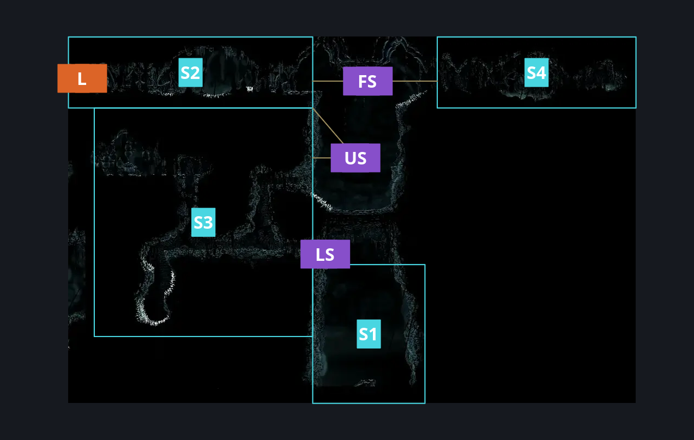
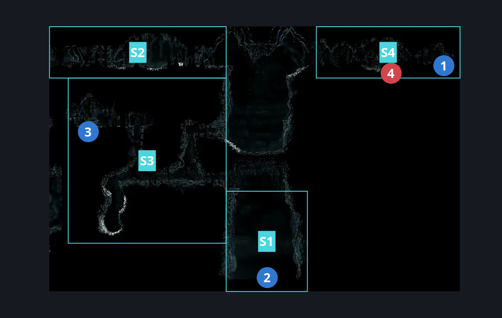
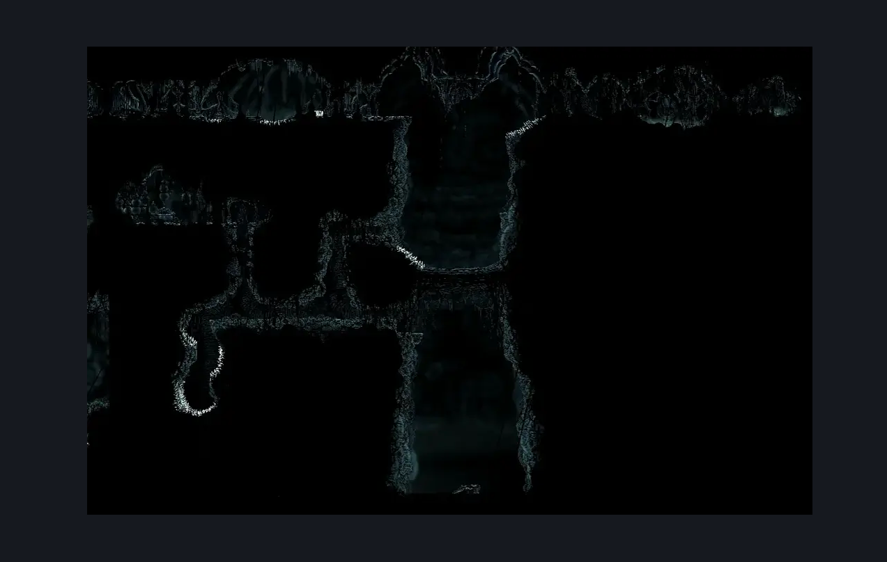

# Weavenest Absolom (Abyss_08)

**Game ID:** Abyss_08

**Contributors:** Pyxl

## Subrooms

| No. | Subroom | Annotated |
| --- | --- | --- |
| S1 | The Void | ✓ |
| S2 | Entrance Zone | ✓ |
| S3 | Passageways | ✓ |
| S4 | Farsight | ✓ |

## Room Transitions

| Alias | Name | From subroom | Destination | Destination alias | Requirements | TODO | Verification | Annotated | Notes |
| --- | --- | --- | --- | --- | --- | --- | --- | --- | --- |
| L | left1 | Entrance Zone | [Abyss Lower Big Room (Abyss_05)](abyss-lower-big-room.md) | R | Needolin |  | Verified | ✓ |  |

## Subroom Connections

| Alias | Name | Source | Destination | Requirements | TODO | Verification | Annotated | Notes |
| --- | --- | --- | --- | --- | --- | --- | --- | --- |
| US | Upper Shaft | Entrance Zone | Passageways | None |  | Verified | ✓ |  |
| US | Upper Shaft | Passageways | Entrance Zone | Silk Soar |  | Verified | ✓ |  |
| LS | Lower Shaft | Passageways | The Void | None |  | Verified | ✓ |  |
| LS | Lower Shaft | The Void | Passageways | Silk Soar |  | Verified | ✓ |  |
| FS | Farsight | Farsight | Entrance Zone | Silk Soar OR Clawline left x 2 OR ( Faydown Cloak AND ( Dash left OR Drifters Cloak ) ) OR easy scuttleglide |  | Verified | ✓ |  |
| FS | Farsight | Entrance Zone | Farsight | Silk Soar OR Clawline right x 2 OR easy beast pogo OR ( Faydown Cloak AND ( Dash Right OR Drifters Cloak) ) OR ((clawline right OR sharpdart) AND spike pogo) OR (sprint right AND spike pogo AND (dash right OR faydown OR easy architect pogo OR medium shaman pogo)) OR (medium voltvessels stall AND medium [architect,hunter] pogo) OR (medium silkshot original stall AND (medium architect pogo OR (medium hunter pogo AND cling grip right))) |  | Verified | ✓ |  |

## Check Locations

| No. | Check | Subroom | Requirements | TODO | Verification | Location Type | Annotated | Notes |
| --- | --- | --- | --- | --- | --- | --- | --- | --- |
| 1 | Farsight | Farsight | None |  | Verified | collectible | ✓ |  |
| 2 | Silk Soar | The Void | None |  | Verified | collectible | ✓ |  |
| 3 | Journal Entry: Void Tentrils | Passageways | Silk Soar OR (( Faydown Cloak OR medium [shaman,reaper,architect] pogo) AND ( Cling grip right OR easy Scuttlebrace ) ) OR Cling grip left OR (cling grip right AND witch longclaw down AND medium witch pogo) |  | Verified | lore | ✓ |  |
| 4 | Weaver Servitor Broken 1 | Farsight | None |  | Verified | enemy | ✓ |  |

## Room Images

### Connections

### Checks

### Scene

