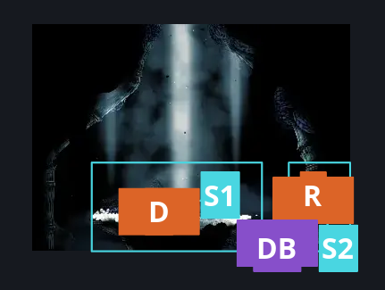
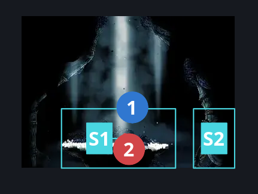
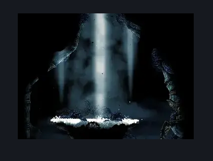

# Lace 2 Fight (Song_Tower_01)

**Game ID:** Song_Tower_01

**Contributors:** Pyxl

## Subrooms

| No. | Subroom | Annotated |
| --- | --- | --- |
| S1 | Arena | ✓ |
| S2 | Behind Right Gate | ✓ |

## Room Transitions

| Alias | Name | From subroom | Destination | Destination alias | Requirements | TODO | Verification | Annotated | Notes |
| --- | --- | --- | --- | --- | --- | --- | --- | --- | --- |
| D | door_cinematicEnd | Arena | [Cog Dancers (Cog_Dancers)](../cogwork-core/cog-dancers.md) | E | Prereq Boss: Lace 2 |  | Verified | ✓ | You know im not actually sure which of these doors is the elevator will need to double check once images are in |
| R | right1 | Behind Right Gate | [Terminus Ventrica (Tube_Hub)](terminus-ventrica.md) | LL | Defeat Boss: Lace 2 |  | Verified | ✓ |  |

## Subroom Connections

| Alias | Name | Source | Destination | Requirements | TODO | Verification | Annotated | Notes |
| --- | --- | --- | --- | --- | --- | --- | --- | --- |
| DB | Door Bridge | Arena | Behind Right Gate | prereq Boss: Lace 2 |  | Verified | ✓ |  |
| DB | Door Bridge | Behind Right Gate | Arena | prereq Boss: Lace 2 |  | Verified | ✓ |  |

## Check Locations

| No. | Check | Subroom | Requirements | TODO | Verification | Location Type | Annotated | Notes |
| --- | --- | --- | --- | --- | --- | --- | --- | --- |
| 1 | Silk Heart: Lace 2 | Arena | prereq Boss: Lace 2 |  | Verified | collectible | ✓ |  |
| 2 | Boss: Lace 2 | Arena | Combat Requirements |  | Verified | enemy | ✓ |  |

## Notes

No map image for this

## Room Images

### Connections

### Checks

### Scene

