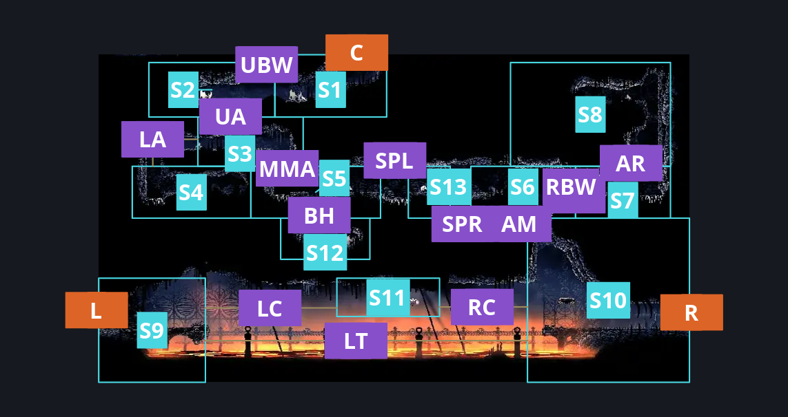
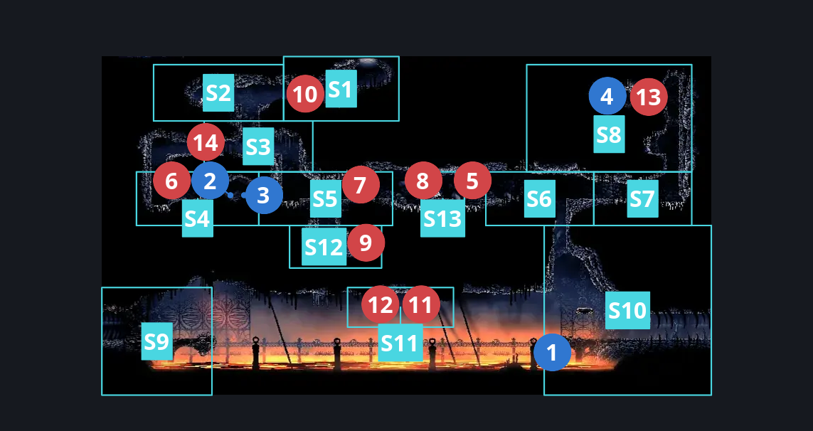
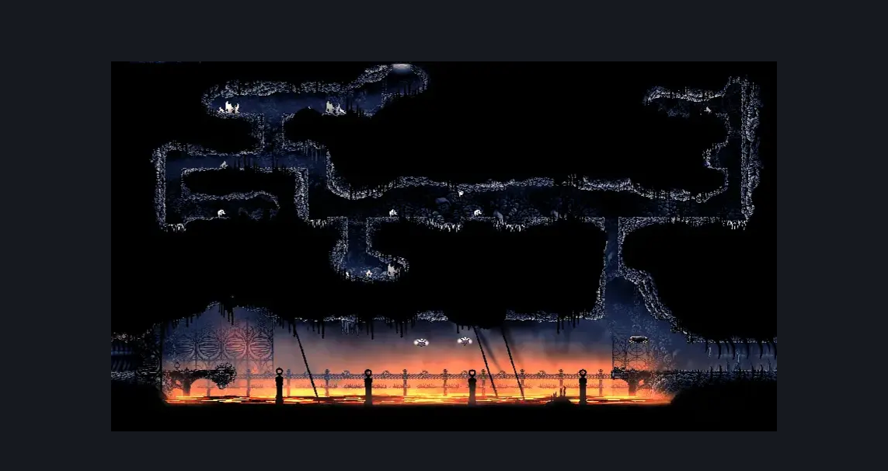

# The Marrow Lava Track (Bone_16)

**Game ID:** Bone_16

**Contributors:** herounit

## Subrooms

| No. | Subroom | Annotated |
| --- | --- | --- |
| S1 | ceiling exit area | ✓ |
| S2 | upper maze left | ✓ |
| S3 | middle maze | ✓ |
| S4 | left alcove | ✓ |
| S5 | lower maze 1 | ✓ |
| S6 | lower maze 2 | ✓ |
| S7 | lower maze 3 | ✓ |
| S8 | right alcove | ✓ |
| S9 | left lava track | ✓ |
| S10 | right lava track | ✓ |
| S11 | caranids over lava | ✓ |
| S12 | brute hole | ✓ |
| S13 | kilik island | ✓ |

- **caranids over lava:** enemy only subroom - only make connections one-way

## Room Transitions

| Alias | Name | From subroom | Destination | Destination alias | Requirements | TODO | Verification | Annotated | Notes |
| --- | --- | --- | --- | --- | --- | --- | --- | --- | --- |
| L | left | left lava track | [The Marrow Lava Intro (Bone_02)](the-marrow-lava-intro.md) | R | none |  | Verified | ✓ |  |
| R | right | right lava track | [The Marrow Lava Docks (Bone_09)](the-marrow-lava-docks.md) | L | none |  | Verified | ✓ |  |
| C | ceiling | ceiling exit area | [The Marrow Skull Tyrant Arena (Bone_15)](the-marrow-skull-tyrant-arena.md) | F | none |  | Verified | ✓ |  |

## Subroom Connections

| Alias | Name | Source | Destination | Requirements | TODO | Verification | Annotated | Notes |
| --- | --- | --- | --- | --- | --- | --- | --- | --- |
| LT | lava track | left lava track | right lava track | activate track pressure plate  OR ( clawline right x 8 AND easy shaman pogo ) |  | Verified | ✓ | other stalls would work but would be harder |
| LT | lava track | right lava track | left lava track | activate track pressure plate  OR ( clawline left x 8 AND easy shaman pogo ) |  | Verified | ✓ | other stalls would work but would be harder |
| LC | left caranid access | left lava track | caranids over lava | activate track pressure plate OR ( clawline right x 4 AND easy shaman pogo ) OR hard shaman scuttle slide |  | Verified | ✓ | other stalls would work but would be harder |
| RC | right caranid access | right lava track | caranids over lava | activate track pressure plate OR ( clawline left x 4 AND easy shaman pogo ) OR (hard shaman scuttle slide AND easy pogo off caranid) |  | Verified | ✓ | other stalls would work but would be harder |
| AM | ascend to maze | right lava track | lower maze 2 | cling grip left OR silk soar  OR easy scuttlebrace OR ( cling grip right AND ( medium enemy pogo off caranid OR ( faydown AND easy enemy pogo off caranid ))) |  | Verified | ✓ |  |
| AM | ascend to maze | lower maze 2 | right lava track | none (falling) |  | Verified | ✓ |  |
| RBW | right break wall | lower maze 2 | lower maze 3 | break wall right |  | Verified | ✓ |  |
| RBW | right break wall | lower maze 3 | lower maze 2 | break wall left |  | Verified | ✓ |  |
| AR | ascend right | lower maze 3 | right alcove | cling grip either OR easy scuttlebrace  OR ( faydown AND ledge grab left ) |  | Verified | ✓ |  |
| AR | ascend right | right alcove | lower maze 3 | spike pogo  OR cling grip either  OR faydown  OR dash left OR drifters  OR clawline left OR sharpdart  OR easy scuttlebrace |  | Verified | ✓ | harder to drop down than to go up LOL |
| MMA | middle maze ascend | lower maze 1 | middle maze | cling grip either OR easy scuttlebrace  OR ( faydown cloak AND ( ledge grab left OR easy shaman pogo ) ) |  | Verified | ✓ |  |
| MMA | middle maze ascend | middle maze | lower maze 1 | none (falling) |  | Verified | ✓ |  |
| LA | left alcove access | middle maze | left alcove | break wall left |  | Verified | ✓ |  |
| LA | left alcove access | left alcove | middle maze | break wall right  AND ( cling grip either OR easy scuttlebrace OR ( ledge grab right AND faydown ) ) |  | Verified | ✓ |  |
| SPL | spike pogo left | lower maze 1 | kilik island | ledge grab right OR spike pogo  OR run  OR dash right OR drifters  OR faydown OR clawline  right OR easy scuttlebrace OR sharpdart OR flea brew |  | Verified | ✓ | roof makes it so ledge grab works from left to right  but not the other way |
| SPL | spike pogo left | kilik island | lower maze 1 | none (jump) |  | Verified | ✓ | no roof obstruction |
| SPR | spike pogo right | lower maze 2 | kilik island | spike pogo  OR run  OR dash left OR drifters  OR faydown  OR clawline left OR easy scuttlebrace  OR sharpdart OR flea brew |  | Verified | ✓ | possible other stalls might work - lip on ceiling seems to make it impassable with walking jump? |
| SPR | spike pogo right | kilik island | lower maze 2 | none (jump) |  | Verified | ✓ | no roof obstruction |
| UBW | upper break wall | upper maze left | ceiling exit area | break wall right |  | Verified | ✓ |  |
| UBW | upper break wall | ceiling exit area | upper maze left | break wall left |  | Verified | ✓ |  |
| UA | upper ascend | middle maze | upper maze left | silk soar  OR cling grip either OR easy scuttlebrace  OR ( faydown cloak AND ledge grab either ) |  | Verified | ✓ |  |
| UA | upper ascend | upper maze left | middle maze | none (falling) |  | Verified | ✓ |  |
| BH | brute hole access | lower maze 1 | brute hole | none (falling) |  | Verified | ✓ |  |
| BH | brute hole access | brute hole | lower maze 1 | silk soar OR cling grip either OR easy scuttlebrace |  | Verified | ✓ |  |

## Check Locations

| No. | Check | Subroom | Requirements | TODO | Verification | Location Type | Annotated | Notes |
| --- | --- | --- | --- | --- | --- | --- | --- | --- |
| 1 | track pressure plate | right lava track | none (stand on it) |  | Verified | switch | ✓ |  |
| 2 | the marrow rosary cache 11 | left alcove | none |  | Verified | collectible | ✓ |  |
| 3 | the marrow rosary cache 12 | left alcove | none |  | Verified | collectible | ✓ |  |
| 4 | the marrow rosary cache 13 | right alcove | none |  | Verified | collectible | ✓ |  |
| 5 | Kilik 1 | kilik island | None |  | Verified | enemy | ✓ |  |
| 6 | Kilik 2 | left alcove | None |  | Verified | enemy | ✓ |  |
| 7 | Kilik 3 | lower maze 1 | None |  | Verified | enemy | ✓ |  |
| 8 | Kilik 4 | kilik island | None |  | Verified | enemy | ✓ |  |
| 9 | Skull Brute 1 | brute hole | None |  | Verified | enemy | ✓ |  |
| 10 | Skull Brute 2 | ceiling exit area | None |  | Verified | enemy | ✓ |  |
| 11 | Caranid 1 | caranids over lava | None |  | Verified | enemy | ✓ |  |
| 12 | Caranid 2 | caranids over lava | None |  | Verified | enemy | ✓ |  |
| 13 | Skull Scuttler 1 | right alcove | None |  | Verified | enemy | ✓ |  |
| 14 | Skull Scuttler 2 | middle maze | None |  | Verified | enemy | ✓ |  |

## Room Images

### Connections

### Checks

### Scene

