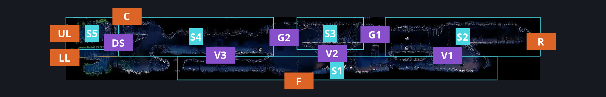
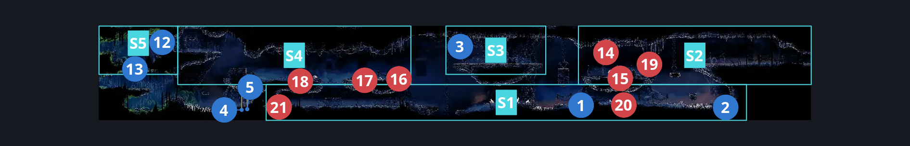
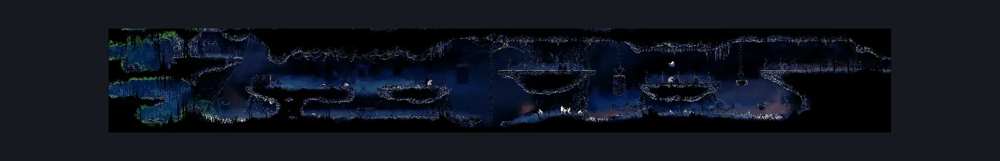

# The Marrow Map Shop (Bone_04)

**Game ID:** Bone_04

**Contributors:** herounit

## Subrooms

| No. | Subroom | Annotated |
| --- | --- | --- |
| S1 | right lower path | ✓ |
| S2 | right upper path | ✓ |
| S3 | middle upper platform | ✓ |
| S4 | shakra intro | ✓ |
| S5 | bench spot | ✓ |

## Room Transitions

| Alias | Name | From subroom | Destination | Destination alias | Requirements | TODO | Verification | Annotated | Notes |
| --- | --- | --- | --- | --- | --- | --- | --- | --- | --- |
| R | right | right upper path | [The Marrow Shaft (Bone_03)](the-marrow-shaft.md) | ML | none |  | Verified | ✓ |  |
| F | floor | right lower path | [The Marrow Entrance (Bone_01)](the-marrow-entrance.md) | C | none |  | Verified | ✓ |  |
| UL | upper left | bench spot | [Mosshome Lower (Bone_11)](../bone-bottom/mosshome-lower.md) | UR | none |  | Verified | ✓ |  |
| LL | lower left | shakra intro | [Mosshome Lower (Bone_11)](../bone-bottom/mosshome-lower.md) | LR | none |  | Verified | ✓ |  |
| C | ceiling | shakra intro | [The Marrow Bellway (Bone_05)](the-marrow-bellway.md) | F | none |  | Verified | ✓ |  |

## Subroom Connections

| Alias | Name | Source | Destination | Requirements | TODO | Verification | Annotated | Notes |
| --- | --- | --- | --- | --- | --- | --- | --- | --- |
| DS | door switch | shakra intro | bench spot | activate bench gate switch |  | Verified | ✓ |  |
| DS | door switch | bench spot | shakra intro | activate bench gate switch |  | Verified | ✓ |  |
| V1 | vertical 1 | right lower path | right upper path | ledge grab left OR cling grip left OR silk soar OR faydown |  | Verified | ✓ |  |
| V1 | vertical 1 | right upper path | right lower path | none (falling) |  | Verified | ✓ |  |
| G1 | gap 1 | right upper path | middle upper platform | activate lower platform switch same room OR clawline left OR sharpdart OR faydown OR ( run AND ( ledge grab left OR dash left OR easy beast pogo OR easy shaman pogo OR drifters ) ) |  | Verified | ✓ |  |
| G1 | gap 1 | middle upper platform | right upper path | activate lower platform switch same room |  | Verified | ✓ |  |
| V2 | vertical 2 | right lower path | middle upper platform | silk soar |  | Verified | ✓ |  |
| V2 | vertical 2 | middle upper platform | right lower path | none (falling) |  | Verified | ✓ |  |
| V3 | vertical 3 | right lower path | shakra intro | ledge grab either OR cling grip either OR silk soar OR faydown OR easy scuttlebrace OR easy shaman pogo |  | Verified | ✓ |  |
| V3 | vertical 3 | shakra intro | right lower path | none (falling) |  | Verified | ✓ |  |
| G2 | gap 2 | middle upper platform | shakra intro | run  OR dash left OR easy beast pogo OR easy architect pogo OR drifters OR faydown OR clawline left OR sharpdart |  | Verified | ✓ |  |
| G2 | gap 2 | shakra intro | middle upper platform | clawline right OR sharpdart OR dash right |  | Verified | ✓ | anything that would get you from lower to upper is excluded for simplicity (ledge grab) |

## Check Locations

| No. | Check | Subroom | Requirements | TODO | Verification | Location Type | Annotated | Notes |
| --- | --- | --- | --- | --- | --- | --- | --- | --- |
| 1 | lower platform switch same room | right lower path | flip switch down |  | Verified | switch | ✓ |  |
| 2 | the marrow rosary cache 7 | right lower path | none |  | Verified | collectible | ✓ |  |
| 3 | lower platform switch other room | middle upper platform | flip switch up |  | Verified | switch | ✓ | lowers platform into the marrow entrance room |
| 4 | the marrow shell shard cache 2 | shakra intro | none |  | Verified | collectible | ✓ |  |
| 5 | the marrow shell shard cache 3 | shakra intro | none |  | Verified | collectible | ✓ |  |
| 6 | quill | shakra intro | spend 50 rosaries |  | Verified | collectible |  | shakra's shop |
| 7 | compass | shakra intro | spend 70 rosaries |  | Verified | collectible |  | shakra's shop |
| 8 | map mosslands | shakra intro | spend 40 rosaries |  | Verified | collectible |  | shakra's shop |
| 9 | map the marrow | shakra intro | spend 50 rosaries |  | Verified | collectible |  | shakra's shop |
| 10 | map bench pins | shakra intro | spend 60 rosaries |  | Verified | collectible |  | shakra's shop |
| 11 | map bellway pins | shakra intro | spend 60 rosaries |  | Verified | collectible |  | shakra's shop \| appears to be bugged in availability logic still. shows available but isn't |
| 12 | bench gate switch | bench spot | flip switch up |  | Verified | switch | ✓ |  |
| 13 | bench | bench spot | none |  | Verified | bench | ✓ |  |
| 14 | volatile flintbeetle 2 | right upper path | complete THE volatile flintbeetles wish promised |  | Verified | miniboss | ✓ | this one swaps position based on when the marrow bellshrine is activated (per the wiki) - best to ensure both locations are accessible for the quest |
| 15 | Pilgrim Pouncer 1 | right upper path | have Progressive Swift Step |  | Verified | enemy | ✓ | ded if shakra here |
| 16 | Pilgrim Pouncer 2 | shakra intro | have Progressive Swift Step |  | Verified | enemy | ✓ | ded if shakra here |
| 17 | Pilgrim Groveller 1 | shakra intro | None |  | Verified | enemy | ✓ |  |
| 18 | Pilgrim Groveller 2 | shakra intro | None |  | Verified | enemy | ✓ |  |
| 19 | Winged Pilgrim 1 | right upper path | have Progressive Swift Step |  | Verified | enemy | ✓ | ded if shakra here |
| 20 | Skull Scuttler 1 | right lower path | None |  | Verified | enemy | ✓ |  |
| 21 | Void Mass 1 | right lower path | Black Thread World Spawn |  | Verified | enemy | ✓ |  |

## Room Images

### Connections

### Checks

### Scene

