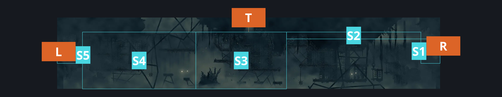
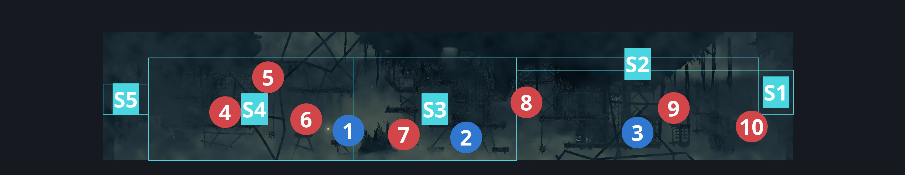
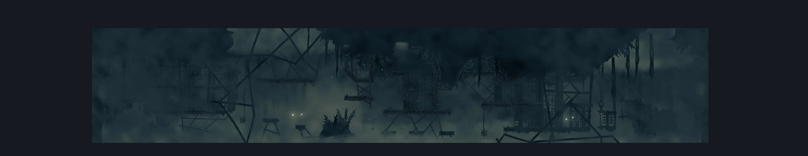

# M1 (Dust_Maze_01)

**Game ID:** Dust_Maze_01

**Contributors:** skai

## Subrooms

| No. | Subroom | Annotated |
| --- | --- | --- |
| S1 | Right (Entrance) | ✓ |
| S2 | Middle Right (Upper) | ✓ |
| S3 | Middle | ✓ |
| S4 | Middle Left | ✓ |
| S5 | Left (Entrance) | ✓ |
| S6 | Middle Right (Lower) |  |

## Room Transitions

| Alias | Name | From subroom | Destination | Destination alias | Requirements | TODO | Verification | Annotated | Notes |
| --- | --- | --- | --- | --- | --- | --- | --- | --- | --- |
| T | Top | Middle | [The Mist Fog](../fast-travel/the-mist-fog.md) | 1T |  |  |  | ✓ |  |
| R | Right | Right (Entrance) | [The Mist Fog](../fast-travel/the-mist-fog.md) | 1R | None |  | Verified | ✓ |  |
| L | Left | Left (Entrance) | [The Mist Fog](../fast-travel/the-mist-fog.md) | 1L | None |  | Verified | ✓ |  |

## Subroom Connections

No subroom connections defined.

## Check Locations

| No. | Check | Subroom | Requirements | TODO | Verification | Location Type | Annotated | Notes |
| --- | --- | --- | --- | --- | --- | --- | --- | --- |
| 1 | Moth 1 |  |  |  |  | switch | ✓ |  |
| 2 | Moth 2 |  |  |  |  | switch | ✓ |  |
| 3 | Moth 3 |  |  |  |  | switch | ✓ |  |
| 4 | Wraith 1 |  |  |  |  | enemy | ✓ |  |
| 5 | Wraith 2 |  |  |  |  | enemy | ✓ |  |
| 6 | Wraith 3 |  |  |  |  | enemy | ✓ |  |
| 7 | Wraith 4 |  |  |  |  | enemy | ✓ |  |
| 8 | Wraith 5 |  |  |  |  | enemy | ✓ |  |
| 9 | Wraith 6 |  |  |  |  | enemy | ✓ |  |
| 10 | Wraith 7 |  |  |  |  | enemy | ✓ |  |

## Room Images

### Connections

### Checks

### Scene

