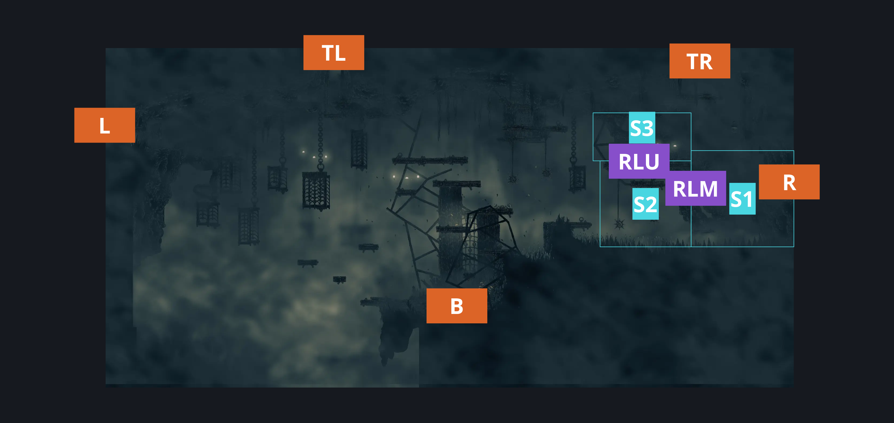
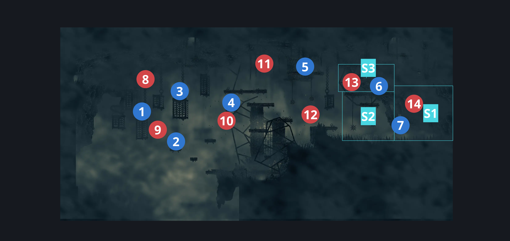
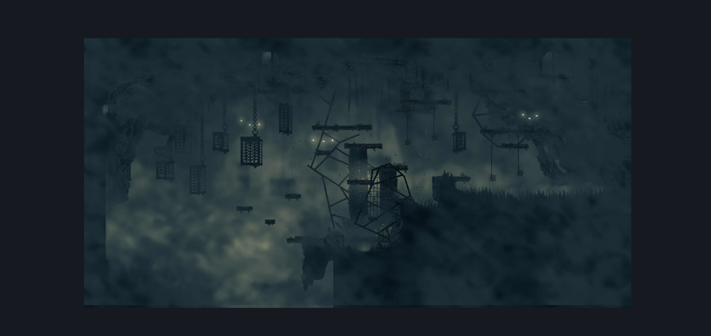

# M4 (Dust_Maze_04)

**Game ID:** Dust_Maze_04

**Contributors:** skai

## Subrooms

| No. | Subroom | Annotated |
| --- | --- | --- |
| S1 | Right (Entrance) | ✓ |
| S2 | Lower Middle Right | ✓ |
| S3 | Upper Middle Right | ✓ |
| S4 | Top Right (Entrance) |  |
| S5 | Temp So The Docs Can Build |  |

- **Temp So The Docs Can Build:** added by hero so the docs generate - 11/16

## Room Transitions

| Alias | Name | From subroom | Destination | Destination alias | Requirements | TODO | Verification | Annotated | Notes |
| --- | --- | --- | --- | --- | --- | --- | --- | --- | --- |
| B | Bottom | Temp So The Docs Can Build | [The Mist Fog](../fast-travel/the-mist-fog.md) | 4B |  |  |  | ✓ |  |
| TR | Top Right | Temp So The Docs Can Build | [The Mist Fog](../fast-travel/the-mist-fog.md) | 4TR |  |  |  | ✓ |  |
| L | Left | Temp So The Docs Can Build | [The Mist Fog](../fast-travel/the-mist-fog.md) | 4L |  |  |  | ✓ |  |
| TL | Top Left | Temp So The Docs Can Build | [The Mist Fog](../fast-travel/the-mist-fog.md) | 4TL |  |  |  | ✓ |  |
| R | Right | Temp So The Docs Can Build | [The Mist Fog](../fast-travel/the-mist-fog.md) | 4R |  |  |  | ✓ |  |

## Subroom Connections

| Alias | Name | Source | Destination | Requirements | TODO | Verification | Annotated | Notes |
| --- | --- | --- | --- | --- | --- | --- | --- | --- |
| RLM | Right to Lower Middle | Right (Entrance) | Lower Middle Right | None |  | Verified | ✓ |  |
| RLM | Right to Lower Middle | Lower Middle Right | Right (Entrance) | ((Easy Shaman Crest Pogo  OR Progressive Swift Step 1 Right  OR Sharpdart  OR Clawline Right  OR Hard [Hunter, Reaper, Wanderer, Witch, Architect] Crest Bind Stall  OR Easy Beast Crest Bind Stall  OR Easy [Plasmium Phial, Voltvessels] Stall  OR Easy [Rune Rage, Thread Storm] Stall)  AND (Ledge Grab Right  OR (Cling Grip Right AND Proficient Movement)))   OR (((Progressive Swift Step 1 Right AND Proficient Movement)  OR Progressive Swift Step 2 Right  OR Clawline Right  OR Easy Beast Crest Pogo  OR Sharpdart  OR Drifter's Cloak)  AND Ledge Grab Left)   OR Flea Brew  OR Faydown |  | Verified | ✓ |  |
| RLU | Right Lower Middle to Upper | Lower Middle Right | Upper Middle Right | ((Ledge Grab Left  OR Easy [Flea Brew, Plasmium Phial, Voltvessels] Stall  OR Easy [Architect, Hunter, Reaper, Wanderer, Witch, Beast] Crest Bind Stall  OR Easy Shaman Crest Pogo)  AND Needle Up)   OR Faydown   OR Silk Soar |  | Verified | ✓ | Stepjump Left can also be placed here to replace Ledge Grab Left. |
| RLU | Right Lower Middle to Upper | Upper Middle Right | Lower Middle Right | None |  | Verified | ✓ |  |

## Check Locations

| No. | Check | Subroom | Requirements | TODO | Verification | Location Type | Annotated | Notes |
| --- | --- | --- | --- | --- | --- | --- | --- | --- |
| 1 | Moth 1 |  |  |  |  | switch | ✓ |  |
| 2 | Moth 2 |  |  |  |  | switch | ✓ |  |
| 3 | Moth 3 |  |  |  |  | switch | ✓ |  |
| 4 | Moth 4 |  |  |  |  | switch | ✓ |  |
| 5 | Moth 5 |  |  |  |  | switch | ✓ |  |
| 6 | Moth 6 |  |  |  |  | switch | ✓ |  |
| 7 | Moth 7 | Right (Entrance) |  |  |  | switch | ✓ |  |
| 8 | Wraith 1 |  |  |  |  | enemy | ✓ |  |
| 9 | Wraith 2 |  |  |  |  | enemy | ✓ |  |
| 10 | Wraith 3 |  |  |  |  | enemy | ✓ |  |
| 11 | Wraith 4 |  |  |  |  | enemy | ✓ |  |
| 12 | Wraith 5 |  |  |  |  | enemy | ✓ |  |
| 13 | Wraith 6 |  |  |  |  | enemy | ✓ |  |
| 14 | Wraith 7 | Right (Entrance) | Nothing |  |  | enemy | ✓ |  |

## Room Images

### Connections

### Checks

### Scene

