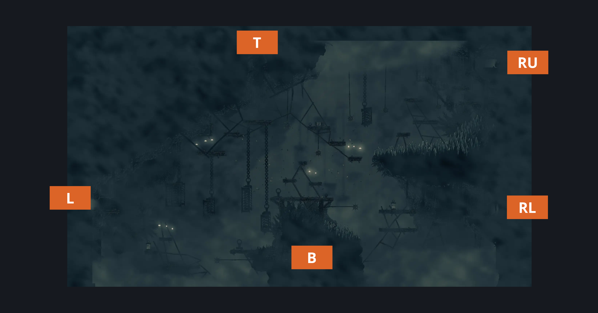
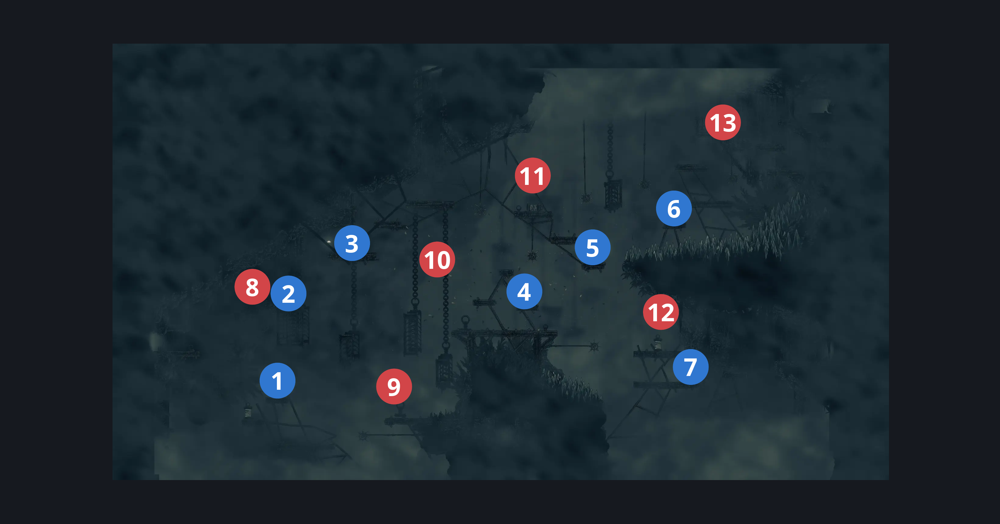
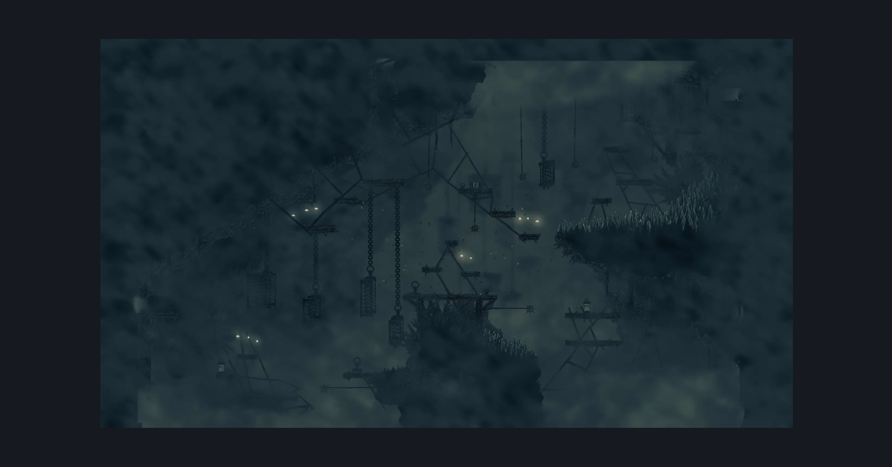

# M5 (Dust_Maze_05)

**Game ID:** Dust_Maze_05

**Contributors:** skai

## Subrooms

No subrooms defined.

## Room Transitions

| Alias | Name | From subroom | Destination | Destination alias | Requirements | TODO | Verification | Annotated | Notes |
| --- | --- | --- | --- | --- | --- | --- | --- | --- | --- |
| L | Left |  | [The Mist Fog](../fast-travel/the-mist-fog.md) | 5L |  |  |  | ✓ |  |
| RU | Right Upper |  | [The Mist Fog](../fast-travel/the-mist-fog.md) | 5RU |  |  |  | ✓ |  |
| T | Top |  | [The Mist Fog](../fast-travel/the-mist-fog.md) | 5T |  |  |  | ✓ |  |
| B | Bottom |  | [The Mist Fog](../fast-travel/the-mist-fog.md) | 5B |  |  |  | ✓ |  |
| RL | Right Lower |  | [The Mist Fog](../fast-travel/the-mist-fog.md) | 5RL |  |  |  | ✓ |  |

## Subroom Connections

No subroom connections defined.

## Check Locations

| No. | Check | Subroom | Requirements | TODO | Verification | Location Type | Annotated | Notes |
| --- | --- | --- | --- | --- | --- | --- | --- | --- |
| 1 | Moth 1 |  |  |  |  | switch | ✓ |  |
| 2 | Moth 2 |  |  |  |  | switch | ✓ |  |
| 3 | Moth 3 |  |  |  |  | switch | ✓ |  |
| 4 | Moth 4 |  |  |  |  | switch | ✓ |  |
| 5 | Moth 5 |  |  |  |  | switch | ✓ |  |
| 6 | Moth 6 |  |  |  |  | switch | ✓ |  |
| 7 | Moth 7 |  |  |  |  | switch | ✓ |  |
| 8 | Wraith 1 |  |  |  |  | enemy | ✓ |  |
| 9 | Wraith 2 |  |  |  |  | enemy | ✓ |  |
| 10 | Wraith 3 |  |  |  |  | enemy | ✓ |  |
| 11 | Wraith 4 |  |  |  |  | enemy | ✓ |  |
| 12 | Wraith 5 |  |  |  |  | enemy | ✓ |  |
| 13 | Wraith 6 |  |  |  |  | enemy | ✓ |  |

## Room Images

### Connections

### Checks

### Scene

