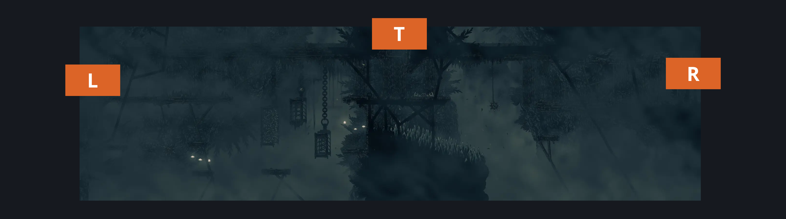
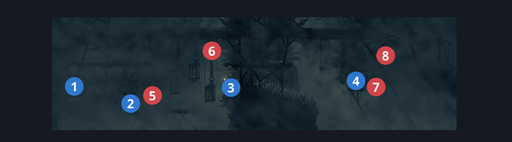
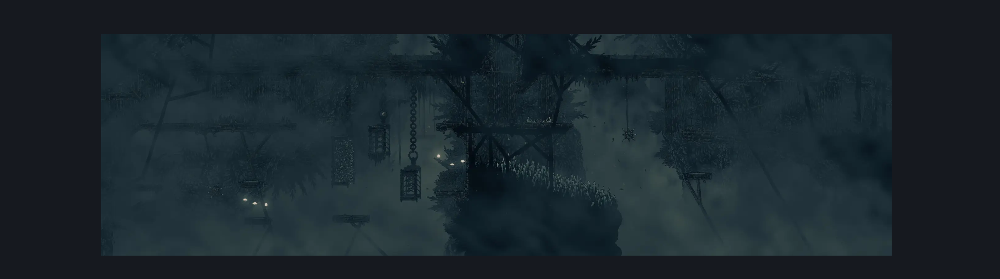

# M6 (Dust_Maze_06)

**Game ID:** Dust_Maze_06

**Contributors:** skai

## Subrooms

No subrooms defined.

## Room Transitions

| Alias | Name | From subroom | Destination | Destination alias | Requirements | TODO | Verification | Annotated | Notes |
| --- | --- | --- | --- | --- | --- | --- | --- | --- | --- |
| L | Left |  | [The Mist Fog](../fast-travel/the-mist-fog.md) | 6L |  |  |  | ✓ |  |
| R | Right |  | [The Mist Fog](../fast-travel/the-mist-fog.md) | 6R |  |  |  | ✓ |  |
| T | Top |  | [The Mist Fog](../fast-travel/the-mist-fog.md) | 6T |  |  |  | ✓ |  |

## Subroom Connections

No subroom connections defined.

## Check Locations

| No. | Check | Subroom | Requirements | TODO | Verification | Location Type | Annotated | Notes |
| --- | --- | --- | --- | --- | --- | --- | --- | --- |
| 1 | Moth 1 |  |  |  |  | switch | ✓ |  |
| 2 | Moth 2 |  |  |  |  | switch | ✓ |  |
| 3 | Moth 3 |  |  |  |  | switch | ✓ |  |
| 4 | Moth 4 |  |  |  |  | switch | ✓ |  |
| 5 | Wraith 1 |  |  |  |  | enemy | ✓ |  |
| 6 | Wraith 2 |  |  |  |  | enemy | ✓ |  |
| 7 | Wraith 3 |  |  |  |  | enemy | ✓ |  |
| 8 | Wraith 4 |  |  |  |  | enemy | ✓ |  |

## Room Images

### Connections

### Checks

### Scene

