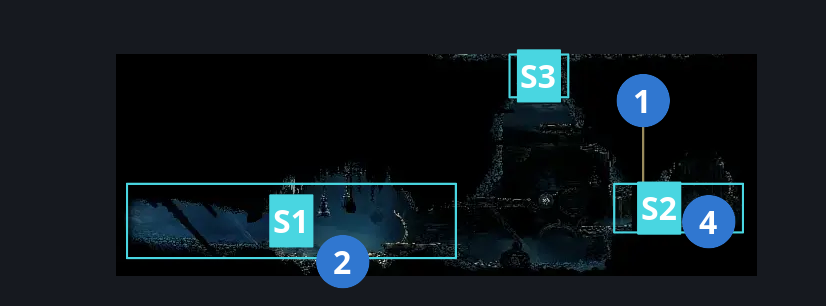

# Slab Bellway (Slab_06)

**Game ID:** Slab_06

**Contributors:** MayaXTG, Gallos

## Subrooms

| No. | Subroom | Annotated |
| --- | --- | --- |
| S1 | Bellway | ✓ |
| S2 | Bench | ✓ |
| S3 | Upper | ✓ |

## Room Transitions

| Alias | Name | From subroom | Destination | Destination alias | Requirements | TODO | Verification | Annotated | Notes |
| --- | --- | --- | --- | --- | --- | --- | --- | --- | --- |
| T | top1 | Upper | [Slab Infleatween Bottom (Slab_05)](slab-infleatween-bottom.md) | B | None |  | Verified | ✓ |  |
| L | left1 | Bellway | [Mount Fay Entrance (Peak_01)](../mount-fay/mount-fay-entrance.md) | LR | none |  | Verified | ✓ | To Peaks_01 |
| BW | door_fastTravelExit | Bellway | [Bellway Menu](../fast-travel/bellway-menu.md) | TS | Unlock Bellway The Slab |  | Verified |  |  |

## Subroom Connections

| Alias | Name | Source | Destination | Requirements | TODO | Verification | Annotated | Notes |
| --- | --- | --- | --- | --- | --- | --- | --- | --- |
| D | Drop | Upper | Bench | None |  | Verified | ✓ |  |
| D | Drop | Bench | Upper | silk soar  OR (faydown AND (cling grip right OR ledge grab right OR easy scuttlebrace)) OR (cling grip left AND (flea brew OR sharpdart OR clawline left OR sprint left OR easy beast pogo OR medium shaman pogo OR easy [beast,architect,wanderer] charge OR easy [voltvessels,plasmium,voltvessels,rune rage,cross stitch,thread storm,pale nails] stall OR (cling grip right AND proficient movement) OR (ledge grab left AND (medium [hunter,reaper,witch] pogo OR medium silkshot original stall)))) |  | Verified | ✓ |  |
| C | Cross | Bench | Bellway | None |  | Verified | ✓ |  |
| C | Cross | Bellway | Bench | ledge grab right OR cling grip right OR faydown OR silk soar OR medium [voltvessels,plasmium] stall OR easy shaman pogo OR easy beast charge OR easy beast bind stall OR (sprint right AND clawline right) OR (clawline right x 2 AND (easy bind stall OR (easy [flintslate,plasmium,flea brew,pale nails,cross stitch,rune rage,thread storm] stall))) |  | Verified | ✓ |  |

## Check Locations

| No. | Check | Subroom | Requirements | TODO | Verification | Location Type | Annotated | Notes |
| --- | --- | --- | --- | --- | --- | --- | --- | --- |
| 1 | Flea: The Slab - Bellway | Bench | silk soar OR (faydown AND (cling grip either OR (easy scuttlebrace AND (easy shaman pogo OR (medium [reaper] pogo AND medium bind stall) OR (easy beast pogo AND medium beast bind stall))))) OR (proficient movement AND ((cling grip right AND dash right) OR (cling grip left AND dash left))) |  | Verified | collectible | ✓ |  |
| 2 | Bellway The Slab | Bellway | Unlock Bellway Rosary Lock |  | Verified | travel | ✓ |  |
| 3 | Bellway Rosary Lock | Bellway | spend 40 rosaries |  | Verified | lock |  |  |
| 4 | Slab - Bellway Bench | Bench | none |  | Verified | bench | ✓ |  |

## Room Images

### Connections

### Checks

### Scene

