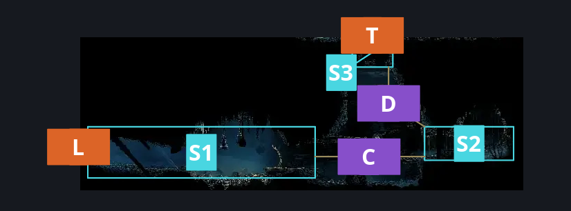
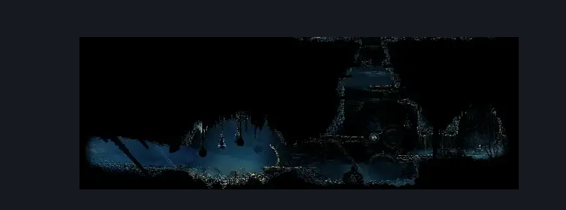

# Slab Bellway (Slab_06)

**Game ID:** Slab_06

**Contributors:** MayaXTG, Gallos

## Subrooms

No subrooms defined.

## Room Transitions

| Alias | Name | From subroom | Destination | Destination alias | Requirements | TODO | Verification | Annotated | Notes |
| --- | --- | --- | --- | --- | --- | --- | --- | --- | --- |
| T | top1 |  | [Slab Infleatween Bottom (Slab_05)](slab-infleatween-bottom.md) | B | silk soar OR (cling grip left AND (ledge grab right OR easy shaman pogo) AND (dash left OR run OR sharpdart OR clawline left)) OR (faydown AND (ledge grab right OR cling grip left OR easy scuttlebrace OR ((clawline left OR easy [parry,air bind,flintslate,flea brew,rune rage,thread storm,pale nails] stall OR sharpdart) AND cling grip right))) OR (cling grip left AND easy scuttlebrace) |  | Verified | ✓ |  |
| L | left1 |  | [Mount Fay Entrance (Peak_01)](../mount-fay/mount-fay-entrance.md) | LR | none |  | Verified | ✓ | To Peaks_01 |
| BW | door_fastTravelExit |  | [Bellway Menu](../fast-travel/bellway-menu.md) | TS | Unlock Bellway The Slab |  | Verified |  |  |

## Subroom Connections

No subroom connections defined.

## Check Locations

| No. | Check | Subroom | Requirements | TODO | Verification | Location Type | Annotated | Notes |
| --- | --- | --- | --- | --- | --- | --- | --- | --- |
| 1 | Flea: The Slab - Bellway |  | (cling grip either AND faydown cloak) OR silk soar OR (easy shaman pogo AND faydown AND easy scuttlebrace) |  | Verified | collectible | ✓ |  |
| 2 | Bellway The Slab |  | Unlock Bellway Rosary Lock |  | Verified | travel | ✓ |  |
| 3 | Bellway Rosary Lock |  | spend 40 rosaries |  | Verified | lock |  |  |
| 4 | Slab - Bellway Bench |  | none |  | Verified | bench | ✓ |  |

## Room Images

### Connections

### Checks

### Scene

