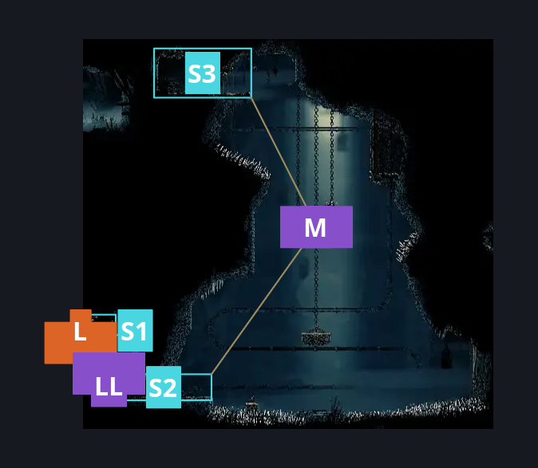
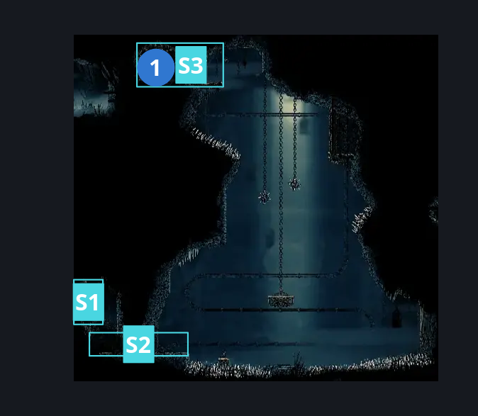
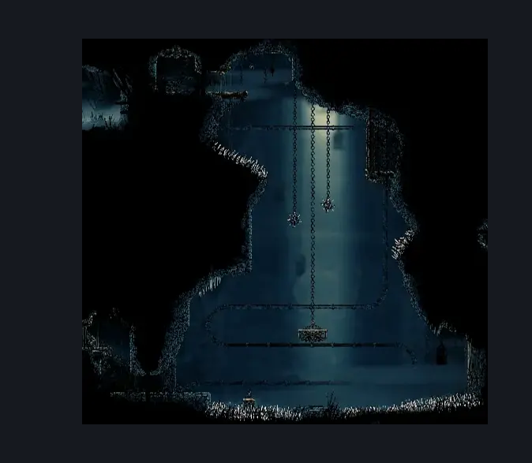

# Slab Why Room (Slab_17)

**Game ID:** Slab_17

**Contributors:** MayaXTG

## Subrooms

| No. | Subroom | Annotated |
| --- | --- | --- |
| S1 | Left | ✓ |
| S2 | Left Lower | ✓ |
| S3 | Mask Shard | ✓ |

## Room Transitions

| Alias | Name | From subroom | Destination | Destination alias | Requirements | TODO | Verification | Annotated | Notes |
| --- | --- | --- | --- | --- | --- | --- | --- | --- | --- |
| L | left1 | Left | [Slab Cell (Slab_03)](slab-cell.md) | WHY | unlock apostate door mask shard IN slab cell |  | Verified | ✓ | apostate is required on other side, not here |

## Subroom Connections

| Alias | Name | Source | Destination | Requirements | TODO | Verification | Annotated | Notes |
| --- | --- | --- | --- | --- | --- | --- | --- | --- |
| LL | Left Lower | Left Lower | Left | faydown cloak OR cling grip left OR cling grip right OR scuttlebrace OR silk soar |  | Verified | ✓ |  |
| LL | Left Lower | Left | Left Lower | none (falling) |  | Verified | ✓ |  |
| M | Mask Shard | Left Lower | Mask Shard | (medium silk soar cancel AND (faydown OR cling grip right OR dash left OR clawline left OR sharpdart OR easy [beast,hunter,architect] pogo OR easy voltvessels stall OR (medium shaman pogo AND ledge grab left)))  OR (silk soar AND (Faydown AND (medium shaman pogo OR ((ledge grab left OR cling grip left) AND (easy [beast,shaman,architect,reaper] pogo OR medium [hunter,wanderer,witch] pogo)))))  OR (faydown AND spike pogo AND cling grip right) |  | Verified | ✓ |  |

## Check Locations

| No. | Check | Subroom | Requirements | TODO | Verification | Location Type | Annotated | Notes |
| --- | --- | --- | --- | --- | --- | --- | --- | --- |
| 1 | The Slab: Mask Shard | Mask Shard | none |  | Verified | collectible | ✓ |  |

## Room Images

### Connections

### Checks

### Scene

