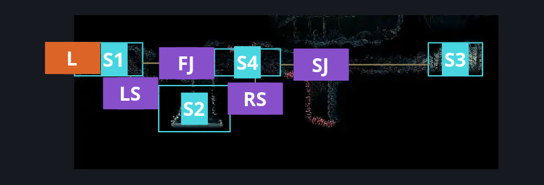
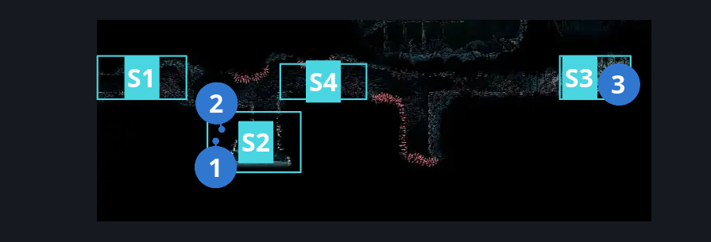
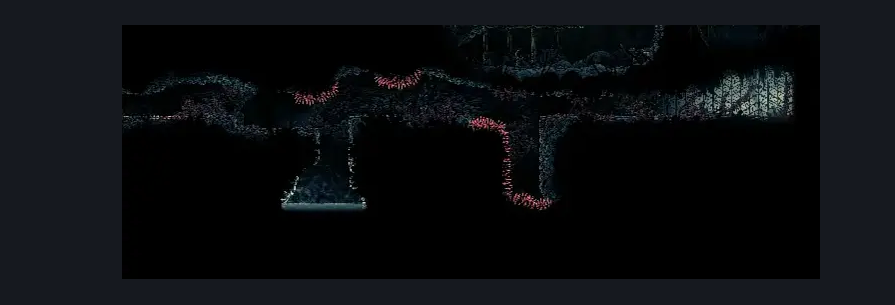

# Slab Window (Slab_12)

**Game ID:** Slab_12

**Contributors:** MayaXTG

## Subrooms

| No. | Subroom | Annotated |
| --- | --- | --- |
| S1 | left | ✓ |
| S2 | shards | ✓ |
| S3 | effigy | ✓ |
| S4 | center | ✓ |

## Room Transitions

| Alias | Name | From subroom | Destination | Destination alias | Requirements | TODO | Verification | Annotated | Notes |
| --- | --- | --- | --- | --- | --- | --- | --- | --- | --- |
| L | left1 | left | [Slab Cell (Slab_03)](slab-cell.md) | WND | break wall left |  | Verified | ✓ | you will take damage taking this entrance without breaking the other wall |

## Subroom Connections

| Alias | Name | Source | Destination | Requirements | TODO | Verification | Annotated | Notes |
| --- | --- | --- | --- | --- | --- | --- | --- | --- |
| LS | Shards Left | left | shards | none |  | Verified | ✓ | fall and hit left before water |
| RS | Shards Right | center | shards | none |  |  | ✓ | same as above |
| FJ | First Jump | left | center | cling grip either OR faydown OR sprint right OR clawline right OR sharpdart OR easy beast pogo OR medium shaman pogo OR (ledge grab right AND (proficient movement OR flea brew OR drifters OR easy voltvessels stall OR easy shaman pogo OR easy architect charge)) |  | Verified | ✓ | clawline and sharpdart are a little tight, but I wouldn't call them 'proficient movement' |
| FJ | First Jump | center | left | sprint left OR faydown OR drifters OR ledge grab left OR cling grip either OR clawline left OR sharpdart |  |  | ✓ |  |
| SJ | Second Jump | center | effigy | sharpdart OR clawline right OR drifters OR (sprint right AND (dash right OR easy beast pogo OR easy beast charge OR (medium architect charge AND ledge grab right)))  OR (faydown AND (proficient movement OR flea brew OR cling grip right OR easy [voltvessels,plasmium,flintslate,pale nails,thread storm,rune rage,cross stitch] stall OR easy bind stall OR easy [hunter,beast,architect,shaman,reaper,witch] pogo OR easy [beast,architect,wanderer] charge))  OR (cling grip right AND (flea brew OR easy voltvessels stall OR easy [hunter,beast,reaper,architect] pogo OR easy [flintslate,thread storm,cross stitch,pale nails] stall x 2))  OR (ledge grab right AND (easy beast charge OR medium beast pogo)) |  | Verified | ✓ |  |
| SJ | Second Jump | effigy | center | clawline left OR sharpdart OR (sprint left AND (dash left OR faydown)) OR (cling grip right AND faydown) |  |  | ✓ |  |

## Check Locations

| No. | Check | Subroom | Requirements | TODO | Verification | Location Type | Annotated | Notes |
| --- | --- | --- | --- | --- | --- | --- | --- | --- |
| 1 | The Slab - Shell Shard Cache #4 | shards | none |  | Verified | collectible | ✓ |  |
| 2 | The Slab - Shell Shard Cache #5 | shards | none |  | Verified | collectible | ✓ |  |
| 3 | Relic: Weaver Effigy (Atla, The Slab) | effigy | none |  | Verified | collectible | ✓ |  |

## Room Images

### Connections

### Checks

### Scene

