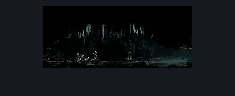

# Broken Elevator (Under_01b)

**Game ID:** Under_01b

**Contributors:** samupo and Rebel

## Subrooms

No subrooms defined.

## Room Transitions

| Alias | Name | From subroom | Destination | Destination alias | Requirements | TODO | Verification | Annotated | Notes |
| --- | --- | --- | --- | --- | --- | --- | --- | --- | --- |
| L | left1 |  | [Grand Elevator (Under_01)](../grand-gate/grand-elevator.md) | R | none |  | Verified | ✓ |  |
| R | right1 |  | [Underworks Shaft (Under_02)](underworks-shaft.md) | L1 | Activate Underworks Elevator Entrance Lever |  | Verified | ✓ |  |

## Subroom Connections

No subroom connections defined.

## Check Locations

| No. | Check | Subroom | Requirements | TODO | Verification | Location Type | Annotated | Notes |
| --- | --- | --- | --- | --- | --- | --- | --- | --- |
| 1 | Underworks Elevator Entrance Lever |  | Flip Switch Right |  | Verified | switch | ✓ |  |
| 2 | Underworks Elevator Left Toll |  | spend 15 rosaries |  | Verified | lock | ✓ |  |
| 3 | Underworks Elevator Left Toll Bench |  | Unlock Underworks Elevator Left Toll |  | Verified | bench | ✓ | Temporary, requires the toll be purchased each use |
| 4 | Underworks Elevator Right Toll |  | spend 15 rosaries |  | Verified | lock | ✓ |  |
| 5 | Underworks Elevator Right Toll Bench |  | Unlock Underworks Elevator Right Toll |  | Verified | bench | ✓ | Temporary, requires the toll be purchased each use |

## Room Images

### Connections

### Checks

### Scene

