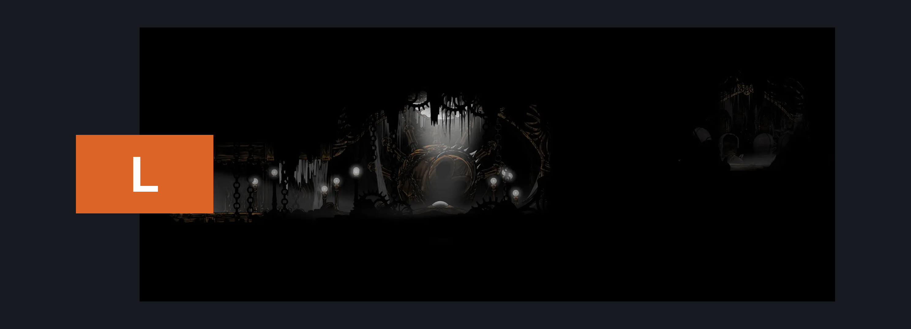
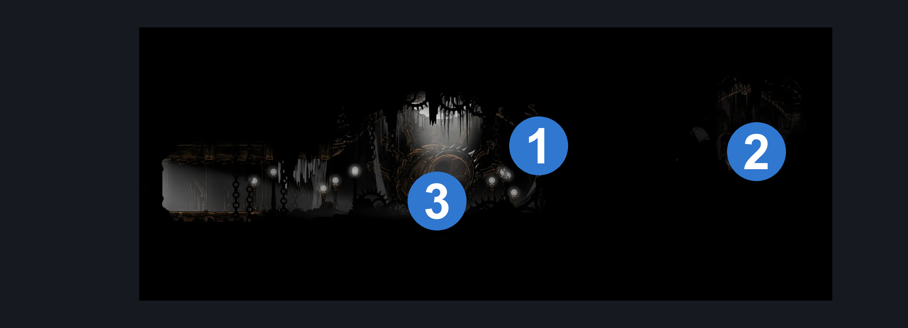
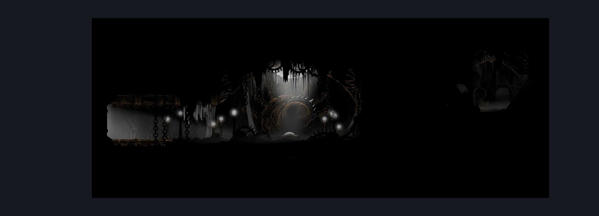

# Chapel of the Architect (Under_20)

**Game ID:** Under_20

## Subrooms

No subrooms defined.

## Room Transitions

| Alias | Name | From subroom | Destination | Destination alias | Requirements | TODO | Verification | Annotated | Notes |
| --- | --- | --- | --- | --- | --- | --- | --- | --- | --- |
| L | left1 |  | [Underworks Twelfth Architect (Under_17)](underworks-twelfth-architect.md) | AC | Nothing. |  | Verified | ✓ |  |

## Subroom Connections

No subroom connections defined.

## Check Locations

| No. | Check | Subroom | Requirements | TODO | Verification | Location Type | Annotated | Notes |
| --- | --- | --- | --- | --- | --- | --- | --- | --- |
| 1 | Underworks Chapel Needolin Wall |  | Break Wall Up |  | Verified | blockade | ✓ |  |
| 2 | Underworks: Needolin Lore |  | Needolin. |  | Verified | lore | ✓ |  |
| 3 | Architect's Crest |  | Nothing. |  | Verified | collectible | ✓ |  |
| 4 | import enemies |  |  | TODO | Needs verification |  |  |  |

## Room Images

### Connections

### Checks

### Scene

